# Implémentation des sept design systems dans ANTSIA

**20 octobre 2026 — sources réelles et recette locale.**

Référence : [ANTSIA, sept thèmes et huit rubriques](https://claude.ai/artifact/AnLxkaqaai725ywzkrVk6b#page-c71058556eba).
[Index](README.md) · [Socle](00_SOCLE_COMMUN.md) · [Constat initial](08_ECARTS_REFERENCE_ET_CODE.md).

## Résultat

Gaboma, Soleil, Forêt, Corail, Lagon, Électrique et Sable habillent les composants
déjà servis par l’application. Le thème choisi reste celui du compte ; apparence
et motif conservent leur portée existante. Les routes, données, habilitations,
consentements, sessions et contrôleurs de communication restent ceux du moteur.

Les couleurs fondamentales sont conservées. Les nouveaux raccords sont opt-in :
jetons à `initial` dans `packages/ui/src/styles/charte.css`, valeurs définies
uniquement par les sept chartes ANTSIA et anciens styles en repli dans le moteur.
Les tests d’isolation de DIASPORALE et de la console passent.

## Couverture des huit rubriques

| Rubrique | Sources raccordées | Présentation appliquée |
|---|---|---|
| Les sept thèmes | Sept CSS `packages/ui/src/themes/antsia*.css`, `theme-picker.tsx`, primitives et kit UI | Nuanciers, clair/sombre, polices, géométrie, contrastes, motifs et profondeur |
| Accueil et accès | `access-home-screen`, `sign-in-screen`, `welcome-screen`, `public/*` | Marque avec point, navigation responsive, porte IDN/OTP, aperçu de profil, aperçu public SSR réel, sommaire mobile/bureau |
| Fil et vie sociale | `shell/ReseauAgentPage`, `shell/mobile`, features réseau, actus et notifications, découverte et préférences du fil | Colonnes, gouttières, cartes, textes riches, composeur, recherche, listes et états existants |
| Messages et directs | Styles et conversation iCom, DirectPage/Studio/Discussion/Antenne, iAppel | Titres, champs, corps, surfaces et rôles ; conférence raccordée via DirectPage |
| Profils et pages | ProfilPersonnePage, ProfilPagePage, Avatar, ProfilFrame, AlbumPage/AlbumsSection, `moi/me-screen` | Avatar de profil 104 px, grande page rayon 24 px, médias, titres et espace personnel |
| Boutiques et achats | Composants réels `shops/`, `cart/`, `checkout/`, `payment/`, `purchases/` | Vitrine, catalogue, offre, contact, panier, préparation, paiement, achat et gestion ; panneaux responsive et étapes distinctes |
| Emplois et services | Composants réels `jobs/` et `services/` | Offre, candidature, pièces, demandes, devis, rendez-vous et prestations ; états et consentements existants |
| Compte et données | Paramètres, PersonalControls, modération, santé et coque membre | Affichage, langue/fuseau, consentements, export/effacement, décisions et état du service |

Les 60 planches sont des références de composition. Leurs personnes, messages,
prix, offres et compteurs ne sont pas injectés dans l’application.

## Mesures et arbitrages

- Corps Inter **15 px / 1,5**, champs **16 px / 1,4**.
- Titres Familjen Grotesk : **26 / 20 / 16 px**, interlignes **1,1 / 1,2 / 1,3**.
- Carte **24 px**, intérieur **16 px**, espacement intérieur **12 px** ;
  champ **14 px**, média **16 px**, badge **6 px**, puce **10 px**.
- Cibles tactiles **44 px** conservées, conformément à la règle écrite de la référence.
- Créer **52 × 52 px**, rayon **18 px**, ombre à **75 %** de l’aplat.
- Dock carte **88 %**, flou **16 px**, rayon **28 px** ; téléphone côtés **12 px**,
  bas **16 px** ; tablette largeur **540 px**, bas **26 px**.
- Bureau : grille **248 px / centre flexible / 312 px**, gap **24 px**,
  maximum **1 400 px**, gouttières **20 px** selon la composition.
  Depuis le 22/10/2026 (demande du propriétaire) : **une seule gouttière**,
  plus de maximum. La marge extérieure vaut l'écart entre les colonnes, et la
  barre du haut comme le bandeau démo s'y alignent : **16 px** de 768 à
  1 199 px, **24 px** au-delà (jeton Tailwind `--spacing-gutter`). La colonne
  centrale prend la largeur restante ; le téléphone ne change pas.
- Tablette du fil : colonne **728 px**, padding **8 / 24 / 140 px** ;
  téléphone **4 / 12 / 120 px**.
- Les exceptions d’ombre de **Soleil** et **Corail** suivent les CSS des maquettes.
  Les autres cartes restent plates ; Électrique garde son anneau.
- Fonds doux message et réaction calculés en sRGB à **15 % / 18 %**, avec
  vérification des contrastes ; grain radial **5 / 7 / 11 px** et projecteur **85 % / 55 %**.
- Messages conserve la barre iCom **Menu / Conversations / Appels / Contacts**,
  comme `Messages.dc.html` ; les pages sociales gardent les cinq destinations.

## Vérifications exécutées

| Vérification | Résultat |
|---|---|
| `bun run codegen`, déploiement anonyme local | Réussi ; typage strict Convex réussi |
| Types application, UI et social-features | Réussis |
| Tests application | **756 / 756**, 102 fichiers |
| Tests UI | **2 263 / 2 263**, 17 fichiers ; nouvelle mesure de référence et isolation incluses |
| Tests social-features | **4 026 / 4 026**, 260 fichiers |
| Cliquets transverses | **140 / 140**, 25 fichiers |
| Compilation Next.js optimisée et typage de build | Réussis |
| Lint application, UI et social-features | **0 erreur**, avertissements du dépôt conservés |
| Espaces finaux et liens Markdown locaux | Contrôlés |

Les assertions CSS de géométrie vérifient aussi les anciens replis et les
scrollers du moteur. Un test de candidature utilisait un mauvais prototype de
Storage dans jsdom : le test vise désormais le stockage réel, sa garde métier
n’a pas changé. La fixture d’état inconnu est explicitement distincte de la
fixture de candidature valide.

## Recette sur l’application servie

Serveur **localhost:3030** existant, moteur anonyme local sur **3210**.
Compte local de démonstration vérifié, sans connexion à une cible de production.

- Paramètres : **sept thèmes × clair/sombre** à 1 440 × 1 024.
  Corps 15 px, titre 26 px, champ 16 px et absence de débordement vérifiés.
- Téléphone **390 × 844** : paramètres, messagerie, profil, candidatures,
  demandes, données personnelles, page publique et état du service.
- Tablette **834 × 1 194** : fil, paramètres et vitrine existante ;
  dock 540 px centré et colonne de fil 728 px mesurés.
- Accueil : passage FR/EN immédiat du titre et de l’aperçu public vérifié, puis français rétabli.
- Le conflit `inline-flex` / `hidden` du menu public a été corrigé puis
  revérifié : marque et Entrer au téléphone ; sommaire ouvrable.
- Le profil réel, la vitrine de démonstration et les états vides de
  conversations, candidatures et demandes sont affichés sans données inventées.
- Préférences du compte de démonstration rétablies : **Lagon, Système, Aucun**.
  Tailles temporaires du navigateur rétablies.

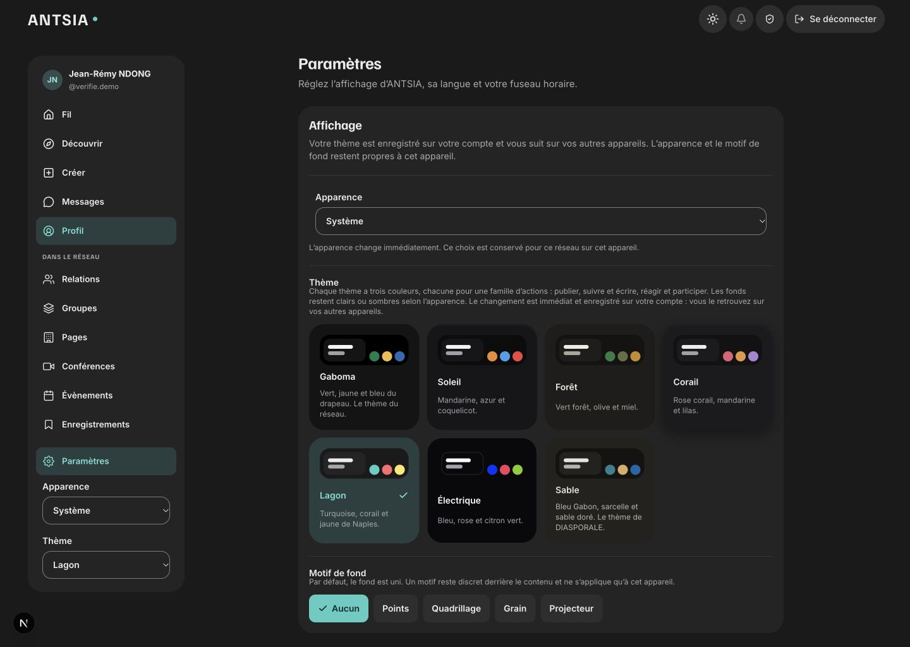

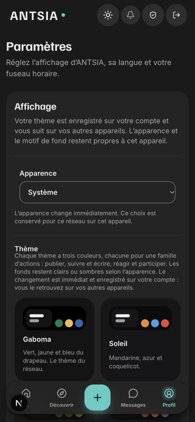

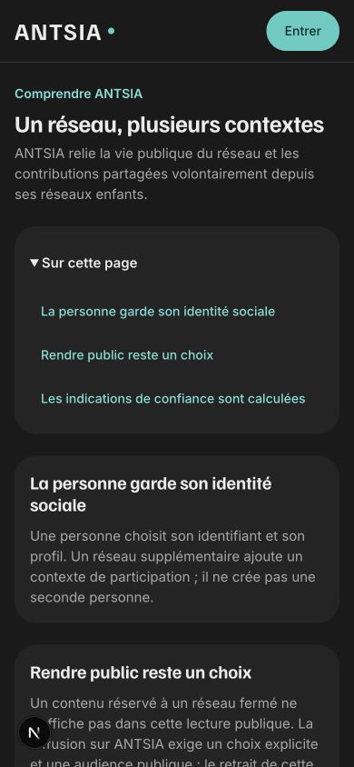

### Gouttière unique (22/10/2026)

Candidat tiré de `main`, backend Convex local isolé, sept comptes de
démonstration et contenu fictif semés ; aucune cible de démonstration ni de
production. Mesures prises dans la page (`getBoundingClientRect`), sur `/fil` :

| Largeur | Marge gauche | Écart rail / fil | Écart fil / colonne droite | Marge droite | Barre du haut (gauche / droite) |
|---|---|---|---|---|---|
| 1 024 px | 16 | 16 | — (pas de colonne droite) | 16 | 16 / 16 |
| 1 280 px | 24 | 24 | — (pas de colonne droite) | 24 | 24 / 24 |
| 1 440 px | 24 | 24 | 24 | 24 | 24 / 24 |
| 1 920 px | 24 | 24 | 24 | 24 | 24 / 24 |

- La colonne du fil mesure 880, 960, 784 puis 1 264 px ; les publications
  l'occupent entière, en Liste comme en Immersion.
- Réglages et Messages, à 1 440 px : rail à 24 px du bord, écart de 24 px, contenu
  jusqu'à 24 px du bord droit.
- Téléphone **390 px** : coquille inchangée (cartes à 12 px des bords), sans
  défilement horizontal.
- Le bandeau démo n'existe qu'avec le backend de démonstration : sa classe
  `px-gutter` a été mesurée dans la page, à 16 px puis 24 px dès 1 200 px.

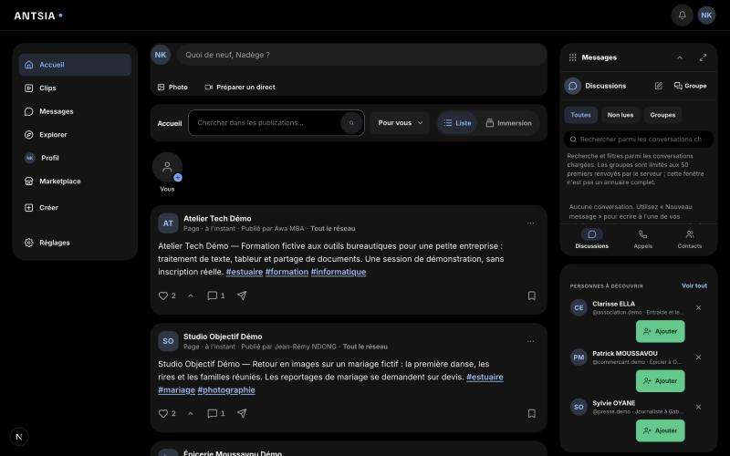

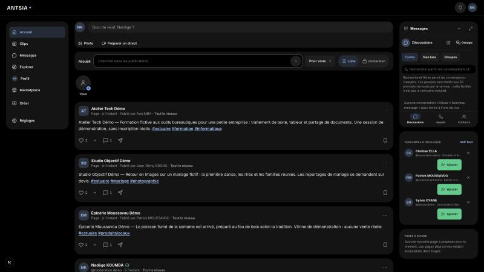

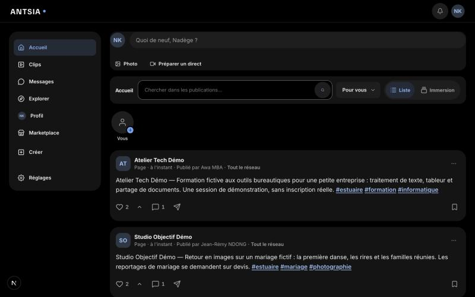

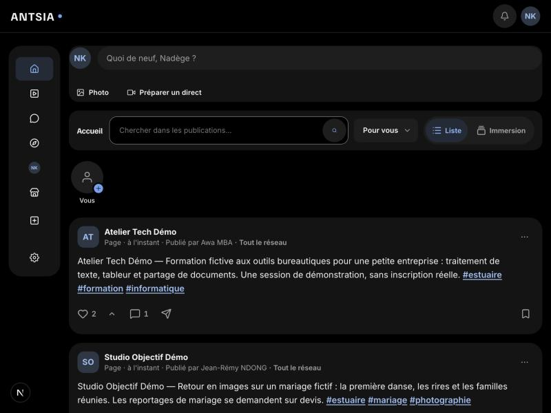

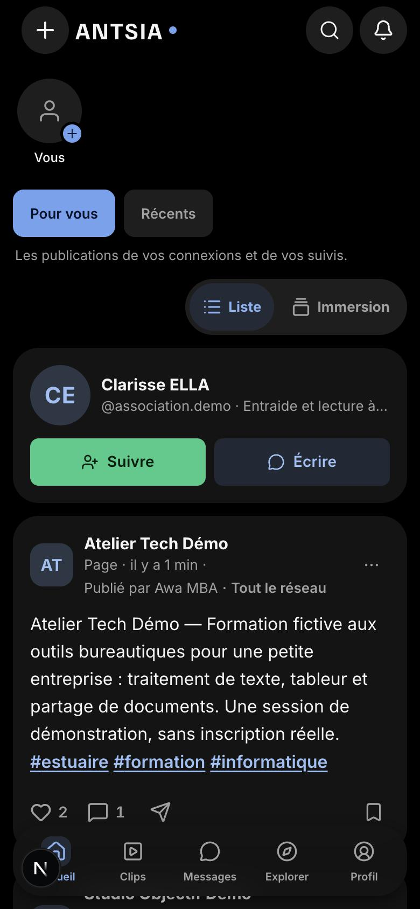

### Gouttière des espaces spécialisés (22/10/2026)

Boutique, prestataire, professionnels et média ont leur propre cadre
(`specialized-page.tsx`). Il suit désormais la même règle : dès 768 px, le
jeton `--spacing-gutter` fait la marge extérieure, l'écart entre le rail de
l'espace et son contenu, et le retrait de la barre de l'espace. Le cadre de
1 440 px centré est retiré. Le téléphone ne change pas : barre basse fixe,
retraits de 12 px, puis 24 px de 640 à 767 px.

Même candidat et même méthode que ci-dessus. Mesures prises sur
`/boutique/epicerie-moussavou-demo`, `/prestataire/studio-objectif-demo`,
`/professionnels`, `/media/gabon-actu-demo` et `/presse`. Les quatre espaces
donnent les mêmes valeurs :

| Largeur | Marge gauche | Écart rail / contenu | Marge droite | Barre de l'espace (gauche / droite) | Colonne de contenu |
|---|---|---|---|---|---|
| 1 024 px | 16 | 16 | 16 | 16 / 16 | 880 |
| 1 280 px | 24 | 24 | 24 | 24 / 24 | 1 000 |
| 1 440 px | 24 | 24 | 24 | 24 / 24 | 1 160 |
| 1 920 px | 24 | 24 | 24 | 24 / 24 | 1 640 |

- La marge gauche se mesure aux destinations du rail. Le rail n'a plus de
  retrait intérieur : le fond de la destination active touche la gouttière.
- Téléphone **390 px** : barre basse fixe d'un bord à l'autre, contenu et barre
  de l'espace à 12 px, sans défilement horizontal. À 700 et 767 px : 24 px,
  comme avant. À 768 px : 16 / 16 / 16.
- Piège corrigé : Tailwind 4 émet `sm:` (en rem) après `min-[768px]:` (en px).
  Le `min-[1200px]:px-8` du contenu ne s'appliquait donc jamais. Le `sm:` est
  désormais borné au téléphone (`sm:max-[768px]:`).
- Reste hors de ce lot : plusieurs écrans se centrent eux-mêmes dans la colonne,
  avec leur propre largeur maximale :
  - la vitrine, le catalogue, les offres et les formulaires de boutique ou de
    prestataire (`ShopFrame` de `shop-ui.tsx`, 768 px). À 1 920 px, la vitrine
    laisse 436 px de chaque côté de son bloc ;
  - l'annuaire des professionnels (1 024 px) ;
  - l'annuaire presse (1 152 px).

  La vitrine, le catalogue, les offres et les annuaires occupent désormais toute
  la colonne : voir la section suivante.

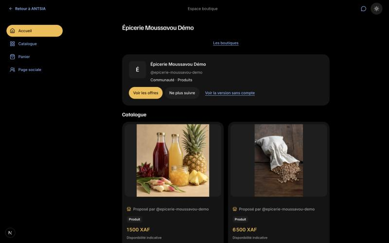

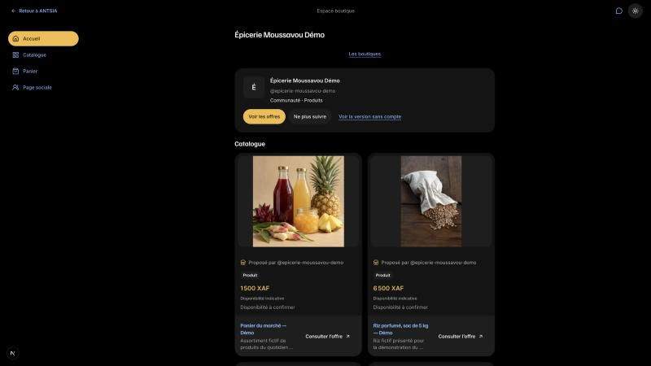

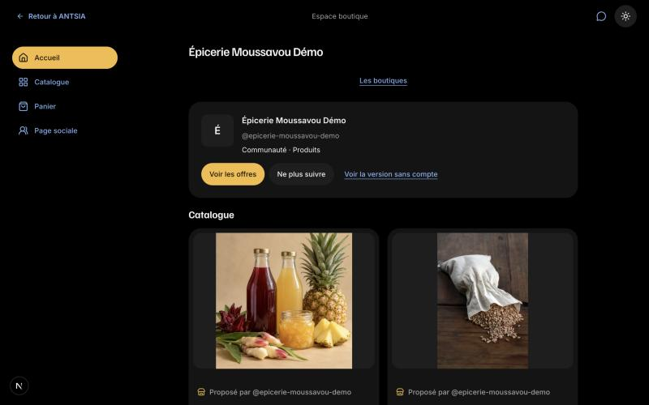

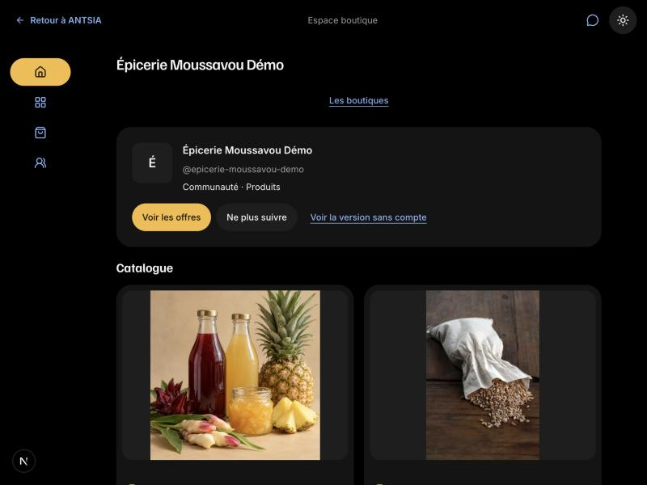

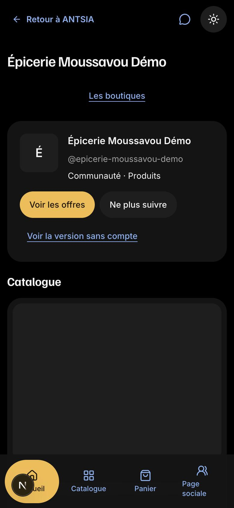

### Pleine colonne des écrans des espaces (22/10/2026)

Décision du propriétaire, après la capture de la boutique à 1 920 px : « que la
vitrine, le catalogue, les offres et les annuaires occupent toute la colonne
(formulaires à arbitrer sur capture) ».

- `ShopFrame` (`shop-ui.tsx`) et `ProfessionalFrame` (`profile-fields.tsx`)
  prennent `width="column"`. Dans ce mode, l'écran n'a plus de largeur maximale
  ni de centrage. Il est passé par :
  - la vitrine de la boutique ;
  - le catalogue et les offres, de la boutique comme du prestataire ;
  - la présentation du prestataire ;
  - l'annuaire des professionnels.

  L'annuaire presse perd son propre `max-w-6xl`.
- Par défaut, `width="reading"` : les formulaires et les pages de gestion gardent
  leur largeur de lecture centrée, en attendant l'arbitrage. Cela vaut pour le
  contact, le devis, la préparation, la fiche et l'éditeur du profil pro, et les
  collaborations. L'arbitrage est venu le même jour : tous les écrans passent en
  pleine largeur et `width` disparaît (section suivante).
- Les grilles étaient déjà fluides. À 1 920 px, le catalogue
  (`auto-fill, minmax(18rem, 1fr)`) passe à cinq colonnes. La fiche d'offre se
  met sur deux colonnes, média et en-tête, dès que son conteneur atteint 832 px.
- Deux retouches, visibles seulement en pleine colonne :
  - dès 768 px, le lien de retour s'aligne sur le titre au lieu de flotter au
    centre. Au téléphone, il garde toute la largeur ;
  - en deux colonnes, l'en-tête de l'offre reste groupé en haut
    (`align-content: start`). Avant, il s'étirait sur la hauteur du média
    (779 px à 1 920 px) et ses lignes s'écartaient.

Mesures prises dans la page, sur huit écrans :
- boutique : vitrine, catalogue et offre ;
- prestataire : présentation, prestations et offre ;
- les annuaires des professionnels et de la presse.

Les huit écrans donnent les mêmes valeurs. Le bloc de l'écran va du rail, plus
la gouttière, jusqu'à la gouttière du bord droit :

| Largeur | Écart rail / écran | Bloc de l'écran (gauche / droite) | Largeur de l'écran |
|---|---|---|---|
| 1 024 px | 16 | 128 / 16 | 880 |
| 1 280 px | 24 | 256 / 24 | 1 000 |
| 1 440 px | 24 | 256 / 24 | 1 160 |
| 1 920 px | 24 | 256 / 24 | 1 640 |

Au téléphone (390 px), les huit écrans restent à 12 / 12 px, sans défilement
horizontal. Le lien de retour garde toute la largeur (366 px).

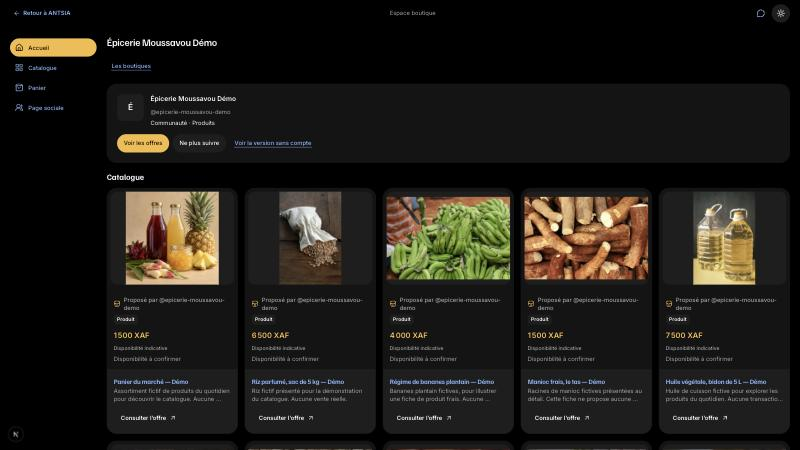

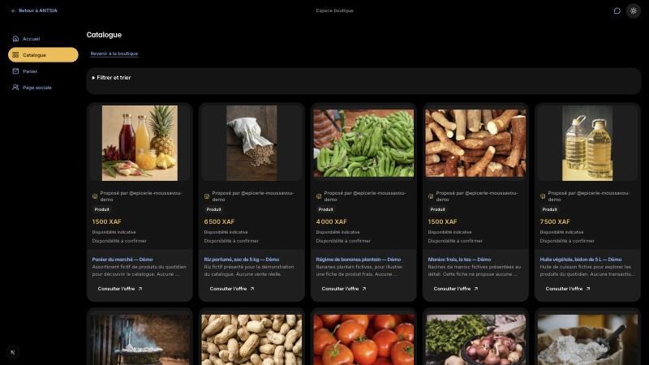

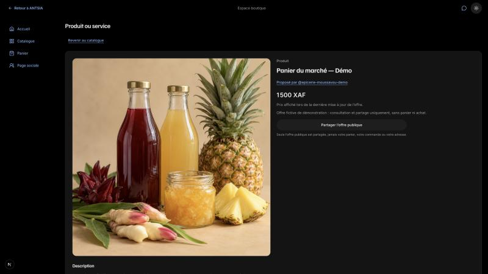

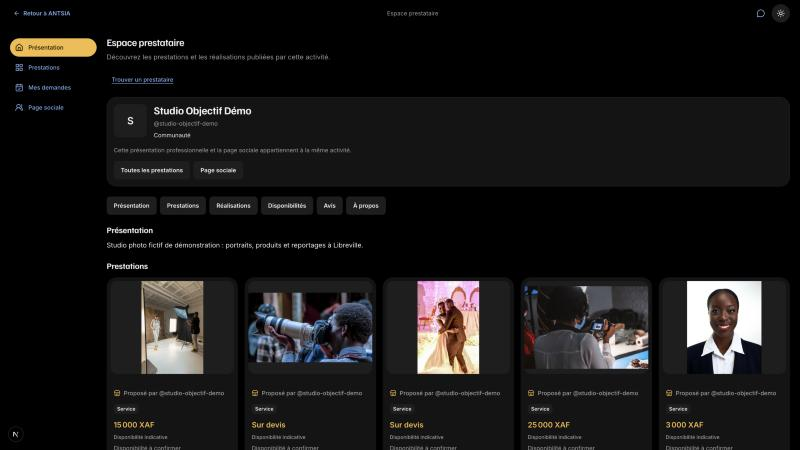

### Pleine largeur de tous les écrans de membre (22/10/2026)

Décision du propriétaire, après les captures d'arbitrage des formulaires :
« le design doit être uniforme, s'adapter à tous les formats (responsive) et
les écarts cohérents. en plein largeur. »

- Plus aucune largeur de lecture centrée dans les trois gabarits : `ShopFrame`,
  `ProfessionalFrame` et `EditorialFrame`. Tous leurs écrans occupent la colonne,
  formulaires compris.
- Les autres écrans de membre centrés font de même :
  - Réglages et Mon espace ;
  - Découvrir, le fil national et les préférences du fil ;
  - Marketplace, Modération et Rencontres ;
  - le site d'un média côté membre.

  Rencontres perd aussi ses retraits latéraux en double dès 768 px.
- Colonnes responsives partagées (`components/shared/screen-layout.ts`) :
  - `SCREEN_SECTIONS` sert aux sections, aux cartes et aux zones de texte.
    Chaque colonne fait 32rem au moins : une colonne jusqu'à 1 280 px de
    fenêtre, deux à 1 440 px, trois à 1 920 px ;
  - `FORM_FIELDS` sert aux champs courts, avec 16rem au moins. Deux champs
    tiennent côte à côte dès 528 px, comme avec `sm:grid-cols-2`.

  Entre deux colonnes, l'écart vaut la gouttière ; l'écart vertical de chaque
  écran est gardé. `SCREEN_SUBMIT` fait que, dès 768 px, le bouton d'envoi
  garde sa largeur au lieu de traverser la colonne.
- Les écrans réorganisés en colonnes :
  - les formulaires :
    - le profil pro (profil d'un côté ; réalisations, activités et visibilité
      de l'autre) ;
    - le devis, le rendez-vous et la prestation ;
    - la préparation de commande (champs et récapitulatif côte à côte) ;
    - la candidature (champs et pièces côte à côte) ;
  - les listes de commandes, d'achats, de paiements, de candidatures, de
    demandes, de boutiques, d'offres d'emploi et de lignes de panier ;
  - les détails d'un achat, d'un paiement, d'une préparation et d'une demande ;
  - la fiche pro, les collaborations et la présentation de l'éditeur de
    boutique ;
  - Réglages, Mon espace, et les contenus de Découvrir.
- Le cliquet `member-screens-full-width` interdit qu'un écran de membre se
  borne puis se centre. Il nomme les exceptions, qui ne sont pas des écrans de
  membre :
  - les pages publiques ;
  - la lecture d'un article (76ch) ;
  - les cartes d'état (session, notification, erreur) et l'accueil d'un nouveau
    compte ;
  - la page autonome des données personnelles ;
  - la coque des réseaux sans destinations.

Mesures prises dans la page, sur dix écrans :
- Réglages, Mon espace, Mes boutiques, Découvrir, Marketplace, Rencontres ;
- Ma rédaction, l'éditeur du profil pro, la vitrine et le fil national.

Le bloc de chaque écran va du rail, plus la gouttière, jusqu'à la gouttière du
bord droit. Le cadre de membre a un rail de 96 puis 248 px, celui des espaces de
96 puis 208 px.

| Largeur | Écart rail / écran | Bloc (membre) | Bloc (espace) | Colonnes de sections |
|---|---|---|---|---|
| 1 024 px | 16 | 128 / 16, 880 px | 128 / 16, 880 px | 1 |
| 1 280 px | 24 | 296 / 24, 960 px | 256 / 24, 1 000 px | 1 |
| 1 440 px | 24 | 296 / 24, 1 120 px | 256 / 24, 1 160 px | 2 |
| 1 920 px | 24 | 296 / 24, 1 600 px | 256 / 24, 1 640 px | 3 (2 pour Mes boutiques et le profil pro) |

- Les paires de champs du profil pro restent côte à côte à toutes ces largeurs.
- Téléphone (390 px) : les dix écrans restent à 12 / 12 px, sans défilement
  horizontal. Les retraits propres de Rencontres (16 px) ne changent pas.
- Laissés tels quels :
  - la liste d'équipe de la Modération, un filtre de tête sur toute la largeur ;
  - les listes de la rédaction (`md:grid-cols-2`) et les trois choix d'activité
    (`sm:grid-cols-3`), déjà en colonnes ;
  - les grilles internes des composants, qui gardent leurs écarts de 8 à 16 px.

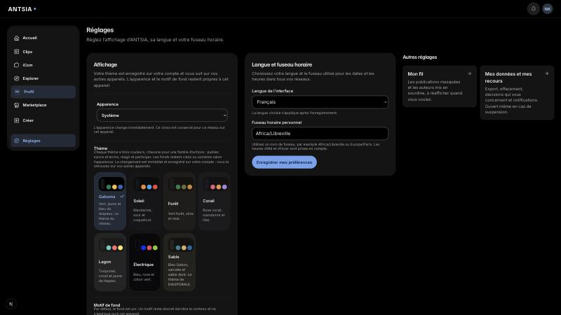

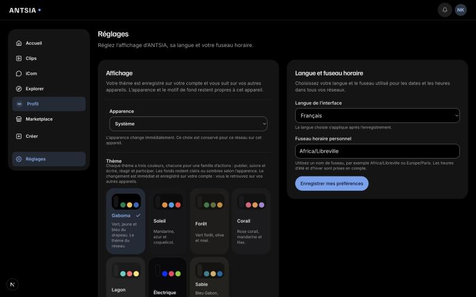

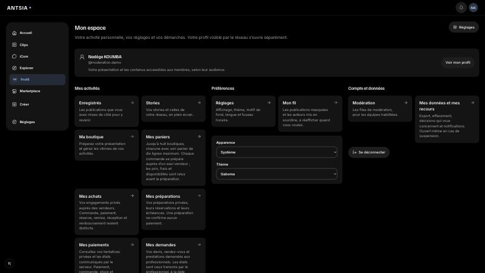

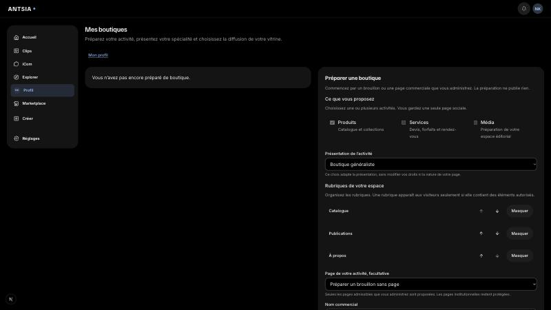

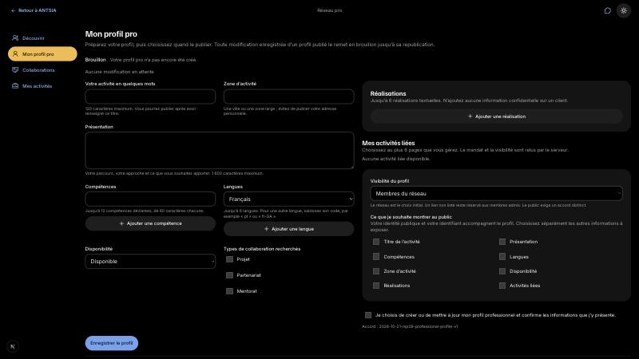

### Marketplace sur le modèle des ventes privées, lot 1 : l'accueil (22/10/2026)

Demande du propriétaire, avec les captures d'une application de ventes privées :
des boutiques en grandes cartes, une par ligne au téléphone et trois ou quatre
par ligne au bureau, et des « moments » qui défilent. Ses décisions du jour :
rien d'inventé (aucun prix barré, remise, sponsor, minuterie ni total
d'articles, absents du moteur) ; la bannière de la page s'ajoute à la carte de
boutique du moteur.

- `/marketplace` sans paramètre devient l'accueil ; toute recherche, vue ou
  rayon garde les résultats d'avant, sous le même en-tête :
  - un salut au nom du membre (`displayName`, jamais découpé) ;
  - ses paniers, avec leur nombre de lignes ;
  - la recherche des produits. Sa suggestion tourne sur de vrais rayons du
    registre et reste fixe si le mouvement est réduit.
- Pastilles qui défilent : Accueil, Produits, les six rayons de premier niveau,
  Services, Boutiques. Une recherche en cours suit le changement de rayon ; une
  seule pastille est active.
- Sections de l'accueil, toutes lues dans le moteur :
  - « Boutiques » : vitrines de produits en grandes cartes. La bannière fait la
    photo, avec le nom en haut, la spécialité ou le modèle en bas à gauche, le
    badge calculé et la zone en bas à droite ;
  - « Prestataires de services » : vitrines sur devis, en carrousel de grandes
    cartes ;
  - « Nouveautés » et « Services » : offres les plus récentes, en carrousel ;
  - la sélection de démonstration, avec sa mention.

  Une section vide ou un index en préparation disparaît.
- Carte d'offre commune, au membre comme au SSR :
  - galerie à points, photo entière sur fond clair ;
  - marque et couleur publiées (facettes), sinon le nombre de variantes ;
  - prix exact et lien vers le vendeur ;
  - indisponibilité récente signalée ;
  - aucune remise.

  Côté membre, l'action « Au panier » ajoute d'un geste une offre au prix exact
  sans variante. « Choisir » ouvre une feuille avec la sélection réelle des
  variantes. La démonstration et les offres à consulter n'ont pas de bouton.
- « Filtrer » ouvre le formulaire de filtres existant dans une feuille (en bas
  au téléphone, à droite dès 768 px). Le bouton flotte au-dessus de la barre
  d'onglets jusqu'à 1 023 px, puis rejoint la barre de l'écran. Une recherche
  appliquée rend le focus au titre. Un bouton ramène en haut de la page.
- Écarts : grilles et carrousels à 12 px au téléphone, puis sur la gouttière
  (`--spacing-gutter`) dès 768 px, comme les marges.

Mesures sur `/marketplace` et `/marketplace?vue=produits` (backend local du
candidat, contenu de démonstration) :

| Largeur | Bloc | Grandes cartes (colonnes) | Grille d'offres (colonnes) | Défilement horizontal |
|---|---|---|---|---|
| 390 px | 12 / 12, 366 px | 1 | 2 (177 px) | aucun |
| 1 024 px | 128 / 16, 880 px | 3 | 4 | aucun |
| 1 280 px | 296 / 24, 960 px | 3 | 4 | aucun |
| 1 440 px | 296 / 24, 1 120 px | 3 | 5 | aucun |
| 1 920 px | 296 / 24, 1 600 px | 4 | 6 | aucun |

Défaut trouvé et corrigé pendant la recette : le lien du vendeur, aligné à
gauche dans la grille, prenait sa largeur de contenu (260 px dans une carte de
177 px) et élargissait la page à 477 px au téléphone. Il est désormais borné à
la carte.

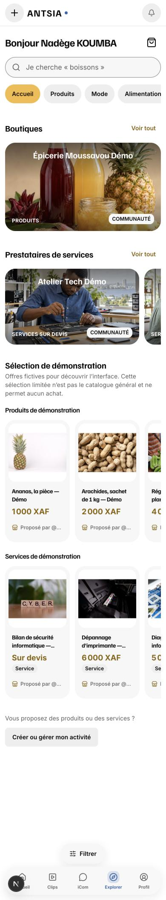

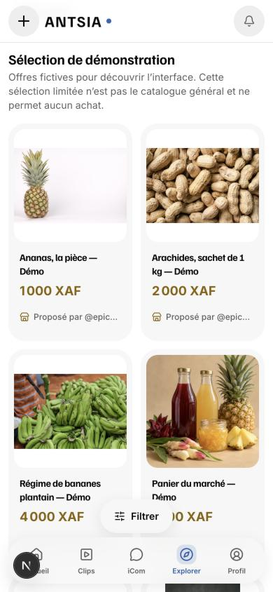

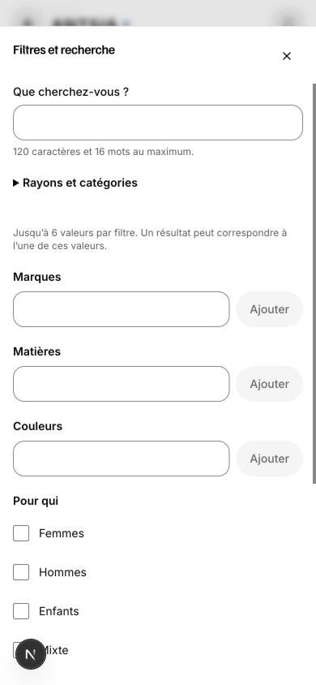

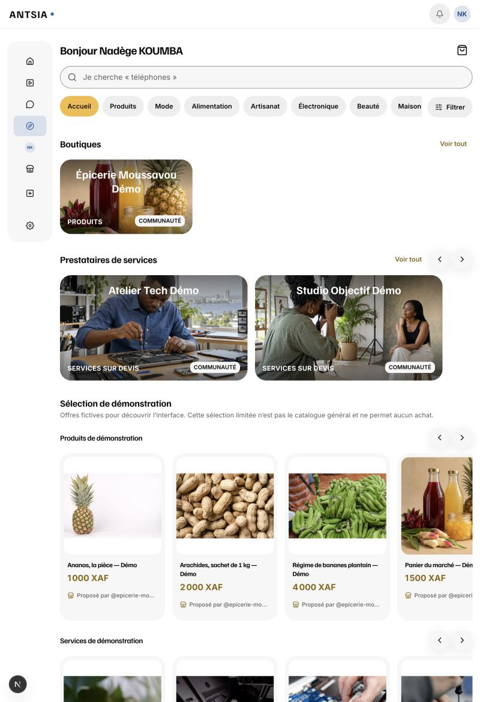

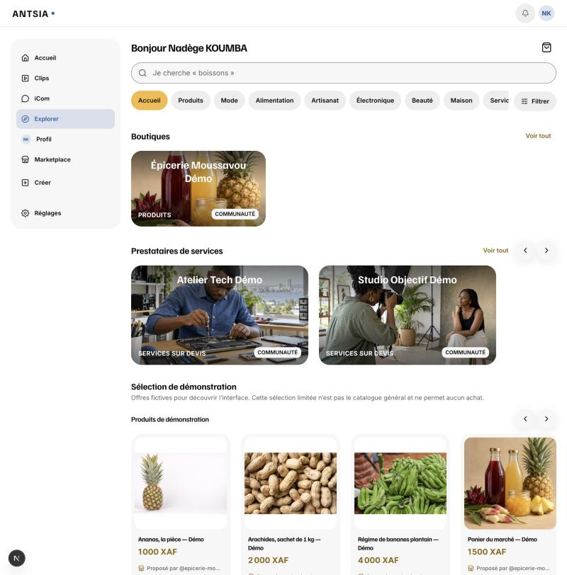

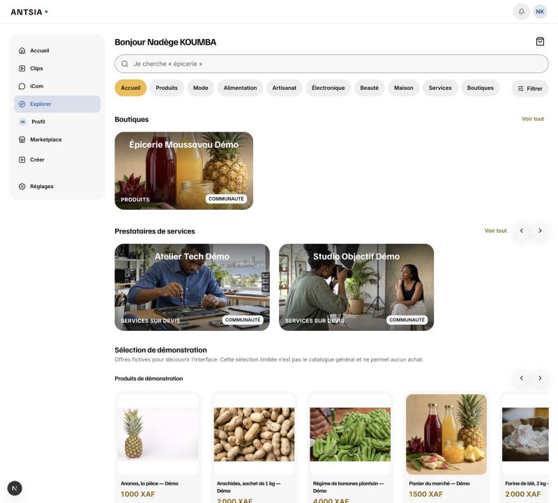

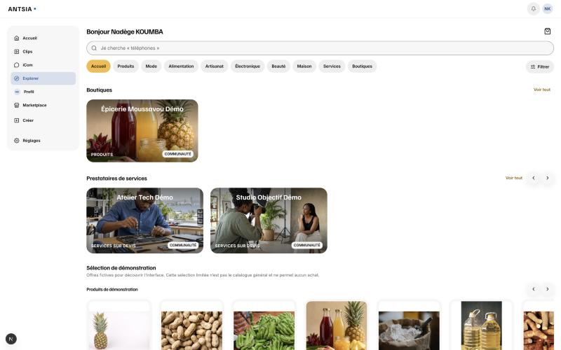

Limite : en local, aucune offre réelle (pas de PRO.GA). Les carrousels
« Nouveautés » et « Services » et l'ajout au panier se prouvent par les tests ;
les offres de démonstration refusent le panier par conception.

## Limites de preuve et état Git

Le `verify` global avec l’ensemble des tests backend et des espaces de travail voisins n’a pas été relancé : la validation est ciblée sur les surfaces modifiées et leurs contrats.

Cette recette confirme les vues citées et les raccords des composants réels ;
elle ne constitue pas une comparaison exhaustive de chaque pixel des
60 planches × sept thèmes × deux modes × trois formats.

Les données locales ne fournissent pas tous les états de catalogue, paiement,
candidature ou prestation. Leurs composants et tests ont été vérifiés ; aucune
transaction, candidature, demande commerciale, communication, autorisation de
caméra/microphone, export ou suppression n’a été exécuté pour produire les captures.

Les travaux parallèles du dépôt sont conservés, notamment les changements de
modération/effacement et les traductions de boutiques. Aucun changement de
branche, commit applicatif, push, merge, publication ni fichier d’environnement
modifié par cette livraison. Les anciens rapports de production ne prouvent
pas la publication de ces nouveaux raccords.
