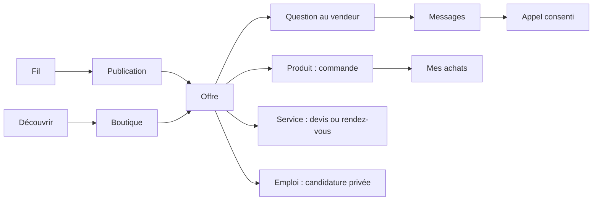

# Navigation, publications et défilement

Statut : conception proposée. Références : [benchmark](01_BENCHMARK_SOURCES.md), [audit réel](02_AUDIT_ANTSIA.md), [charte](03_DESIGN_SYSTEM.md).

## 1. Architecture de navigation

Sur téléphone, cinq destinations stables : **Fil · Découvrir · Créer · Messages · Profil**. « Créer » ouvre un choix de contenu ; ce n'est pas une page vide. La cloche et la recherche restent dans l'en-tête. Le profil contient « Ma boutique », « Mes achats », « Mes candidatures » et les réglages.

« Découvrir » contient des onglets : **Tout · Boutiques · Services · Emplois**. Les groupes, événements, relations et contenus nationaux existants restent accessibles depuis Découvrir et le menu du profil, avec leurs liens directs conservés. Le sélecteur de réseau/audience reste explicite ; une catégorie commerciale n'est pas un réseau.

Sur ordinateur, les mêmes destinations passent dans un rail à gauche ; « Boutique » et « Mes achats » peuvent être des raccourcis supplémentaires. Les appels restent hébergés une seule fois dans la coque persistante.



## 2. La publication commune

Ordre : **auteur → média → actions → légende → offre liée facultative**. Le nom d'une boutique ne remplace jamais silencieusement l'identité d'auteur. Le membre choisit « publier en mon nom » ou « au nom de ma page » et le serveur vérifie le mandat.

| Zone | Contenu et comportement |
|---|---|
| En-tête | Avatar/logo, nom, badge calculé, origine si réseau enfant, date, menu ; publication commerciale identifiée |
| Média | Photo ou vidéo ; galerie avec index et commandes ; ratio de source respecté |
| Actions | Aimer/réagir, commenter, partager, enregistrer ; libellés accessibles, compteurs réels |
| Légende | Aperçu borné puis « Lire la suite » ; hashtags/mentions accessibles ; texte complet disponible |
| Offre liée | Une carte compacte avec titre, prix correctement qualifié, vendeur et « Voir l'offre » |
| Pied | Commentaires récents si autorisés ; aucune copie d'un contenu retiré ou privé |

Garder les quatre réactions existantes : action principale simple, choix complémentaire accessible sans appui long obligatoire. Le double toucher peut être un raccourci facultatif, jamais l'unique moyen d'aimer. Un partage public ne contourne pas l'audience ; un lien privé affiche une page de refus sans aperçu de contenu.

### Formats proposés

- Photo : rendu de référence 4:5 dans le fil, carré 1:1 pris en charge ; afficher l'original entier dans le visualiseur. Le cadrage éditorial est prévisualisé et choisi, jamais destructif.
- Galerie : un média à la fois, balayage horizontal, flèches, index et textes alternatifs par image. Conserver initialement la limite réelle de quatre images tant qu'un lot n'étend pas le contrat.
- Vidéo : 9:16 pour le contenu vertical ; les formats paysage/carré restent acceptés avec bandes de fond. Sous-titres lorsqu'ils sont fournis, description/alternative accessible ; pas de transcription inventée.
- Texte seul : carte à hauteur naturelle, texte complet lisible ; sa présence n'impose pas de vide jusqu'au bas de l'écran.
- Produit : pas de recadrage qui masque une caractéristique, une étiquette ou une information de prix.

Le ratio 16:10 forcé constaté dans `PostMedia` doit devenir un choix de présentation adapté au média. Le modèle média et les contrôles d'accès ne sont pas remplacés.

## 3. Fil inspiré de TikTok, adapté à toutes les publications

**Sur téléphone, le mode immersif progresse verticalement de publication en publication.** Ce mode s'applique aux posts du fil, pas seulement à un onglet vidéo. Un mode **Liste** reste accessible dans l'en-tête et mémorisé par réseau. Sur ordinateur, la liste est le défaut ; « Immersion » ouvre le même lecteur avec un panneau de détail latéral.

Pour les contenus visuels courts : une publication principale dans la hauteur disponible, hors navigation et zones sûres. Le geste vertical mène au post suivant/précédent ; le geste horizontal change l'image d'un carrousel. L'axe est déterminé au début du geste. Le lecteur ne capture pas un mouvement commencé sur un curseur, une sélection de texte ou une feuille ouverte.

Pour une publication longue : « Lire la suite » ouvre un détail qui défile normalement. Tant qu'il est ouvert, le fil ne change pas de post. En mode liste et avec zoom/lecteur d'écran, aucune hauteur fixe ne tronque le texte. `scroll-snap` reste progressif ; l'option réduction des mouvements utilise une transition immédiate ou le mode liste.

### Règles de lecture

1. Un coordinateur de lecture autorise **au plus une vidéo active**. Le seuil initial proposé est 70 % de visibilité, réglable après recette.
2. Lecture automatique muette seulement si le navigateur l'autorise et si l'économie de données n'est pas activée. Sinon afficher « Lire ».
3. Le son demande un geste ; sa préférence est explicite. Un média hors écran, un onglet masqué ou un appel entrant suspend la lecture.
4. Préchargement limité : métadonnées/affiche suivante, une voisine au plus ; jamais toute la page de vidéos. Mode économie : aucune vidéo préchargée.
5. Reconnexion : conserver la publication, son index de galerie et la position, afficher la vraie indisponibilité. Pas de saut à la première publication.
6. Aucun passage automatique au post suivant à la fin d'une vidéo en V1. L'utilisateur contrôle sa progression.

## 4. Chargement, pagination et retour

Les curseurs du moteur restent l'autorité. Utiliser un curseur opaque lié au réseau, à la portée et à la requête. Le chargement en approche de fin n'empêche pas une commande « Charger la suite » accessible. Une page filtrée vide avec un curseur suivant n'est pas une fin de fil.

Fenêtre DOM initiale proposée : quelques publications autour de l'active, puis ajustement après profilage. Ne pas recycler l'élément focalisé ni modifier l'ordre annoncé aux technologies d'assistance. Les nouvelles publications disponibles apparaissent via une commande dédiée ; pas d'insertion qui déplace le post lu.

État de retour en mémoire de navigation : réseau, portée, post, index média, offset. Purger tout état personnel à la déconnexion selon le mécanisme existant. Ne pas introduire une URL privée dans l'analytique ou un stockage durable non autorisé.

## 5. Schémas d'écran

### Téléphone, fil visuel

```text
┌─────────────────────────────────┐
│ ANTSIA             Recherche  🔔 │
│ Pour vous · Abonnements    Liste │
├─────────────────────────────────┤
│ Avatar  Nom / Boutique     ⋯     │
│ origine · date · statut         │
│                                 │
│           MÉDIA                 │
│   photo / galerie / vidéo       │
│                                 │
│ pause  son  sous-titres    1/4   │
├─────────────────────────────────┤
│ aimer  commenter  partager  ☆    │
│ Légende… Lire la suite           │
│ Offre · prix/unité · Voir        │
├─────────────────────────────────┤
│ Fil Découvrir Créer Messages Moi│
└─────────────────────────────────┘
```

Les symboles du schéma sont indicatifs ; l'application emploie ses icônes et traductions accessibles. À faible hauteur, réduire le média ou passer en liste, jamais masquer les actions.

### Ordinateur

```text
┌───────────────┬────────────────────────┬─────────────────────┐
│ ANTSIA        │ Portée · recherche     │ Détail contextuel   │
│ Fil           │                        │ ouvert à la demande │
│ Découvrir     │ Carte de publication   │                     │
│ Créer         │ de 560 à 640 px        │ Commentaires        │
│ Messages      │                        │ ou offre            │
│ Boutique      │ Médias dominants       │ ou conversation     │
│ Profil        │                        │                     │
└───────────────┴────────────────────────┴─────────────────────┘
```

## 6. Classement et contrôle utilisateur

Conserver des choix distincts : « Pour vous » (sources suivies et centres d'intérêt explicitement choisis), « Abonnements » et « Récents ». V1 : règles compréhensibles fondées sur fraîcheur, abonnements, thème et zone choisie, sans nouveau modèle opaque.

« Pourquoi ce contenu ? » donne une raison issue du classement réel. Masquer, bloquer, signaler et ne plus recommander sont accessibles. Aucun contenu d'un réseau fermé, candidature, message ou historique d'achat n'entre dans ce classement. Les contenus sponsorisés, s'ils sont décidés plus tard, portent un libellé et un contrôle de densité ; ne pas les activer dans cette refonte.

## 7. États à dessiner avant le développement

Fil initial, aucun abonnement, résultat vide, fenêtre lacunaire, hors ligne, publication indisponible, vidéo refusée, photo manquante, envoi en cours, publication refusée, article retiré, prix modifié, changement de réseau, session expirée.

Le squelette garde la géométrie finale ; pas de faux contenu ni de compteur inventé. Une erreur de session garde le traitement corrigé existant ; elle n'est pas remplacée par une redirection anonyme ou une boucle de rechargement.

## 8. Recette spécifique

Faire défiler 30 publications mixtes ; ouvrir une offre puis revenir ; changer d'image sans changer de post ; ouvrir les commentaires ; recevoir un appel ; tourner le téléphone ; zoomer à 200 % ; couper puis rétablir le réseau. Vérifier absence de lecture simultanée, absence de saut de position, absence de double téléchargement massif et contrôle complet sans geste tactile.
