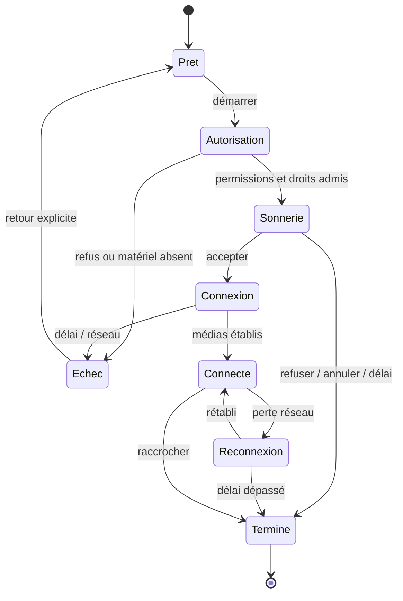

# iCom — Conversations et appels inspirés de WhatsApp

Statut : proposition. Le moteur actuel fournit déjà messages, groupes, pièces jointes, vocaux, présence et appels LiveKit. L'objectif est de clarifier et fiabiliser ces parcours, en les reliant au commerce sans multiplier les systèmes de communication.

## 1. Organisation

Trois vues dans Messages : **Conversations · Appels · Contacts**. Recherche et filtres « Toutes / Non lues / Groupes / Boutiques » ; compteurs réels. Les stories restent accessibles depuis le fil pour éviter deux navigations concurrentes. Un fil commercial est identifié par le nom et le logo de la boutique, avec la personne de l'équipe qui répond lorsque pertinent.

Sur téléphone : liste puis conversation pleine page, retour qui conserve recherche et position. Sur bureau : liste à gauche, conversation à droite ; mode compact possible sans afficher en permanence un téléphone miniature sur le fil. Le composeur reste au-dessus du clavier et des zones sûres.

## 2. Conversation

| Élément | Comportement prévu |
|---|---|
| En-tête | Identité et contexte ; recherche ; audio/vidéo si autorisés ; menu de blocage/signalement |
| Messages | Jour, texte, pièces jointes admises, vocaux, réactions et réponses ; états d'envoi distincts |
| Carte commerciale | Référence d'offre/commande, titre autorisé et état actuel ; pas de prix figé considéré comme promesse de vente |
| Composeur | Texte, joindre, vocal ; progression et annulation de dépôt ; brouillon préservé |
| Lecture | Accusés uniquement selon preuve et préférence ; aucune présomption de lecture après ouverture d'une notification |
| Indisponibilité | Message local conservé en brouillon, erreur expliquée ; renvoi explicite et idempotent |

Le bouton « Envoyer » n'accepte pas plusieurs clics créant plusieurs messages. L'état local optimiste possède un identifiant raccordé à l'admission serveur. Une réponse tardive d'une ancienne session ne réinjecte rien après déconnexion.

## 3. Contact commercial sans relation préalable

L'actuelle messagerie personnelle exige une relation acceptée pour un nouveau fil. Créer un **canal commercial distinct**, avec `shopRef`, demandeur et participants autorisés. Ne pas affaiblir la garde personnelle.

Parcours : fiche → « Poser une question » → texte accompagné de la référence de l'offre → demande → acceptation/réponse ou refus. Avant acceptation : une demande bornée, pas d'appel ni de fichiers libres en série. Le destinataire peut bloquer et signaler. Les limites de fréquence sont par membre et par boutique, contrôlées au serveur.

Une boutique choisit les membres de son équipe qui peuvent répondre, chacun avec un mandat actif. La suppression d'un mandat ferme immédiatement la lecture et l'envoi de cet équipier. Elle n'efface pas la conversation de l'acheteur. Aucun salarié n'obtient tout le CRM par le seul droit de répondre à un message.

Transmettre un prospect à PRO.GA exige un geste explicite. Le contrat transmet la demande et les coordonnées choisies ; il n'exporte pas l'intégralité du fil, le carnet d'adresses ou le graphe social.

## 4. Appels : états et actions

Actions : couper/rétablir micro, activer/désactiver caméra, basculer caméra, sélectionner sortie si la plateforme le permet, réduire l'appel, raccrocher. L'appel audio ne demande pas la caméra. Le passage à la vidéo sollicite la permission au bon moment et n'allume pas la caméra distante sans choix.

Le statut « connecté » et la durée commencent avec l'établissement réel. « Occupé », « manqué », « refusé », « annulé », « réseau indisponible » sont distingués dans l'historique selon les événements disponibles. Les événements tardifs ne ressuscitent jamais un appel terminé.

## 5. Arbitrage des médias et continuité

Un hôte d'appel global persistant dans la coque, déjà prévu dans l'architecture, reste monté une seule fois. Le changement de thème, route, filtre et page ne recrée pas la salle. Priorité audio : appel actif → message vocal lancé volontairement → vidéo de fil ; un nouvel appel suspend les lecteurs sociaux.

À la sortie effective : arrêter les pistes et libérer caméra/micro ; ne pas confondre réduction de fenêtre avec fin d'appel. La déconnexion globale ferme l'appel et interdit toute reprise liée à une session précédente. Les deux participants voient un état cohérent après raccrochage, même si une fermeture réseau est retardée.

Les appels de groupe existants restent disponibles dans la limite réelle du contrat courant (11 participants au moment de l'audit), avec invitations et participants autorisés. La nouvelle présentation conserve l'identification des intervenants, les états micro/caméra et la sortie individuelle sans terminer abusivement la conversation de tous.

L'appel d'un vendeur suppose son acceptation et sa disponibilité. Une première question commerciale ne donne pas un droit illimité à faire sonner sa boutique. V1 commerciale : appel 1:1 à un répondant autorisé ; file d'appels/centre d'appels d'entreprise hors périmètre.

## 6. Web et téléphone natif : preuve séparée

| Surface | Cible | Ce qu'il faut tester |
|---|---|---|
| Web actif | Audio/vidéo, changement de route, partage d'écran si supporté et décidé | Deux sessions réelles, deux appareils, permissions et réseau |
| PWA / navigateur en arrière-plan | Notification et reprise selon capacités du système | Ne pas promettre une sonnerie permanente ; onglet fermé, système suspendu |
| Android natif | Appel entrant, service adapté, intégration système et notification ciblée | Appareil physique, écran verrouillé, restrictions batterie, Bluetooth |
| iOS natif | Intégration CallKit et mécanisme d'appel entrant adapté | Appareil physique, écran verrouillé, interruption par appel système |

L'audit constate des notifications APNs de type `alert`, pas une chaîne VoIP native complète, et aucun client natif ANTSIA dans `apps`. Le worker Web ouvre actuellement une destination générique. Un lot explicite doit fournir le routage notification → appel/conversation autorisée, avec validation de la session et de l'état courant.

## 7. Confidentialité et chiffrement

La ressemblance avec WhatsApp ne permet pas d'annoncer son niveau de chiffrement. Le stockage des messages ANTSIA et le transport LiveKit doivent être décrits tels qu'ils sont. LiveKit documente un support E2EE qui demande configuration et gestion des clés par l'application ; les appels API et la signalisation sont un sujet distinct. [Documentation LiveKit](https://docs.livekit.io/transport/encryption/).

Un éventuel E2EE exige un lot de décision : modèle de menace, identité des appareils, distribution/rotation des clés, révocation, récupération multi-appareils, pièces jointes, notification sans contenu, signalement volontaire et limites des conversations d'équipe. Ne pas créer une cryptographie maison ni un paramètre « chiffré » purement visuel. Les appels ne sont pas enregistrés ; toute évolution demanderait son propre consentement et périmètre.

## 8. Critères de recette

- Question commerciale envoyée par un inconnu admis, refus/spam/blocage testés.
- Répondant désaffilié refusé au prochain accès serveur.
- Audio audible dans les deux sens ; vidéo visible dans les deux sens ; muet et caméra arrêtée réellement effectifs.
- Appel de groupe à trois comptes de recette : rejoindre/quitter, identité des participants et permissions ; plafond contractuel testé sans prétendre une charge réelle à onze appareils.
- Appel maintenu lors de fil → boutique → messages et changement clair/sombre.
- Refus de permission récupérable, pas d'écran de sonnerie infinie.
- Coupure/reconnexion, double acceptation, appel occupé et raccrochage tardif testés.
- Une notification technique « envoyée » n'est pas la preuve de réception sur téléphone.
- Appels natifs validés séparément sur Android/iOS avant toute annonce correspondante.
