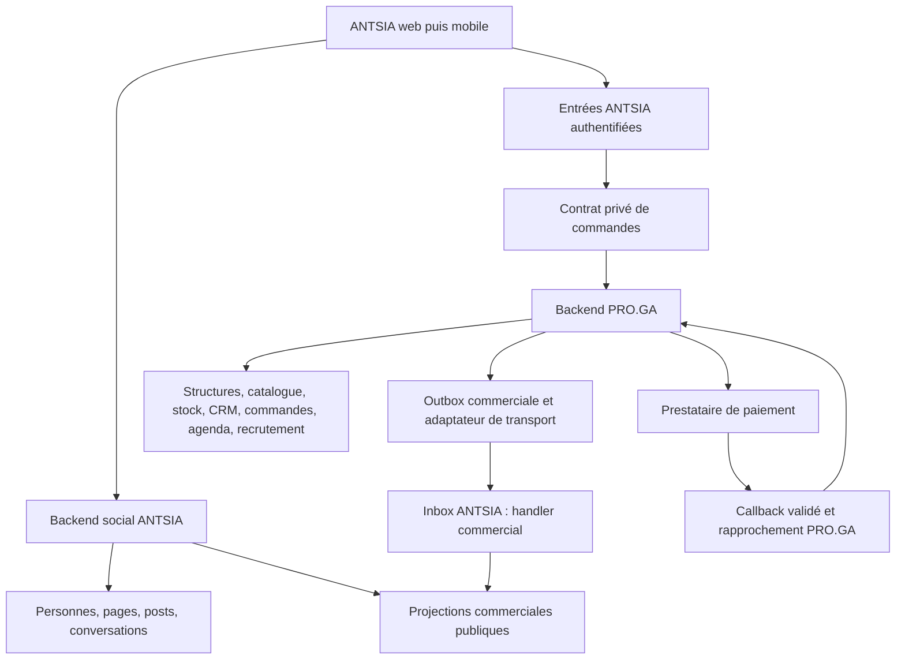

# Architecture cible — ANTSIA × PRO.GA

Statut : proposition, 18 octobre 2026. Les noms de tables, contrats, événements et routes ajoutés ci-dessous sont **des cibles à créer**, pas des capacités déjà déployées. L'[audit PRO.GA](07_AUDIT_PRO_GA.md) décrit les différences entre plans et code présent.

## 1. Frontières et choix d'architecture

Retenir un **miroir public de catalogue dans ANTSIA et des commandes privées vers PRO.GA**. Cela permet une découverte rapide sans déplacer la gestion commerciale. Une simple redirection vers PRO.GA serait moins coûteuse mais ne satisferait pas tout le parcours demandé ; une seconde base maître commerciale dans ANTSIA créerait des conflits de prix, stock et commande.



Pas de client Convex croisé, de lecture de base voisine ou d'import `_generated` externe. Le BFF transmet un contrat borné ; il ne reçoit aucune clé de prestataire dans le navigateur. Le backend commerce ne reçoit pas toute la session sociale ni son cookie.

## 2. Sources de vérité

| Entité | Autorité d'écriture | ANTSIA conserve |
|---|---|---|
| Personne sociale, handle, graphe, réseau | ANTSIA | Données sociales existantes |
| Structure vendeuse, établissements et mandats d'activité | PRO.GA | Liaison consentie et preuve de droits limitée, renouvelable/révocable |
| Présentation sociale, blocs, abonnés, posts de boutique | ANTSIA | Habillage et activité sociale ; nom légal/commercial canonique reflété selon champ |
| Offres, variantes, prix, conditions et collections | PRO.GA | Projection publiée, version, date de fraîcheur, référence opaque |
| Stock, réservations et exécution | PRO.GA | Disponibilité indicative et état des demandes de l'acheteur |
| Conversations et demandes de contact social | ANTSIA | Messages avec participants autorisés ; références commerciales minimales |
| Prospect, client, devis, commande, facture, avoir | PRO.GA | Projection privée par acheteur et état corrélé |
| État réel des fonds | Prestataire ; registre rapproché par PRO.GA | État servi par PRO.GA, jamais déduit du retour navigateur |
| Agenda, créneau, ressource | PRO.GA | Offre et résultat de réservation autorisé |
| Offre d'emploi et traitement de candidature | PRO.GA | Offre volontairement publiée et suivi privé du candidat |
| Modération sociale | ANTSIA | Retrait local et motifs ; demandes de retrait commercial corrélées |

Chaque champ éditable a un maître. Une modification de prix depuis une interface légère ANTSIA est une commande PRO.GA ; elle ne modifie pas d'abord le miroir local. Les signataires sociaux et mandats commerciaux se croisent pour agir au nom d'une boutique, sans devenir interchangeables.

## 3. Liaison du vendeur, sans fusion automatique des comptes

L'audit n'a pas trouvé de SSO IDN déjà configuré dans PRO.GA. **Ne pas dépendre d'un SSO imaginaire et ne pas changer l'authentification ANTSIA pour le contourner.**

Proposition V1 : flux de liaison à double preuve.

1. Membre ANTSIA authentifié demande « Lier mon activité PRO.GA ». Le serveur crée un état et un défi à durée courte, à usage unique, liés au réseau, à la session et à une URI de retour allowlistée.
2. L'utilisateur s'authentifie réellement dans PRO.GA ; choisit une structure où son mandat permet le partage commercial ; voit les scopes demandés et consent.
3. PRO.GA émet un code court opaque, consommé serveur à serveur, lié au défi et à la destination. Échange de type code + preuve de possession/PKCE, signature de service et anti-rejeu ; pas de jeton réutilisable dans l'URL.
4. ANTSIA enregistre `commercialLink` : références publiques opaques, scopes, version du consentement, expiration/état de révocation. Les identifiants internes restent locaux.
5. Publication et opérations sensibles relisent le mandat côté PRO.GA. Les caches de droits sont courts ; une révocation invalide les capacités et stoppe les nouveaux achats/actions de gestion.

Ne pas lier par égalité d'e-mail, de téléphone ou de handle. Une identité IDN commune pourra simplifier la preuve après un lot dédié, sans supprimer le consentement ni la vérification du mandat de structure.

Les acheteurs n'ont pas besoin d'un rôle dans une structure PRO.GA : le canal privé leur attribue un sujet opaque, signé et limité à leurs propres demandes. Les données de livraison sont saisies/consenties au checkout ; elles ne viennent pas d'un profil privé exporté silencieusement.

## 4. Modèles locaux à introduire

### Côté ANTSIA

| Modèle proposé | Champs principaux / index à spécifier |
|---|---|
| `shopDrafts` | networkId, créateur, type d'activité, champs de présentation, état, dates ; par réseau/personne |
| `shopCapabilities` | networkId, pageId, lien commercial, capacités admises, visibilité publique, état de publication ; par réseau/page |
| `commercialLinks` | références opaques, autorité liée, scopes, consentement, version, révocation ; aucune clé secrète exposée |
| `catalogProjections` | networkId, shopRef, offerRef, type, révision, prix qualifié, médias admis, date de fraîcheur, état/retrait ; par boutique/type/publication |
| `commercialRequests` | networkId, auteur, boutique, nature, référence de demande, état, idempotence ; accès participants seulement |
| `buyerOrderViews` | networkId, acheteur, orderRef, révision et état projeté minimal ; pas de registre comptable parallèle |
| Conversations commerciales | Étendre proprement le contrat de source de messagerie avec participants/mandats/contextes ; pas de conversation personnelle ouverte artificiellement |

Ce sont des propositions de découpage : vérifier les modèles existants avant ajout. Chaque table sociale étend l'inventaire d'export/effacement, les cibles de modération, les limites et les tests d'isolation. Les projections anonymes ont une porte spécifique, sans généraliser `networkQuery`.

### Côté PRO.GA

Réutiliser les modules existants. Ajouter les références stables des variantes, la révision commerciale cohérente (offre + variantes publiées), la provenance ANTSIA, les sujets acheteurs, les liaisons autorisées, les réservations corrélées aux commandes, les commandes privées et les producteurs d'événements manquants.

Les lignes de commande actuelles ne portent pas offre/variante/article : ajouter les liens nécessaires tout en conservant un **snapshot immuable** des libellés, prix, taxes/frais décidés et conditions au moment de l'engagement. Aucun changement de catalogue ne réécrit une facture émise.

## 5. Deux familles de contrats, séparées

### A. `PRO-COMMERCE-PUBLIC-V1` — projection publique

Événements proposés : `shop.published`, `shop.updated`, `shop.withdrawn`, `offer.published`, `offer.updated`, `offer.withdrawn`, `offer.availabilityChanged`, `job.published`, `job.closed`. Chaque type a un schéma fermé ; les types non implémentés restent refusés.

Enveloppe adaptée au récepteur ANTSIA actuel : `eventId`, `contract`, `version`, `objectRef`, `payload`. Dans le payload : sous-type fermé, référence commerciale publique, révision métier monotone, date de changement et DTO allowlisté. **Le `version` de transport n'est pas la révision du prix.** Le réseau provient de la configuration de l'émetteur, jamais d'un `networkId` reçu arbitrairement.

Écarts à résoudre explicitement :

- Les références PRO.GA avec `/` ne passent pas la validation `objectRef` actuelle : définir un identifiant de transport opaque compatible et conserver un mapping serveur, sans assouplissement global des validations.
- PRO.GA et ANTSIA n'utilisent pas le même format de signature. Écrire un adaptateur explicite selon le contrat destinataire ; ne pas recopier le HMAC d'un protocole dans l'autre.
- Persister les octets exacts envoyés pour rejouer la même enveloppe avec le même digest. Clés distinctes par environnement/destination, rotation documentée et secrets hors documents/source.
- `proOutboxEvents` et `proIntegrationOutbox` sont deux mécanismes distincts : décider d'un raccord unique transactionnel ou d'un pont borné vérifiable ; pas de double émission concurrente. Réutiliser leasing/retry/DLQ de la fondation existante avec transport HTTP réel.
- L'inbox ANTSIA actuelle classe les contrats en `unsupported_contract`. Le handler commercial et ses projections doivent être branchés. Un HTTP 202 est une réception, pas la preuve d'application métier.

Le DTO public exclut contacts privés, acheteurs, CV, marges, quantités internes, secrets et identifiants Convex. Un SKU interne n'est pas publié par commodité. Les médias sont copiés/admis par une chaîne explicite ou servis par un mécanisme contractuel autorisé ; aucune URL de stockage d'un autre produit n'est directement propagée.

### B. `PRO-COMMERCE-COMMAND-V1` — actions privées

Commandes proposées : `link.confirm`, `catalog.draft.save` (interface vendeur simplifiée), `inquiry.submit`, `quote.accept`, `checkout.prepare`, `payment.start`, `order.cancel.request`, `booking.request`, `application.submit`. Leurs routes HTTP restent à créer et à déclarer côté destination ; elles ne sont pas l'inbox de reflets publics.

Chaque requête porte : identifiant de demande et clé d'idempotence, sujet opaque authentifié, activité autorisée, scope, horodatage/expiration, références et contenu strictement nécessaire. La destination revalide identité déléguée, portée, mandat/qualité d'acheteur, révision attendue, limites et état métier. Une signature de machine ne confère pas tous les droits de la structure.

Réponses bornées : acceptée + résultat/reçus, déjà traitée + même résultat, changement à reconfirmer, refus métier, indisponibilité temporaire. Répéter la même clé avec un corps différent est un conflit ; avec le même corps retourne le résultat précédent. Après délai réseau, consulter l'état de la demande avant d'émettre une nouvelle intention de paiement.

## 6. Ordre, retraits, réconciliation et défaillances

| Cas | Règle |
|---|---|
| Doublon exact | Même effet et même reçu ; pas de doublon d'offre/commande |
| Événement ancien | Ne remplace pas une révision plus récente |
| Retrait reçu puis ancien upsert | Tombstone versionné : l'offre ne ressuscite pas |
| Trou de révisions | Déclencher une relecture contractuelle bornée ; ne pas supposer les champs absents |
| Pause/site dépublié/vendeur suspendu | Émettre retrait et interdire nouvelle commande côté autorité, même si le miroir est en retard |
| Destination indisponible | Backoff plafonné, bail, DLQ, alerte ; rendre la fraîcheur visible et bloquer le paiement non confirmé |
| Retrait de consentement/lien | Révoquer capacités, retirer projections, conserver seulement les obligations transactionnelles nécessaires sous politique dédiée |
| Rejeu après panne | Même enveloppe persistée ; reçus corrélés ; audit de rejeu ; pas d'action opérateur implicite |

Cible de fonctionnement proposée : propagation courante p95 < 60 s, à mesurer en pilote ; les actions transactionnelles revalident toujours le vendeur, le prix et le stock. La péremption d'un miroir ne devient pas une autorisation d'achat. Réconciliation périodique par curseurs/révisions pour détecter les retraits manqués, sans export complet des bases.

## 7. Commande, stock et paiement

```mermaid
sequenceDiagram
    participant A as Acheteur ANTSIA
    participant N as Serveur ANTSIA
    participant P as PRO.GA
    participant S as Prestataire
    A->>N: Confirmer variante, quantité et remise
    N->>P: checkout.prepare (idempotent)
    P->>P: Relire vendeur/prix ; réserver stock atomiquement
    P-->>A: Récapitulatif et expiration
    A->>N: Accepter le total
    N->>P: payment.start (même intention)
    P->>S: Créer session de paiement
    S-->>A: Autoriser le paiement
    S->>P: Callback authentifié
    P->>S: Vérifier/rapprocher si nécessaire
    P->>P: Confirmer paiement et transition de commande
    P-->>N: État privé corrélé
    N-->>A: Payé / en attente / échec réel
```

Ordre, paiement et remise ont **trois machines d'état** indépendantes. Exemples de concepts à mapper aux enums existants : commande `awaiting_payment → confirmed → preparing → fulfilled`, paiement `pending → confirmed / failed / expired`, remboursement `requested → processing → confirmed / rejected`. Aucun `paid` issu uniquement d'un paramètre de redirection.

La réservation est limitée dans le temps. Une expiration libère le stock de manière idempotente. Un paiement confirmé tardivement après expiration déclenche une réconciliation : réacquérir le stock si possible, sinon procédure de remboursement/support explicite ; ne pas livrer un article inexistant ni ignorer un paiement reçu.

Callbacks dupliqués, hors ordre et rejoués : authentification du fournisseur et unicité événement/transaction, vérification du montant/devise/bénéficiaire, transitions autorisées, journal sans données de paiement sensibles. Le retour navigateur peut indiquer « Vérification en cours » et consulter l'état canonique. Les secrets de paiement ne sont jamais transmis au client.

Le choix du fournisseur est ouvert. [La documentation officielle SingPay](https://client.singpay.ga/doc/reference/index.html) présente des appels Airtel Money/Moov Money, une interface externe et des consultations de transaction ; c'est un candidat à évaluer, pas un contrat retenu ni une preuve de disponibilité pour les vendeurs d'ANTSIA. Les garanties de callback, remboursement, frais, admission marchand et sandbox doivent être vérifiées avec le fournisseur sélectionné.

## 8. Accès, effacement et exploitation

- `networkId` reste partout dans le domaine social ; `tenant/structure` dans PRO.GA. Une table de liaison autorisée les relie, sans les assimiler.
- La page publique ne montre ni signataires, ni commandes, ni conversations. Les droits de page ne suffisent pas à lire tous les dossiers clients.
- Révocation de mandat/bannissement/retrait d'offre testés pendant checkout, conversation et réponse tardive ; possibilité de support pour engagements antérieurs sous autorité dédiée.
- Effacement social et obligations commerciales sont distingués : purge/minimisation du social, accès privé borné aux pièces transactionnelles suivant une politique validée. Aucune durée légale inventée, aucun document signé réécrit pour changer sa casse.
- Observabilité : correlationId, type d'événement, révision et état technique ; pas de contenu de conversation, contact ou CV dans les logs/analytique. Alertes sur retards, DLQ, commandes sans rapprochement et réservations bloquées.
- Migration additive et compatible : backfill borné, validation sur données de recette, puis activation ANTSIA. Désactiver une fonction masque les nouveaux achats mais continue le suivi/remboursement des commandes existantes.

## 9. Capacité et coût : hypothèses à mesurer

Scénario de test initial, **pas une prévision commerciale** : 1 000 boutiques × 100 offres = 100 000 projections ; 5 000 changements/jour ; 100 préparations de checkout/minute au pic simulé. Mesurer lectures/écritures, latence, contention du dernier article, taille des médias et coût fournisseur, puis revoir ces hypothèses avec le pilote.

Lectures paginées/indexées par réseau/boutique/catégorie ; aucun scan du catalogue complet à chaque fil. Compteurs matérialisés ou fragmentés, jobs par lots bornés. Le fil actuel limité à 200 sources ne devient pas nationalement exhaustif par l'ajout d'un scroll infini : PA10 et ses budgets restent nécessaires avant montée en charge.
