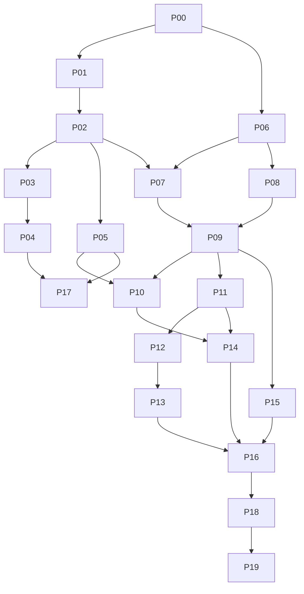

# Plan d'implémentation et dépendances

Statut : **lots prêts à être étudiés/exécutés un à un lors d'une demande d'implémentation**. Aucun lot n'est déclaré réalisé par la rédaction de son prompt. Le périmètre de cette livraison est documentaire.

## 1. Ordre recommandé

Commencer par la charte, la navigation et les publications, pour améliorer immédiatement la lecture. Construire ensuite la boutique et son catalogue relié à PRO.GA, puis le parcours commercial complet. Les appels natifs et la montée en charge disposent de leurs propres recettes.

| Lot / prompt | Résultat attendu | Dépendances | Périmètre propriétaire | Charge relative / incertitude |
|---|---|---|---|---|
| [P00](prompts/P00_CADRAGE.md) | Inventaire frais, décisions et ADR proposés/actés, plan de migration | Étude complète | Documentation / coordination | S / faible |
| [P01](prompts/P01_CHARTE.md) | Nouvelle charte claire/sombre ANTSIA | P00 | Thème ANTSIA + contrat de jetons si nécessaire | M / faible |
| [P02](prompts/P02_NAVIGATION.md) | Coque et destinations téléphone/bureau | P01 | App ANTSIA et surfaces de coque opt-in | M / moyenne |
| [P03](prompts/P03_PUBLICATIONS.md) | Carte photo/galerie/vidéo/texte commune et parité publique | P02 | Publications / médias / SSR | M / moyenne |
| [P04](prompts/P04_SCROLL.md) | Fil immersif et lecture unique, retour conservé | P03 | Fil mobile/bureau, coordination médias | L / élevée |
| [P05](prompts/P05_ICOM.md) | Messages/appels plus lisibles et persistants | P02 | iCom / communication / notifications Web | M / moyenne |
| [P06](prompts/P06_CONTRATS.md) | Modèles commerciaux et contrats testables | P00 | Contrats purs, architecture et fixtures | M / élevée |
| [P07](prompts/P07_BOUTIQUES.md) | Brouillon et page boutique, publication adaptée | P02, P06 | Domaine boutique ANTSIA et projections | L / moyenne |
| [P08](prompts/P08_LIAISON_TRANSPORT.md) | Double preuve de liaison, transport réel en dev | P06 | Passerelles ANTSIA/PRO.GA, propriétaires séparés | L / élevée |
| [P09](prompts/P09_CATALOGUE.md) | Catalogue PRO.GA reflété, retrait/révision fiables | P07, P08 | Catalogue/outbox PRO.GA ; handler/read models ANTSIA | L / élevée |
| [P10](prompts/P10_CONTACT_COMMERCIAL.md) | Question au vendeur et équipe autorisée | P05, P07, P09 | Canal commercial ANTSIA ; CRM PRO.GA si consenti | M / moyenne |
| [P11](prompts/P11_COMMANDE_STOCK.md) | Préparation de commande et réservation canonique | P08, P09 | Commande / stock PRO.GA | L / élevée |
| [P12](prompts/P12_PAIEMENT.md) | Adaptateur fournisseur et rapprochement sandbox | P11 + fournisseur admis | Paiement PRO.GA | L / élevée, dépendance externe |
| [P13](prompts/P13_PARCOURS_ACHAT.md) | Achat et suivi dans ANTSIA — [sources partielles, contrôles différés](rapports/P13_ACHAT_ET_SUIVI.md) | P09–P12 | UI ANTSIA et projections privées | L / moyenne |
| [P14](prompts/P14_SERVICES.md) | Demande, devis accepté et rendez-vous | P09, P10, P11 ; P12/P13 pour acompte | Agenda/devis PRO.GA, surfaces ANTSIA | L / élevée |
| [P15](prompts/P15_EMPLOI.md) | Offre d'emploi publique et candidature privée | P08, P09 | Recrutement PRO.GA et surfaces ANTSIA | M / moyenne |
| [P16](prompts/P16_CONFIANCE.md) | Revue transverse droits, modération et cycle de données | P07–P15 applicables | Responsables de chaque domaine / console | M / moyenne |
| [P17](prompts/P17_MOBILE_NATIF.md) | Client natif ANTSIA et appels sur appareils | P04, P05, contrats mobiles stabilisés | App native ANTSIA, transport appels | XL / élevée, appareils/fournisseurs |
| [P18](prompts/P18_PERFORMANCE_ACCESSIBILITE.md) | Recette accessibilité/performance et budgets | Lots de la version candidate | Ensemble des surfaces modifiées | M–L / mesurée par résultats |
| [P19](prompts/P19_PILOTE.md) | Dossier de pilote, vérification stable et preuves | P16, P18 ; P17 si promesse native | Coordination / qualité / propriétaire | M / dépend des écarts ouverts |

S/M/L/XL expriment une comparaison de taille, pas un délai contractuel. Estimer en jours après P00 et les décisions de fournisseur/appareil ; aucune date de livraison n'est inventée.

## 2. Parallélisme utile et fichiers partagés

Le diagramme représente la branche commerciale complète ; P17 rejoint P18/P19 si la version promet le natif. Une Version A peut se recetter dès P01–P05, avec P18/P19 réduits à son périmètre, sans prétendre livrer les boutiques.

P01–P05 peuvent avancer parallèlement à la définition des contrats P06. Dans P08/P09, séparer les propriétaires PRO.GA et ANTSIA après accord du contrat ; intégrer et vérifier ensemble. Aucun agent ne modifie en parallèle `schema.ts`, `package.json`, le contrat de routes, le contrat de tokens ou les mêmes locales. Le coordinateur réserve ces fichiers. Un seul serveur de dev sauf créneau de recette croisée expressément coordonné et borné.

Le lot Partager/Copier le lien ANTSIA est en cours dans une autre conversation à la date de l'étude. P00/P03 doivent repartir du `PostCard`, du dialogue de partage et des routes alors présents, en conservant leur résultat.

## 3. Prompts : mode d'emploi

Lire [PROMPT_COMMUN.md](prompts/PROMPT_COMMUN.md), puis exécuter **un seul prompt**. Chaque prompt rappelle ses entrées, ses fichiers responsables, ses limites, ses contrôles et ses conditions d'arrêt. Si un lot L/XL dépasse une tranche vérifiable, le découper en sous-lots documentés avant de coder, sans lancer les suivants automatiquement.

La réussite d'un lot implique : code branché au vrai parcours, garde serveur préservée, test pertinent, recette de sa surface, rapport vérifié/non vérifié. Un écran alimenté seulement par des fixtures ne clôt pas un lot d'intégration. Les fixtures sont utiles aux tests, jamais affichées comme des données commerciales réelles.

## 4. Activation progressive et migration

| Version | Capacités activables après recette | Ce qui doit rester honnête |
|---|---|---|
| A | Charte, cartes, navigation, immersion et iCom | Aucun bouton acheter opérationnel si le contrat commerce manque |
| B | Boutique, catalogue public, questions | Prix et disponibilité indicatifs ; contact/devis selon capacité |
| C | Commandes, paiement, services et emploi validés | Activer chaque action seulement pour vendeurs/pays/prestations admis |
| D | Natif et appels en arrière-plan | Matrice des appareils effectivement éprouvés |

Utiliser des capacités fermées au niveau application/réseau et des habilitations serveur. Un drapeau client ne donne pas de droits. Schémas et DTO évoluent de façon additive ; clients plus anciens continuent à lire les anciennes offres sans afficher un faux prix.

Rollback : désactiver l'entrée vers une nouvelle capacité ; conserver lecture et traitement des engagements déjà créés ; revenir à la liste si l'immersion échoue ; revenir à l'ancien mapping visuel si nécessaire. Aucune purge destructive de commandes ou de sessions pour revenir en arrière. Les retraits et remboursements continuent après fermeture des nouvelles ventes.

## 5. Traçabilité demande → plan → prompt → preuve

| Demande / exigence | Document de conception | Prompts | Preuve principale |
|---|---|---|---|
| Instagram, SC01/02 | 03, 04 | P01, P03 | Captures et médias exacts en clair/sombre, téléphone/bureau |
| TikTok, SC03/04 | 04 | P02, P04 | Parcours mixte, lecteur unique, retour/restauration, clavier |
| WhatsApp, SC05/15 | 05 | P05, P17 | Appel réel 2 appareils ; arrière-plan natif séparé |
| Boutique de chacun, SC06/07 | 06 | P07 | Déclaré → brouillon → vitrine ; droits vendeurs distincts |
| PRO.GA, SC08 | 07, 08 | P06, P08, P09 | Événement réellement appliqué, mise à jour et retrait |
| Questions, SC09 | 05, 06 | P10 | Inconnu → demande admise → réponse → blocage |
| Achat/paiement, SC10 | 06, 08 | P11–P13 | Concurrence dernier stock, callback, commande et fonds rapprochés |
| Service, SC11 | 06, 08 | P14 | Devis accepté par client ; créneau unique et annulation |
| Travail, SC12 | 06, 08 | P15 | Publication volontaire et candidature inaccessible aux tiers |
| Confiance, SC13 | 08, 10 | Tous, puis P16 | Tests négatifs réseau/mandat/suspension, cycle des données |
| Qualité et mesure, SC14/16 | 10 | P18, P19 | Rapport stable, protocole utilisateur et mesures consenties |

## 6. Définition de fin du programme étudié

Le programme est terminé lorsque les parcours requis ont été exécutés sur les surfaces et fournisseurs annoncés, avec preuve des états et des limites, et que le propriétaire dispose d'un guide d'exploitation. Ce dossier rend ces travaux spécifiables ; il n'en préjuge ni la réalisation ni la publication.
