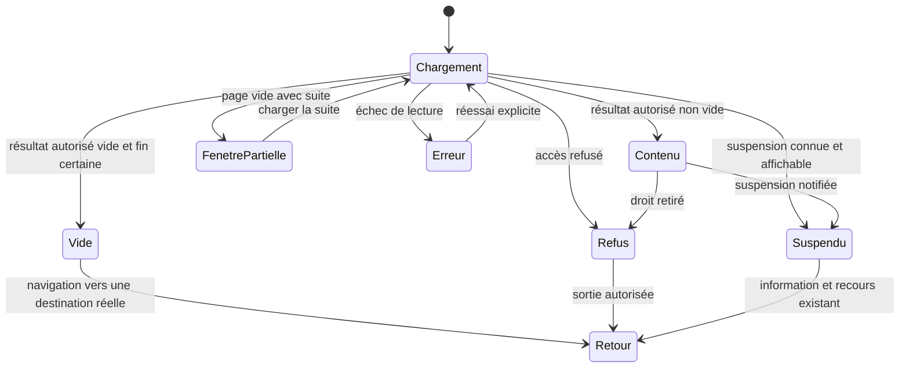
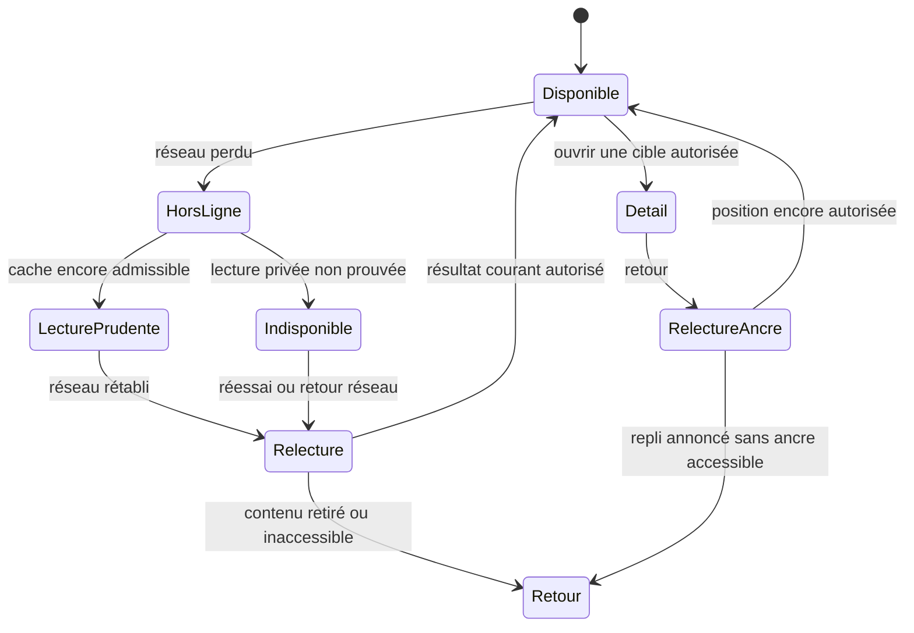

# U08 — Finition, accessibilité et dossier de recette différée

## Préambule

Lire le [plan responsive](../04_PLAN_IMPLEMENTATION.md) et les bilans source U01–U07 réellement disponibles. Ce lot prépare la finition et la recette future : **aucune vérification ou mesure n’est exécutée maintenant**. Pas de test, codegen, typage, lint, build, audit automatisé, navigateur, appareil, serveur, Git d’écriture, installation, appel réel ou environnement. Préserver les sources parallèles et les registres fermés.

## Périmètre et fichiers réutilisés

Les composants modifiés par U01–U07, les jetons de `packages/ui/src/styles/charte.css` et thèmes existants, i18n FR/EN, gardes de fichiers/visibilité, retours de fil et hôte média/appel. Les primitives UI restent intactes ; une correction ciblée s’effectue dans les vrais composants consommateurs réservés, sans page de démonstration.

Pour le natif, réutiliser le registre et le protocole de preuves de `docs/recette/antsia-native-p17d/` ; ne pas transformer une source, un build ou une capture de simulateur en validation physique.

## États à représenter sans placeholders

Les diagrammes suivants sont des contrats d’interface, pas des états backend supplémentaires. La source serveur garde son propre vocabulaire et son autorité.

Ne pas inventer un cache offline privé si la surface n’en possède pas. Une mutation sans réponse reste incertaine : consultation/reprise via son contrat existant, jamais nouvelle clé automatique ou faux succès. Dès qu’une révocation est connue, ou que l’autorité privée n’est plus prouvable, fermer la lecture privée, y compris son ancien contenu en mémoire ; ne pas promettre de détecter instantanément une révocation distante sans réseau.

## Actions de finition source

1. Aligner lexique, icônes nommées, titres, retours et actions sur chaque pose. Garder Mon fil, sourdine/masquage et annulation, signalement, paramètres et sorties de session accessibles.
2. Décrire l’ordre de tabulation, restauration de focus, fermeture Échap, annonces de chargement/erreur, cible active et commandes clavier. Les interactions ne reposent ni sur le survol ni sur la couleur seule.
3. Respecter texte agrandi, zoom, réduction de mouvement et faible hauteur. Le contenu ne doit pas être tronqué par la barre basse, le clavier, un volet ou un lecteur vertical.
4. Consommer les jetons clairs/sombres existants : fond blanc/cartes beige en clair, contraste et états cohérents en sombre. Les dimensions et gestes interactifs gardent une cible tactile utilisable ; les valeurs finales seront observées lors de la recette.
5. Préparer les médias pour limiter le coût : miniatures réellement disponibles, dimensions réservées, chargement différé raisonnable et un seul lecteur actif. Pagination bornée et retour d’ancre ne doivent pas provoquer d’accumulation illimitée.
6. Préserver les gardes de fichiers, purge de session, audiences et capacités P16 ; aucun mode démo n’introduit une donnée ou un droit factice.

## Matrice de recette future — à remplir sans l’exécuter

| Axe | Scénarios à observer ultérieurement | Preuve à consigner |
|---|---|---|
| Poses Web | Téléphone étroit/paysage, 767/768, tablette, 959/960, 1199/1200, grand écran ; aucun débordement | Candidat source, viewport CSS, navigateur/version, route, date et capture locale expurgée |
| Thèmes et accès | Clair/sombre, clavier, lecteur d’écran, texte agrandi, réduction de mouvement, zoom | Interaction exacte, résultat observé et écart, sans promesse WCAG acquise par intention |
| Navigation | Transition Créer puis Clips prêt, Boutiques, hub/mur, Mon fil et retour au post | Parcours et destination réels, ancre conservée ou repli annoncé |
| Données et droits | Chargement, vide certain, page filtrée avec suite, refus, suspension, retrait, changement de personne/réseau | Résultat courant autorisé ; aucun contenu privé dans la preuve |
| Offline et timeout | Perte réseau, ancienne lecture, action inconnue, reconnexion/rechargement | Absence de faux succès, consultation de statut et même intention selon le contrat |
| Médias | Photo/galerie/vidéo, retenue, légende longue, son coupé, arrière-plan, priorité appel | Lecteur actif, reprise et libération observées ; aucune audibilité déduite d’un token |
| Messages et commerce | Personnel/groupe/commercial distincts, invitation, refus, limites de recherche, CTA fermé | Acteurs consentants, capacité courante et absence de nouvel engagement non autorisé |
| Performance | Coût de grille/fil, médias chargés, pagination, changement de pose, mémoire | Méthode, candidat, appareil/réseau et mesures réelles ; aucun score inventé |
| Natif | Écrans réellement portés vs renvois Web ; iOS/Android physiques et appels selon P17d | Source/build/OS/appareil/réseau et preuve locale du registre ; NOT RUN tant qu’absente |

Toute référence de média utilisateur reste locale dans le document 01 ; les livrables n’embarquent ni compte, message, token, identité privée ni copie non nécessaire des vidéos. Les preuves de recette futures doivent être expurgées de la même façon.

## Critères d’acceptation et exclusions

- Chaque surface possède une sortie réelle pour chargement, vide, erreur, refus/suspension et hors ligne ; aucune tuile d’exemple n’est livrée comme résultat.
- Les écarts restants sont attribués à un composant/contrat et à un responsable ; une capacité absente n’est pas déclarée « finie » par un changement cosmétique.
- Le bilan distingue plan, source raccordée, scénarios écrits, exécution automatisée, recette Web, recette physique et publication. Toutes les cases non observées restent **NON EXÉCUTÉ / NOT RUN**.
- Pas de publication, activation P16, réécriture d’auth/session, promesse E2E, métrique ou score de performance inventé. Pas d’énorme Centre de comptes, publicité, IA, carte géolocalisée ou abonnement ajouté.

Livrable attendu : corrections source ciblées si autorisées, inventaire des surfaces, matrice prête pour une recette ultérieure et limites précises. Le présent prompt n’autorise aucune commande de recette ni validation d’un scénario par déduction.
