# ANTSIA — Sept univers pour le Gabon

**Étude stratégique : les besoins de la population, une page pour chaque activité, la vie publique dans le réseau national et iAsted pour orienter acheteurs et vendeurs.**

21 octobre 2026 · version 1.1 · **décisions D01 à D08 validées par le propriétaire le 21/10/2026** ([ADR-0035](../../adr/0035-sept-univers-et-vie-publique.md)) ; D09 à D12 proposées · dossier visuel : [ETUDE_SEPT_UNIVERS_ANTSIA.pdf](ETUDE_SEPT_UNIVERS_ANTSIA.pdf) · conformité : [SU01](SU01_CONFORMITE_ORDONNANCE_0011.md)

> **Portée.** Document d'étude. Il ne modifie aucun code, n'active aucune capacité, ne publie rien et ne remplace aucune recette. Il prolonge, sans les réécrire, le plan marketplace accepté le 21 octobre ([ADR-0034](../../adr/0034-marketplace-et-espaces-specialises.md), décisions A01 à A10, lots MP00 à MP14 en cours) et les études du [18 octobre](../2026-10-18-social-commerce/README.md) et du [20 octobre](../2026-10-20-experience-sociale-responsive/README.md). Le dossier `2026-10-21-marketplace-specialites` reste réservé à la session marketplace ; cette étude n'y écrit rien.

> **Règle de véracité.** L'existant est décrit tel que le code et les ADR le montrent ; « en source » ne veut pas dire « vérifié en production ». Toute proposition est nommée comme telle. Chaque chiffre externe est daté et sourcé ; aucun chiffre d'usage d'ANTSIA n'est avancé, faute de mesure.

> **Fabrication.** Ce fichier, le PDF et les schémas sont produits par `source/build.py` à partir des mêmes données (`source/donnees*.py`) ; modifier les données puis relancer `python3 source/build.py all` garde les deux documents d'accord.

---

## 0. La décision en une page

**Faut-il partir dans cette stratégie ? Oui**, en ouvrant d'abord les univers qui ne demandent ni paiement ni preuve de majorité, et en faisant d'iAsted un service d'orientation gratuit pour le membre.

1. **Trois piliers.** ANTSIA réunit le divertissement qui fait revenir chaque jour, le business qui fait vivre et la vie publique qui informe et rassure.
2. **Sept univers business**, choisis d'après ce qui circule déjà sur les réseaux au Gabon : boutiques ; immobilier et foncier ; emploi et talents ; alimentation et restauration ; services et artisans ; auto et mobilité ; cérémonies et sorties.
3. **Un business = une page.** La page porte l'identité ; l'activité y active les espaces métier dont elle a besoin ; une entité responsable se tient derrière. Quand l'activité grandit, PRO.GA la gère et ANTSIA devient un canal de vente parmi d'autres.
4. **Le particulier n'a pas besoin de page** pour vendre son frigo ou louer son studio : il publie une annonce ; s'il publie souvent, ANTSIA lui propose de « passer pro ».
5. **La vie publique a ses places réservées** : pages Officielles reflétées depuis administration.ga, agents publics volontaires, médias labellisés, annonceurs étiquetés — jamais confondus.
6. **iAsted devient l'assistant du membre** : il comprend un besoin, trouve les offres publiées, prépare le contact, la visite ou la commande ; la personne confirme toujours.
7. **On ouvre d'abord ce qui n'exige pas de paiement en ligne**, et l'on se conforme dès la conception à l'ordonnance 0011/PR/2026. Billetterie et rencontres attendent leurs conditions externes.

> **Le contexte de 2026.** Les réseaux sociaux sont suspendus par la HAC depuis le 17 février 2026 (statut au 21 octobre incertain) et l'ordonnance 0011/PR/2026 encadre désormais les plateformes, ANTSIA compris. C'est une fenêtre, et un risque : ANTSIA doit gagner par l'utilité et la confiance, jamais comme réseau de remplacement d'une censure.

**Ce que l'étude garde, ce qu'elle ajoute.** Elle garde le plan marketplace validé le 21 octobre (ADR-0034, A01 à A10, lots MP00 à MP14 en cours) : une page par activité, PRO.GA maître du commerce, préparer, publier et encaisser séparés. Elle ajoute quatre univers (immobilier et foncier, alimentation et restauration, auto et mobilité, cérémonies et sorties), l'annonce de particulier, les espaces de la vie publique, la chaîne de confiance d'État, la conformité à l'ordonnance 0011 et l'entrée d'iAsted dans ANTSIA. Les rencontres, déjà conçues (MP10–MP11), sont rangées dans le pilier Divertissement et restent fermées.

**La formule : « Une page pour exister, des espaces pour vendre, PRO.GA pour gérer. »**

Les douze décisions sont détaillées au [§ 18](#18-les-décisions-à-prendre) ; D01 à D08 sont validées et consignées dans l'[ADR-0035](../../adr/0035-sept-univers-et-vie-publique.md).

---

## 1. Méthode et sources

**Ce qui a été lu (sources locales).**
- Le code d'`apps/antsia_ga` (routes, navigation, i18n), les modules du moteur (`convex/modules/*`), les ADR 0001 à 0034, le cahier des charges ANTSIA, les études du 18, du 20 et du 21 octobre et leur fichier d'exécution.
- PRO.GA : modules (`catalog`, `agenda`, `quotes`, `orders`, `recruiting`, `payments`, `commercialAgent`, `iasted`, `needs`…), documents 03, 05, 18 à 30 et recherches sur le Gabon (`docs/recherches_gabon`).
- Le socle administration.ga : doctrine de communication publique, producteur et outbox de fédération (PA9D), iAsted du socle.
- L'inventaire d'iAsted dans tout le programme (socle, PRO.GA, DIASPORALE, plan iAsted 2.0).

**Ce qui a été cherché (sources externes, 21 octobre 2026).** Données numériques et économiques sur le Gabon ; ce qui se vend et s'échange sur les réseaux sociaux gabonais ; plateformes déjà présentes ; cadre juridique (réseaux sociaux, données personnelles, communication, foncier, emploi) ; benchmark de plateformes étrangères (identité business, places de marché verticales, États et médias sur les réseaux, agents IA d'achat, réseaux nationaux). Liste au [§ 19](#19-sources).

**Comment on a choisi.** Douze univers candidats ont été notés de 1 à 5 sur cinq critères d'opportunité et un critère de réemploi (§ 3). Les notes sont des jugements fondés sur les sources : elles ordonnent, elles ne prédisent pas. Elles doivent être revues après six mois de mesures réelles.

**Limites.** Aucune enquête de terrain. Aucun volume d'annonces n'est publié pour le Gabon : les flux sont décrits qualitativement. Le quota de recherche web de la session a été atteint en fin de travail ; restent non vérifiés : le statut de la suspension au 21 octobre, les audiences YouTube et TikTok, les règles de publicité politique en ligne, le coût des cérémonies, la billetterie et les pièces détachées, l'adressage, le prix du foncier au mètre carré, et la plateforme publique PROXIGAB (lancée le 2 octobre 2026, page inaccessible).

---

## 2. Le constat : ce que les Gabonais font déjà en ligne

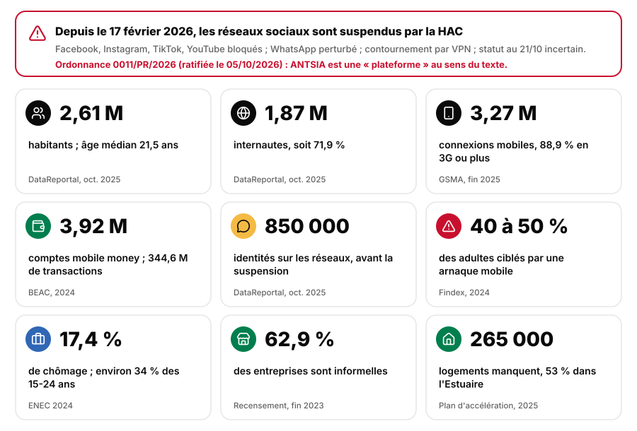

> **17 février 2026** : la HAC suspend « jusqu'à nouvel ordre » les réseaux sociaux. OONI et l'Internet Society mesurent le blocage de Facebook, Instagram, TikTok et YouTube ; WhatsApp est perturbé de façon inégale ; X n'est pas touché. Une levée « progressive » annoncée le 1er avril reste sans effet ; le maintien est confirmé jusqu'au 23 août (Gabon Media Time). **Au 21 octobre, aucune levée n'est annoncée : le statut est incertain** et doit être vérifié avant tout lancement.
>
> **Ordonnance n° 0011/PR/2026** du 26 février (JO n° 110), ratifiée le 5 octobre : elle vise toute plateforme de « mise en relation […] en vue de la vente d'un bien, de la fourniture d'un service » — donc ANTSIA. Identification des utilisateurs (noms, domicile, téléphone, RCCM si assujetti, NIP le cas échéant) ; majorité numérique à 16 ans avec vérification d'âge ; signalement de cyberharcèlement d'un mineur : accusé de réception en 24 h, décision en 72 h ; retrait des hypertrucages en 24 h ; registre public de la HAC ; référé numérique, suspension d'une plateforme plafonnée à 72 h ; amendes de 5 à 50 millions FCFA ; 12 mois pour la vérification d'âge et le marquage des contenus d'IA.

### 2.1 Chiffres clés

| Indicateur | Valeur | Date | Source |
|---|---|---|---|
| Population | 2,61 millions ; 91,6 % urbaine ; âge médian 21,5 ans | oct. 2025 | DataReportal, Digital 2026 |
| Internautes | 1,87 million (71,9 %) | oct. 2025 | DataReportal (Kepios) |
| Identités sur les réseaux sociaux | 850 000 (32,6 % ; 55,8 % des adultes), avant la suspension | oct. 2025 | DataReportal |
| Connexions mobiles | 3,27 millions (126 %), dont 88,9 % en 3G, 4G ou 5G | fin 2025 | GSMA Intelligence via DataReportal |
| Abonnements Internet | 2,31 millions, dont 94,65 % mobiles | T1 2025 | ARCEP via Gabonreview |
| Smartphone | 59,9 % des adultes | 2025 | Global Findex via Gabon Media Time |
| Mobile money | 3 921 190 comptes ; 344,6 millions de transactions ; 3 762,7 milliards FCFA | 2024 | BEAC, rapport 2024 (avril 2026) |
| Arnaques par appel ou SMS | 40 à 50 % des adultes ciblés ; 1 ciblé sur 10 a payé | 2024 | Global Findex via Gabon Media Time |
| Chômage | 17,4 % ; environ 34 % chez les 15-24 ans | 2024 | ENEC 2024 via la presse |
| Emploi | privé informel 46,8 % ; privé formel 25,4 % ; administration 19,6 % | 2024 | ENEC 2024 via Gabon Media Time |
| Entreprises informelles | 62,9 % des entreprises identifiées | fin 2023 | Recensement général des entreprises via GMT |
| Déficit de logements | environ 265 000, dont 53 % dans l'Estuaire | 2025 | Plan d'accélération via Le360 |
| Pauvreté | 34,6 % sous le seuil ; croissance 2,9 % | 2024 | Banque mondiale (juin 2025) |

Repères complémentaires : environ 132 transactions de mobile money par habitant et par an, pour une valeur moyenne d'environ 10 900 FCFA (calcul de l'étude, BEAC et DataReportal) ; dans la CEMAC, le paiement marchand moyen est de 2 049 FCFA et l'USSD reste le canal dominant (BEAC 2024) ; le couloir Cameroun–Gabon représente 56 % des transferts intra-CEMAC en nombre. Les audiences des réseaux sociaux datent d'octobre 2025, **avant** la suspension : l'usage actuel passe par VPN et n'est pas mesuré.

### 2.2 Ce qui circule, et ce qui fait mal

| Ce qui s'échange | Comment aujourd'hui | Douleur principale |
|---|---|---|
| Produits : mode, beauté, téléphonie, importés | catalogues WhatsApp, groupes Facebook de revente, ventes TikTok, CoinAfrique | achat payé d'avance livré non conforme ; comptes piratés ; aucun recours |
| Location de logements | groupes Facebook, démarcheurs, quelques portails | frais de visite (5 000 FCFA), commission de 50 à 100 % d'un loyer, caution d'un à trois mois plus l'avance, photos trompeuses |
| Terrains et maisons à vendre | annonces, bouche-à-oreille | doubles ventes (Akanda, Owendo, Ntoum), cadastre incomplet ; régularisation de masse lancée le 16/02/2026 |
| Emploi | groupes WhatsApp et Facebook, L'Union, sites d'employeurs, PassEmploi241 | faux recrutements payants au nom de grandes entreprises et d'un ministère |
| Repas et produits frais | publicités sur les réseaux, catalogues WhatsApp, applications de livraison | dépendance aux réseaux coupés ; un restaurateur y trouvait environ 40 % de ses clients |
| Services et artisans | TikTok, bouche-à-oreille, numéros partagés | prix flous, qualité incertaine, aucune trace de l'accord |
| Véhicules | TikTok, Facebook, CoinAfrique ; occasions importées (10 ans au plus depuis 12/2023) | ventes effondrées depuis la coupure ; documents difficiles à vérifier |
| Cérémonies | avis et programmes (L'Union, Necro Gabon), location de tentes et de chaises | aucune billetterie locale identifiée ; aucun coût chiffré |
| Rencontres | réseaux généralistes, applications étrangères | arnaques sentimentales, sextorsion, hypertrucages ; aucune plateforme locale |

Quelques preuves datées : une vendeuse de poisson et de vêtements « nourrit sa famille » grâce aux réseaux (RFI, 19/02/2026) ; un restaurateur de Libreville y trouvait environ 40 % de ses clients (BBC, février 2026) ; une agence d'import de véhicules a vu ses ventes s'effondrer avec la coupure (Le360, 25/03/2026) ; des communiqués de GOC, Comilog, Sogara, Ceca-Gadis et d'autres mettent en garde contre de faux recrutements payants ; dans le Grand Libreville, la régularisation foncière de masse délivre depuis le 16/02/2026 un titre à 600 000 FCFA pour une parcelle de 0 à 2 000 m², avec 16 811 dossiers traités au 23/05/2026 (Gabonreview).

### 2.3 Les plateformes déjà présentes

| Secteur | Plateformes | Ce qu'il faut retenir |
|---|---|---|
| Petites annonces | **CoinAfrique Gabon** (groupe Autochek) | actif en octobre 2026 sur toutes les catégories : le concurrent direct le plus sérieux |
| Immobilier | ImmoDem, Gabaho, Cabalou (meublés), Le Visiteur Booking, Expat.com | aucun portail dominant |
| Emploi | PassEmploi241 (PNPE), GoAfricaOnline, petites annonces de L'Union, LinkedIn | intermédiation publique jugée peu fiable par la Présidence le 29/09/2026 |
| Mobilité et livraison | Gozem, Yango (pré-lancement), Taxi Gab+, Ndzéla, CNT ; Yoboresto, FastBox ; Express Courrier | terrain occupé : partenariats plutôt que service maison |
| Commerce en ligne | **Jumia absent** du Gabon ; quelques boutiques locales | pas de leader du e-commerce |
| Autres | Le Pratique du Gabon (annuaire), Necro Gabon (avis de décès), PROXIGAB (plateforme publique pour entrepreneurs, à vérifier) | à articuler, sans copie de données |
| Rencontres | aucune plateforme locale identifiée | arnaques sentimentales et sextorsion sur les réseaux généralistes |
| Paiement | Airtel Money, Moov Money, applications bancaires | 3,92 millions de comptes de mobile money (2024), aucun séquestre identifié |

### 2.4 Le cadre juridique qui s'applique à ANTSIA

| Texte | Ce qu'il impose | Conséquence pour ANTSIA |
|---|---|---|
| **Ordonnance n° 0011/PR/2026** du 26/02/2026 (JO n° 110), ratifiée le 05/10/2026 | vise toute plateforme de « mise en relation […] en vue de la vente d'un bien, de la fourniture d'un service » ; identification des utilisateurs (art. 4) ; responsabilité des administrateurs de pages et de groupes (art. 11) ; majorité numérique à 16 ans et vérification d'âge (art. 16-24) ; cyberharcèlement d'un mineur : 24 h et 72 h (art. 24) ; retrait des hypertrucages en 24 h (art. 33) ; registre de la HAC (art. 37) ; référé numérique et suspension plafonnée à 72 h (art. 39-44) ; amendes de 5 à 50 millions FCFA ; 12 mois pour la vérification d'âge et le marquage de l'IA (art. 53) | ANTSIA est visé deux fois (réseau social et plateforme de vente) : conformité à concevoir maintenant (lot SU01) |
| **Ordonnances n° 0012 et 0013/PR/2026** | communication numérique dans le Code de la communication ; statut de « professionnel de la communication numérique » et d'« assimilé » ; la HAC régule les plateformes et la publicité | vendeurs-créateurs actifs sur ANTSIA possiblement « assimilés » ; conditions des transactions à publier ; sponsorisé sous le regard de la HAC |
| **Loi n° 025/2023** (données personnelles, APDPVP) | consentement démontrable et explicite (l'acceptation des CGU ne vaut pas consentement, art. 72) ; enfant = moins de 18 ans (art. 188) ; données d'enfants : accord préalable des parents (art. 74, 190) et autorisation de l'APDPVP (art. 81) ; profilage des enfants interdit (art. 193) ; autorisation préalable pour traiter le NIP ou la biométrie (art. 81) ; suspension du traitement et amende de 1 à 100 millions FCFA, jusqu'à 300 millions en récidive (art. 204) | dossier APDPVP pour annonces, besoins et iAsted ; pas de NIP sans autorisation ; régime des 16-17 ans à arbitrer (voir SU01) |
| **Loi n° 025/2021** (transactions électroniques), **loi n° 027/2023** (cybersécurité) | commerce électronique, écrit électronique ; sécurité | conditions de vente, preuves et sécurité des parcours |
| **Loi n° 006/2017** (agents immobiliers) | autorisation d'exercer, carte professionnelle ; application jugée peu avancée | label « Agent autorisé » possible par attestation |
| Foncier : régularisation de masse (2026), guichet unique en projet | titres délivrés par l'administration ; cadastre incomplet | « Document contrôlé » seulement par convention avec le service foncier |
| Identité : NIP (2024) | délivrance suspendue depuis plusieurs mois, relance discutée le 27/09/2026 | IDN reste la porte d'identité ; le NIP ne peut pas fonder seul la vérification |
| Paiement et tontines | relèvent des établissements agréés (BEAC, COBAC) | aucun fonds porté par ANTSIA ; tontines écartées |

### 2.5 Ce que le constat implique

- **Le besoin est réel et quotidien.** Vendre, louer, recruter, nourrir passent déjà par les réseaux ; la coupure a montré la dépendance des petits commerçants.
- **La douleur commune est la confiance.** Arnaques à la location, à l'emploi, aux achats payés d'avance, sextorsion : la vérification par l'autorité compétente est le premier service à rendre.
- **Le mobile money est partout, la protection nulle part.** 3,9 millions de comptes, mais aucun séquestre : la mise en relation peut ouvrir sans paiement en ligne ; le paiement protégé viendra avec un établissement agréé.
- **Le contexte de 2026 est une fenêtre et un risque.** ANTSIA doit gagner par l'utilité et la confiance, jamais comme réseau de remplacement d'une censure.
- **ANTSIA est lui-même visé par l'ordonnance 0011.** Identification proportionnée, délais de traitement, âge, marquage de l'IA et registre de la HAC se conçoivent dès maintenant.
- **62,9 % des entreprises sont informelles.** L'annonce de particulier puis le passage vers PRO.GA forment une porte de formalisation.

---

## 3. Choisir les sept univers

Douze candidats sont notés de 1 à 5. **V** : volume d'activité observé sur les réseaux ; **F** : fréquence du besoin ; **D** : intensité de la douleur ; **R** : potentiel de revenus ; **Risque** : risque réglementaire (5 = élevé). Note d'opportunité = V + F + D + R + (6 − Risque), sur 25. La colonne **A** mesure ce que le code d'ANTSIA et de PRO.GA permet déjà de réutiliser : elle ordonne les vagues, elle ne choisit pas.

| Candidat | V | F | D | R | Risque | A | /25 | Verdict |
|---|---|---|---|---|---|---|---|---|
| **Boutiques et marketplace** | 5 | 5 | 4 | 4 | 2 | 5 | **22** | Retenu · V1 |
| **Immobilier : location** | 4 | 4 | 5 | 4 | 3 | 2 | **20** | Retenu · V2 |
| **Emploi et stages** | 4 | 4 | 5 | 3 | 2 | 4 | **20** | Retenu · V1 |
| **Alimentation et restauration** | 4 | 5 | 3 | 3 | 2 | 3 | **19** | Retenu · V2 |
| **Services de proximité** | 3 | 4 | 3 | 3 | 2 | 5 | **17** | Retenu · V1 |
| **Cérémonies, événements et sorties** | 3 | 3 | 3 | 4 | 2 | 3 | **17** | Retenu · V2–V5 |
| **Mobilité et livraison** | 3 | 5 | 4 | 3 | 4 | 1 | **17** | Capacité commune |
| **Automobile** | 4 | 2 | 3 | 4 | 3 | 2 | **16** | Retenu · V2 |
| **Terrains et vente immobilière** | 3 | 2 | 5 | 4 | 4 | 2 | **16** | Dans Immobilier |
| **Tontines et cagnottes** | 3 | 4 | 4 | 3 | 5 | 1 | **15** | Écarté · agrément |
| **Administration et démarches** | 3 | 3 | 4 | 2 | 3 | 4 | **15** | Pilier Vie publique |
| **Rencontres** | 2 | 3 | 4 | 3 | 5 | 3 | **13** | Divertissement · fermé |

*Notes établies à partir des sources citées (presse gabonaise, BEAC, ENEC 2024, Journal officiel) ; elles restent qualitatives, aucune donnée de plateforme n'étant publiée pour le Gabon. Le réemploi A est établi par la lecture du code. Les notes sont à revoir après six mois de mesures réelles.*

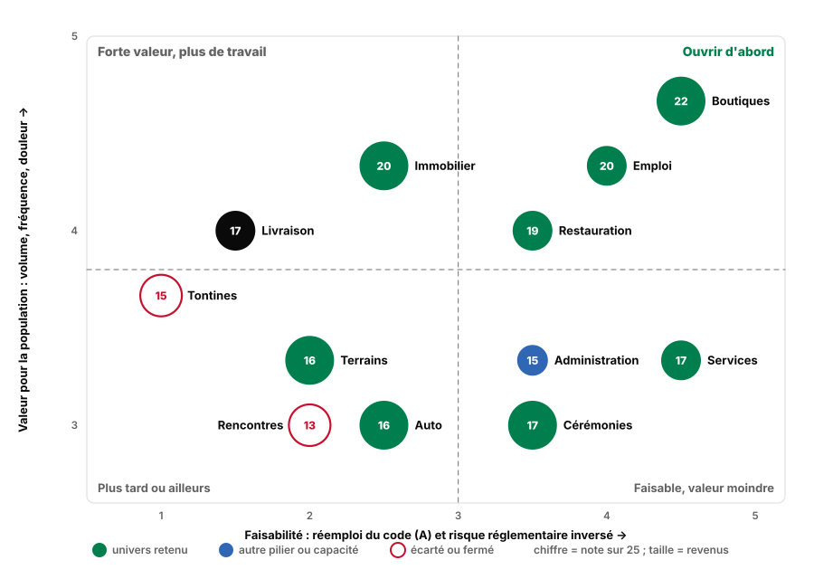

**Pourquoi ces sept, et pas les autres.**
- **Retenus** : les quatre premiers ; à égalité (17), les services et les cérémonies plutôt que la mobilité, confiée à des partenaires ; l'automobile (16), forte en revenus et demandée (location de voitures) ; les terrains rejoignent l'immobilier, avec vérification du titre.
- **Livraison et VTC** : une capacité commune assurée par des partenaires (Gozem, Yango, Taxi Gab+, coursiers), pas un univers ni un VTC maison.
- **Administration** : un pilier, la vie publique, pas un univers marchand.
- **Rencontres** : rangées dans le pilier Divertissement et fermées jusqu'à une preuve de majorité ; risque réglementaire maximal (ordonnance 0011, loi 025/2023, sextorsion), aucun revenu puisque le citoyen ne paie pas. Le choix du propriétaire (rencontres professionnelles et personnelles séparées, MP10–MP11) est conservé.
- **Tontines et cagnottes** : écartées tant qu'un établissement agréé ne porte pas les fonds ; les cagnottes de cérémonies pourront venir avec lui.

**Lecture de la matrice.** Boutiques, emploi et services s'ouvrent d'abord : le code existe en source (MP04–MP06, P15, MP09). La restauration est un gabarit sur la boutique existante. Immobilier, auto et terrains demandent plus de travail : nouveaux types d'offre, location de ressources, vérification foncière et des cartes grises par conventions.

---

## 4. ANTSIA en trois piliers

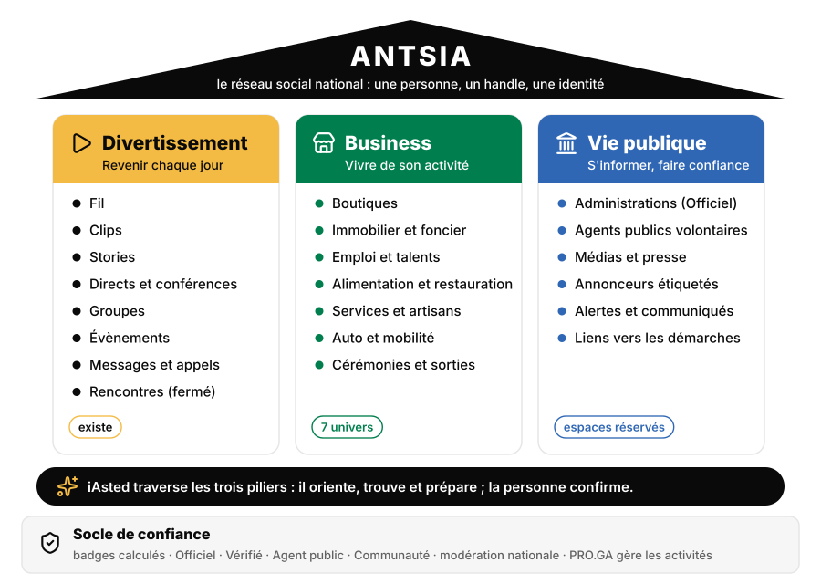

Un réseau social national ne réussit pas par une seule fonction : il lui faut **une raison de revenir** (le divertissement), **une raison d'y gagner sa vie** (le business) et **une raison d'y faire confiance** (la vie publique).

| Pilier | Rôle | Ce qui existe déjà | Ce que l'étude ajoute |
|---|---|---|---|
| **Divertissement** (jaune) | faire revenir chaque jour | Fil, Clips, Stories, directs et conférences, groupes, évènements, Messages et appels ; rencontres (fermées) | vente en direct (vague 5), créateurs invités au pilote |
| **Business** (vert) | vivre de son activité | Marketplace (Produits, Boutiques, Services), boutiques et prestataires, emplois, réseau pro (sources MP01 à MP09, P15) | sept univers, annonce de particulier, immobilier et foncier, restauration, auto et mobilité, cérémonies et sorties |
| **Vie publique** (bleu) | s'informer, faire confiance | pages Officielles fédérées, agents publics volontaires, presse et sites médias (sources PA9, MP12–MP13) | alertes officielles, label Presse, sponsorisé étiqueté, règle politique, liens vers demarche.ga et travail.ga |

**iAsted** traverse les trois piliers. **Le socle de confiance** les porte tous : badges calculés côté serveur (Officiel · Vérifié · Agent public · Communauté), modération nationale, données au Gabon, consentements horodatés. Les trois couleurs du drapeau servent de code dans tout le dossier ; ce sont celles du thème Gaboma (`packages/ui/src/themes/antsia.css` : `#007E4D`, `#F4BB44`, `#2F67B5`).

### La roue de croissance

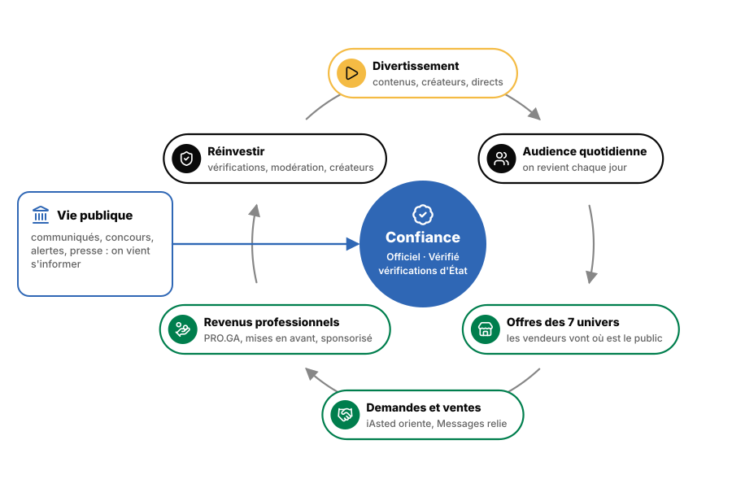

Le divertissement amène le public ; le public attire les vendeurs ; les demandes et les ventes produisent des revenus professionnels ; ces revenus financent les vérifications, la modération et les créateurs ; la confiance qui en résulte fait revenir le public. La vie publique alimente directement la confiance : on vient lire un communiqué, consulter un concours, suivre une alerte.

**Démarrer la roue** : une zone pilote (Grand Libreville : Libreville, Akanda, Owendo, Ntoum) ; des contenus réels dès l'ouverture (reflets des administrations, membres de DIASPORALE déjà inclus, médias partenaires, créateurs invités) ; des vendeurs pilotes consentants dans chaque univers ouvert ; un usage fondateur du quotidien : trouver un logement sans démarcheur, un emploi sans arnaque.

**Ce qui arrête la roue** : une vague d'arnaques ; un univers ouvert mais vide (aucune tuile n'est montrée tant que l'univers n'a pas d'offres réelles, règle « aucun alias vide » de l'ADR-0034) ; la propagande ou la publicité envahissante ; la lenteur sur réseau mobile (cible indicative du cahier : moins de 1,5 s au 95e centile en 3G).

---

## 5. Les sept univers, fiche par fiche

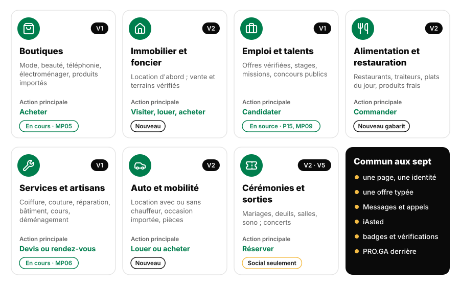

Une action principale par univers : acheter, visiter, candidater, commander, demander un devis, louer, réserver — jamais un faux bouton d'achat pour une offre sur devis. Sont communs aux sept : une page et une entité responsable, une offre typée, le contact dans Messages, iAsted, les badges et vérifications, PRO.GA derrière, la livraison par partenaires et le paiement protégé quand un prestataire agréé sera contracté.

### 5.1 Boutiques — En cours · MP05 · vague V1

Le premier besoin. Une vendeuse de poisson et de vêtements vit des réseaux (RFI, février 2026) ; un groupe Facebook de revente compte environ 10 200 membres. ANTSIA donne une vitrine lisible, un panier par boutique et un suivi d'achat.

| Rubrique | Contenu |
|---|---|
| On y vient pour | acheter vêtements, beauté, téléphonie, électroménager, produits importés |
| Ce qui existe | marketplace, boutiques, variantes, paniers par vendeur (MP04–MP05, en source) |
| Ce qu'il faut construire | vente en direct, avis vérifiés, paiement protégé (après contrat) |
| Aujourd'hui | catalogues WhatsApp, groupes Facebook, ventes TikTok ; prix « en privé », paiement d'avance, coursier |
| Douleur | produit payé d'avance livré non conforme ; comptes piratés ; aucun recours |
| ANTSIA apporte | prix visible, variantes, panier par vendeur, suivi d'achat, contact dans Messages |
| Confiance | Vérifié (IDN), Entreprise vérifiée (PRO.GA : RCCM, NIF) ; catégories interdites refusées |
| PRO.GA | pack Commerce de détail : catalogue, variantes, stock, caisse, livraison |
| iAsted | « une robe en wax taille M sous 25 000 F à Libreville » ; l'agent du vendeur répond sur les tailles et le stock |
| Revenus | commission sur ventes encaissées (P12), mises en avant, abonnement PRO.GA |
| Risques | contrefaçon, produits interdits ; parade : modération, signalement, paiement tracé |

### 5.2 Immobilier et foncier — Nouveau · vague V2

La douleur la plus forte. Démarcheurs non autorisés, frais de visite de 5 000 FCFA, commission de 50 à 100 % d'un loyer, caution d'un à trois mois plus l'avance, photos trompeuses ; doubles ventes de terrains. Déficit d'environ 265 000 logements.

| Rubrique | Contenu |
|---|---|
| On y vient pour | louer un logement, acheter un terrain ou une maison, louer un local |
| Ce qui existe | aucun module dédié ; agenda et devis réutilisables |
| Ce qu'il faut construire | type d'offre bien, espace Biens, visites, gabarit agence, vérification foncière |
| Aujourd'hui | groupes Facebook, démarcheurs, portails peu fréquentés (ImmoDem, Gabaho, Cabalou), CoinAfrique |
| Douleur | frais avant visite, biens déjà loués, trois mois de recherche, titres douteux |
| ANTSIA apporte | annonces structurées (quartier, loyer, caution, avance), photos datées, visites, alertes |
| Confiance | Agent autorisé (loi 006/2017), Document contrôlé (convention foncière), Vérifié exigé pour vendre un terrain |
| PRO.GA | verticale agence immobilière à créer : biens, mandats, visites, baux, quittances |
| iAsted | « une maison 3 chambres à Akanda sous 350 000 F » ; alerte ; aucun contact sans confirmation |
| Revenus | abonnement des agences, mises en avant, vérification à la demande du vendeur (à décider) |
| Risques | arnaques, frais illégaux ; parade : aucun paiement hors parcours tracé, attestations |

### 5.3 Emploi et talents — En source · P15, MP09 · vague V1

Chômage de 17,4 %, environ 34 % chez les 15-24 ans (ENEC 2024). Faux recrutements payants à répétition au nom de grandes entreprises et d'un ministère ; l'intermédiation publique a été jugée peu fiable par la Présidence le 29/09/2026.

| Rubrique | Contenu |
|---|---|
| On y vient pour | trouver un emploi, un stage, une mission ; recruter ; suivre les concours publics |
| Ce qui existe | offres et candidatures privées (P15), réseau pro (MP09), en source |
| Ce qu'il faut construire | univers réuni, concours publics Officiels, lien travail.ga, alertes |
| Aujourd'hui | groupes WhatsApp et Facebook, L'Union, sites d'employeurs, PassEmploi241, GoAfricaOnline |
| Douleur | frais de dossier exigés par de faux recruteurs ; CV envoyés sans suite |
| ANTSIA apporte | offres de pages employeurs vérifiées, candidature privée, suivi, concours Officiels |
| Confiance | employeur = page + mandat (PRO.GA) ; jamais de frais pour candidater |
| PRO.GA | recrutement : postes, candidatures, entretiens ; contrat PRO-COMMERCE-JOBS-V1 |
| iAsted | « un stage en comptabilité à Port-Gentil » ; aide à rédiger son profil |
| Revenus | offres mises en avant et abonnement recrutement, payés par l'employeur |
| Risques | fausses offres, exploitation ; parade : employeurs vérifiés, interdiction des frais |

### 5.4 Alimentation et restauration — Nouveau gabarit · vague V2

Le besoin le plus fréquent. Un restaurateur de Libreville estimait qu'environ 40 % de ses clients venaient de ses publicités sur les réseaux (BBC) ; les commandes passent par des catalogues WhatsApp ; des applications de livraison existent (Yoboresto, FastBox).

| Rubrique | Contenu |
|---|---|
| On y vient pour | commander un plat, trouver un traiteur, acheter des produits frais |
| Ce qui existe | boutique et catalogue réutilisables ; aucun gabarit restauration |
| Ce qu'il faut construire | gabarit restauration (menu, horaires, plat du jour) ; commande à retirer ou livrée, payée à la remise |
| Aujourd'hui | statuts « plat du jour », catalogues WhatsApp, applications de livraison |
| Douleur | dépendance aux réseaux coupés, commandes perdues, livraison informelle |
| ANTSIA apporte | menu à jour, plat du jour en Story, commande à retirer ou livrée, avis |
| Confiance | Vérifié, Entreprise vérifiée ; agréments sanitaires à intégrer plus tard |
| PRO.GA | verticales restauration et épicerie (vrac, lots, dates limites), caisse |
| iAsted | « un traiteur pour 80 personnes samedi à Owendo » |
| Revenus | mises en avant, abonnement PRO.GA ; commission une fois le paiement en ligne ouvert |
| Risques | intoxication, retards ; parade : signalement, avis liés à une commande |

### 5.5 Services et artisans — En cours · MP06 · vague V1

Très répandu, peu mesuré. Un couturier de Mont-Bouët trouve ses clients sur TikTok ; une PME d'infographie vit des réseaux. La nomenclature de l'artisanat (décret 0242/2022) compte 12 secteurs, 43 corps de métiers et 369 métiers.

| Rubrique | Contenu |
|---|---|
| On y vient pour | trouver un artisan, une coiffeuse, une couturière, un répétiteur, un déménageur |
| Ce qui existe | espace prestataire, devis, forfaits, rendez-vous (MP06, en source) |
| Ce qu'il faut construire | avis vérifiés, zones d'intervention, paiement des prestations (après contrat) |
| Aujourd'hui | TikTok, bouche-à-oreille, numéros partagés, CoinAfrique « Services » |
| Douleur | prix flous, qualité incertaine, retards, aucune trace de l'accord |
| ANTSIA apporte | portfolio, forfaits, devis versionnés, rendez-vous, avis après prestation |
| Confiance | Vérifié ; mention « déclaratif » pour l'artisan non déclaré ; métier de la nomenclature |
| PRO.GA | packs artisan et indépendant, déclarés ou non : agenda, devis, projets |
| iAsted | « un électricien à Owendo demain matin » |
| Revenus | abonnement PRO.GA, mises en avant ; commission plus tard |
| Risques | travail mal fait, litiges ; parade : devis accepté tracé, avis liés |

### 5.6 Auto et mobilité — Nouveau · vague V2

Les véhicules figurent parmi les principales importations (DGDI) ; l'âge maximal des occasions importées est passé à 10 ans fin 2023 ; une agence d'import qui vendait sur TikTok et Facebook a vu ses ventes s'effondrer avec la coupure. Taxi, VTC et livraison restent des partenariats.

| Rubrique | Contenu |
|---|---|
| On y vient pour | louer une voiture avec ou sans chauffeur, acheter une occasion, trouver une pièce ou un garage |
| Ce qui existe | aucun module dédié ; boutique réutilisable pour les pièces |
| Ce qu'il faut construire | type d'offre véhicule, location de ressources (créneau + caution), gabarit loueur |
| Aujourd'hui | pages Facebook et TikTok des loueurs et importateurs, CoinAfrique « Véhicules » |
| Douleur | documents invérifiables, cautions en espèces, véhicules non conformes |
| ANTSIA apporte | fiches véhicules, calendrier, réservation, état des lieux en photos, avis |
| Confiance | Carte grise contrôlée (convention), Vérifié pour louer ou vendre |
| PRO.GA | location de ressources (flotte, caution), boutique de pièces, atelier |
| iAsted | « un 4x4 avec chauffeur samedi pour un mariage à Ntoum » |
| Revenus | abonnement des loueurs et garages, mises en avant, commission sur réservations payées |
| Risques | vol, fraude documentaire, accidents ; parade : contrôles, contrats, assurance à préciser |

### 5.7 Cérémonies et sorties — Social seulement · vague V2 · V5

Les obsèques et les retraits de deuil font tourner une économie de tentes, de chaises et de programmes sur plusieurs jours (Necro Gabon, L'Union). Aucune billetterie gabonaise n'a été identifiée ; le coût des cérémonies n'est pas chiffré.

| Rubrique | Contenu |
|---|---|
| On y vient pour | organiser un mariage, une dot, des obsèques, un retrait de deuil ; sortir, prendre un billet |
| Ce qui existe | évènements sociaux (invitations, réponses) et directs ; aucune billetterie |
| Ce qu'il faut construire | espace organisateur, prestataires, location de salles et de matériel ; billetterie après paiement |
| Aujourd'hui | avis et programmes dans L'Union ou sur Necro Gabon, affiches, bouche-à-oreille |
| Douleur | prestataires introuvables ou peu fiables, billets papier, faux évènements |
| ANTSIA apporte | page d'évènement, prestataires (salle, tentes, sono, traiteur), billets à code, directs |
| Confiance | organisateur vérifié, jauge, annulation et remboursement tracés |
| PRO.GA | location de ressources (matériel, salles), offres « billet » à jauge |
| iAsted | « tentes et chaises pour 200 personnes samedi » ; « que faire ce week-end ? » |
| Revenus | commission de billetterie payée par l'organisateur, mises en avant |
| Risques | faux évènements, surréservation, sécurité ; parade : vérification, jauge, signalement |

**Hors des sept univers, et à leur service.**
- **Livraison et colis** : partenaires (coursiers, Gozem, Yango, Express Courrier), proposés au moment de commander ; pas de flotte ANTSIA.
- **Paiement protégé** : fonds reversés après réception (modèle P12), par un établissement agréé ; fermé tant qu'aucun contrat n'existe.
- **Avis vérifiés** : seulement après un engagement réel (achat, visite, prestation, billet).
- **Signalement** : un bouton sur chaque offre ; file prioritaire pour les arnaques et les mineurs.

---

## 6. Ce qui se fait ailleurs

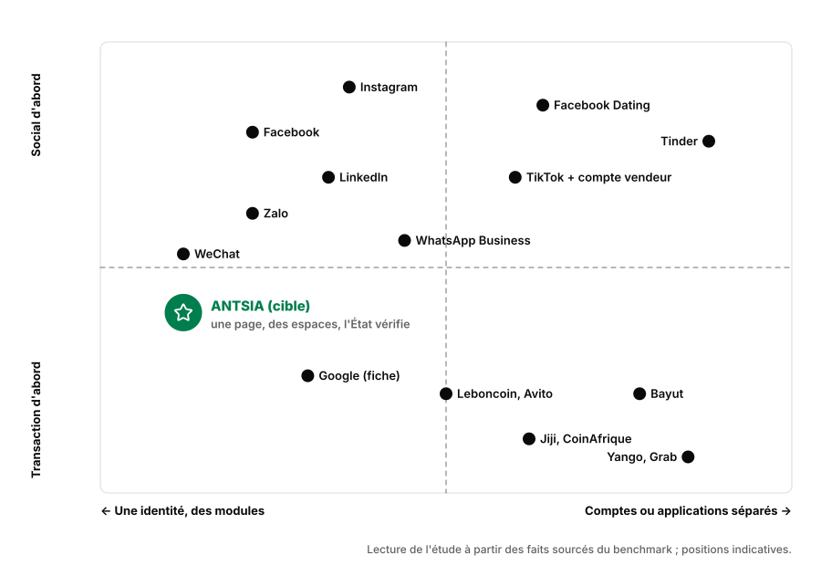

Aucune grande plateforme ne fait de la boutique une identité séparée de la page. Presque toutes séparent trois couches : une entité vérifiée, une ou plusieurs pages, des modules qui ont chacun leur dossier de conformité. Et elles isolent ce qui est risqué : les rencontres ont un profil à part.

| Plateforme | Unité d'identité | Modules | Ce qu'ANTSIA en retient |
|---|---|---|---|
| Facebook | Page, détenue par un portefeuille d'entreprise | boutique (vitrine d'un catalogue), rendez-vous ; Marketplace entre particuliers | la boutique n'est pas une identité ; Meta a retiré l'emploi (2022), la vente en direct, les flux auto et immobilier, puis le paiement intégré (2025) |
| WeChat | l'entité juridique vérifiée | comptes d'abonnement et de service, mini-programmes, paiement | une entité, plusieurs surfaces ; comptes publics abandonnés à nettoyer |
| LinkedIn | page d'entreprise et pages de marque | produits, emplois, services sur le profil | recruteurs vérifiés depuis 2024 ; un badge n'est pas une garantie |
| Google | fiche d'établissement | produits par un catalogue lié, services, réservation | licence et assurance vérifiées pour les services locaux |
| TikTok | compte business + compte vendeur séparé | boutique, ventes en direct | le compte vendeur est un dossier de conformité, pas une identité publique |
| Leboncoin, Avito | un compte, particulier ou pro | immobilier, véhicules, emploi, services | compte pro obligatoire ; badges personne et entreprise distincts ; vérification gratuite (Avito) |
| Bayut (Dubaï) | agent autorisé | annonces adossées à un permis officiel | badge « TruCheck » après vérification sur place |
| Tinder, Facebook Dating | profil séparé | rencontres | vérification faciale ; jamais un module de page |
| Zalo (Vietnam) | compte officiel | mini-apps ; plus de 16 500 comptes publics | frais et conditions imposés en bloc : chute et amende (2026) |
| Koo | — | — | adopté par un gouvernement après une suspension de Twitter, délaissé en quelques mois |

**Dix leçons pour ANTSIA.**

1. **Trois niveaux** : une entité responsable (la personne ou la structure PRO.GA), une page publique, des espaces ; le catalogue appartient à l'entité et sert aussi à iAsted.
2. **Peu d'univers à la fois**, avec des critères d'arrêt fixés d'avance : Meta et Google ont fermé ce qu'ils exploitaient mal.
3. **Une vérification par univers** : agent autorisé et document foncier, carte grise, employeur vérifié, métier ou licence.
4. **La confiance de base est gratuite et calculée**, jamais vendue ; on vend la visibilité et les outils.
5. **Paiement protégé pour les catégories à risque** : la protection de l'acheteur ne vaut que si le paiement reste dans la plateforme (Mercado Libre, Vinted).
6. **Des revenus annoncés à l'avance**, sans revirement brutal (Zalo, 2026).
7. **États et médias** : badge Officiel retiré en fin de mandat ; étiquettes de médias selon des critères publiés, avec appel ; alertes à sens unique ; pas de comptes publics abandonnés.
8. **Publicité** : registre public de toutes les annonces, annonceurs vérifiés, pas de publicité politique payante.
9. **iAsted** : mention « IA », reprise par un humain, aucun engagement sans confirmation ni mandat plafonné, réponses limitées au catalogue vérifié (précédent Air Canada), contenu des annonces jamais pris pour une consigne.
10. **Gagner par l'utilité et la confiance, pas par la contrainte** (échec de Koo) : transparence, recours, export, aucune migration forcée.

**Ce que les plateformes ont abandonné, et pourquoi.** Meta a retiré les offres d'emploi (2022, hors États-Unis et Canada), la vente en direct (2022-2023), les flux auto et immobilier de Marketplace (2021) et le paiement dans les boutiques (2025) : trop lourds à exploiter, retour à la découverte et à la publicité. Google a fermé les sites générés depuis la fiche et sa messagerie (2024), pour faible engagement. LinkedIn a remplacé son onglet produits et services (2014) par des pages de marque. ChatGPT a revu son achat intégré en mars 2026 : les marchands préfèrent leur propre parcours. Zalo a imposé frais et conditions en bloc fin 2025 : chute dans les classements et amende en 2026. **La leçon : peu d'univers, des critères d'arrêt fixés d'avance, le courage de fermer ce qu'on exploite mal.**

---

## 7. Un business, une page ? La réponse

### 7.1 Trois modèles comparés

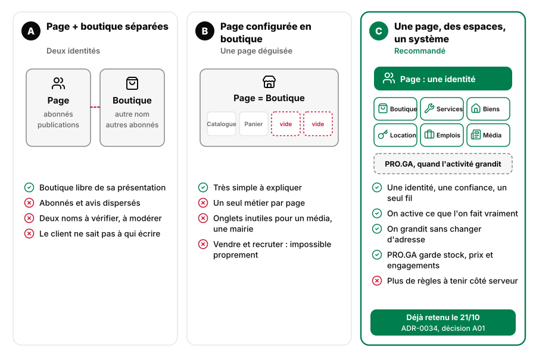

| Modèle | Principe | Avantage | Limites |
|---|---|---|---|
| **A. Page + boutique séparées** | deux objets, deux noms, deux audiences | présentation libre de la boutique | abonnés et avis dispersés ; deux identités à vérifier et à modérer ; le client ne sait pas à qui écrire |
| **B. Page configurée en boutique, un seul métier** | la page *est* la boutique | très simple à expliquer | un seul métier par page ; onglets vides pour un média ou une mairie ; vendre et recruter proprement est impossible |
| **C. Une page, des espaces, un système** | la page porte l'identité ; elle active des espaces métier ; PRO.GA gère derrière | une identité, une confiance, un seul fil ; on active ce que l'on fait vraiment ; on grandit sans changer d'adresse ; PRO.GA garde stock, prix et engagements | plus de règles à tenir côté serveur (déjà prévues : capacités, politique graduée, contrats) |

**La réponse à la question posée.** Pour le public, **c'est une page qui se configure selon son métier** : boutique, agence, loueur, restaurant. Elle porte une seule identité et active des espaces métier, chacun avec sa propre navigation (un vrai site, avec « Retour à ANTSIA ») et sa propre admission (préparer, publier, encaisser restent trois étapes, ADR-0034). Derrière, une **entité responsable** : la personne, ou la structure PRO.GA qui détient catalogue, stock et engagements. Le benchmark confirme ce découpage en trois couches — entité vérifiée, page publique, modules — : aucune grande plateforme ne fait de la boutique une identité séparée.

Ce choix a déjà été retenu le 21 octobre pour les boutiques, les services et les médias (ADR-0034, décision A01 : « Une page sociale par activité ; capacités produits, services et média combinables »). **L'étude propose de l'étendre aux sept univers** (D02) en ajoutant les espaces Biens, Location, Billetterie et les gabarits correspondants. Une entité qui mène plusieurs activités distinctes peut avoir plusieurs pages, sous la même vérification.

**Exemples.** Une couturière : Boutique (pagnes, tenues) et Prestations (retouches). Une agence : Biens, puis Emplois quand elle recrute. Un loueur : Location, puis Boutique de pièces. Un traiteur : Boutique en gabarit Restauration (menu) et Prestations (évènements). Un média : sa page et son site éditorial, jamais de panier par défaut. Une administration : une page Officielle reflétée depuis administration.ga, jamais une capacité marchande par simple choix de modèle.

### 7.2 À quel moment une page, à quel moment un système

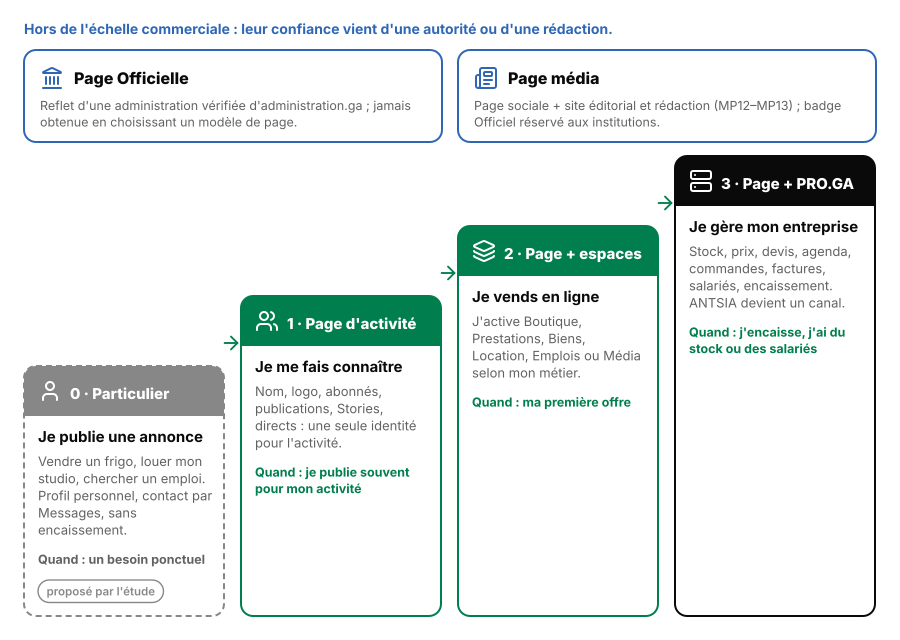

| Marche | Quand | Ce que l'on obtient | Ce qui reste fermé |
|---|---|---|---|
| **0 · Particulier** *(proposé)* | un besoin ponctuel | une annonce dans son univers, le contact par Messages, la visibilité choisie | encaissement, mise en avant, badge d'entreprise |
| **1 · Page d'activité** | on publie souvent pour une activité | une identité, des abonnés, des publications, des Stories, des directs | la vente tant qu'aucun espace n'est activé |
| **2 · Page + espaces** | la première offre | les espaces métier du gabarit choisi, les demandes, les devis, les rendez-vous | l'encaissement sans admission ni prestataire |
| **3 · Page + PRO.GA** | on encaisse, on gère un stock ou des salariés | stock, devis, agenda, commandes, factures, RH, encaissement ; ANTSIA devient un canal parmi d'autres | — |

Les **institutions** et les **médias** ne montent pas cette échelle : leur confiance vient d'une autorité (fédération signée depuis administration.ga) ou d'une rédaction (habilitations, corrections), pas d'un abonnement. Les déclencheurs reprennent la matrice de PRO.GA (`docs/05_PACKS_MODULES_ET_VERTICALES_PRO_GA.md` § 5) : première offre publiée → module `needs` recommandé ; vente de produits physiques → `inventory` ; vente sur rendez-vous → `agenda` ; premier salarié → `hr` et `compliance` requis. Pour PRO.GA, « la vente en ligne n'est ni un pack ni une verticale : c'est un canal » ; ANTSIA est ce canal.

### 7.3 Proposition : l'annonce de particulier (D03)

Aujourd'hui, toute offre d'ANTSIA appartient à une boutique rattachée à une page, et le commerce a pour autorité PRO.GA (ADR-0018). Or une grande part de ce qui circule vient de particuliers : un frigo à vendre, un studio à louer, une voiture d'occasion. Leur imposer une page et une structure PRO.GA serait absurde ; les laisser ailleurs serait renoncer à ces flux.

- Une **annonce** est une publication typée (univers, prix, lieu approximatif, photos, attributs), rattachée à la personne, **sans page ni PRO.GA** : ni stock, ni commande, ni encaissement, seulement une mise en relation. L'autorité commerciale de PRO.GA n'est donc pas contournée.
- **Quotas** par univers et par mois ; **catégories encadrées** : vendre un terrain exige l'identité Vérifiée ; publier une offre d'emploi exige une page employeur ; les catégories interdites (médicaments, armes, espèces protégées, documents officiels…) sont refusées.
- **Contact** par Messages en demande filtrée (patron du contact commercial P10), signalement et blocage ; **retrait automatique** à échéance.
- **« Passer pro »** : au-delà d'un seuil, ANTSIA propose de créer une page ; elle reprend les annonces actives, sans perte d'audience. Avec 62,9 % d'entreprises informelles, c'est une porte de formalisation vers PRO.GA (et son exigence de RCCM, ordonnance 0011, art. 4).
- Données : `networkId`, limitation de débit, modération, export et effacement comme toute table sociale.

### 7.4 Anatomie d'une page d'activité

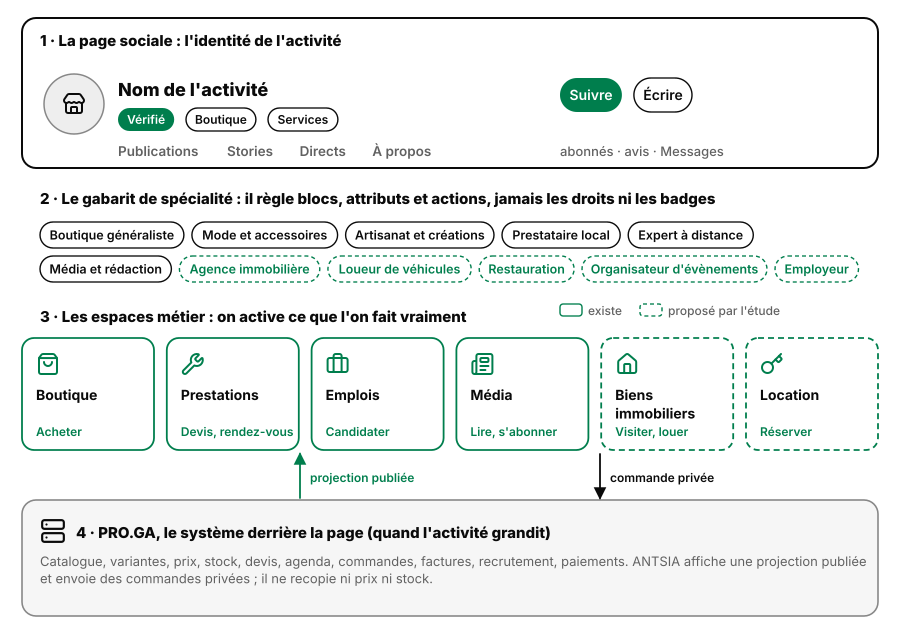

1. **La page sociale** : nom, logo, badge calculé, Suivre, Écrire ; Publications, Stories, Directs, À propos ; abonnés, avis, Messages.
2. **Le gabarit de spécialité** : il règle les blocs, les attributs et les actions, **jamais les droits ni les badges** (règle déjà écrite dans l'assistant d'activité : « Ce choix adapte la présentation, sans modifier vos droits ni la nature de votre page »).
3. **Les espaces métier** : Boutique, Prestations, Emplois, Média (existent en source) ; Biens immobiliers, Location, Billetterie (proposés).
4. **PRO.GA** : catalogue, variantes, prix, stock, devis, agenda, commandes, factures, recrutement, paiements. ANTSIA affiche une projection publiée (`PRO-COMMERCE-PUBLIC-V1`) et envoie des commandes privées (`PRO-COMMERCE-COMMAND-V1`) ; il ne recopie ni prix ni stock.

| Gabarit | Espaces par défaut | Champs métier | Action principale |
|---|---|---|---|
| Boutique généraliste *(existe)* | Boutique | catégories, variantes, retrait ou livraison | Acheter |
| Mode et accessoires *(existe)* | Boutique, Prestations | tailles, couleurs, matières ; retouches | Acheter |
| Artisanat et créations *(existe)* | Boutique, Prestations | sur-mesure, délais | Demander un devis |
| Prestataire local *(existe)* | Prestations | zone, durée, forfait, agenda | Prendre rendez-vous |
| Expert à distance *(existe)* | Prestations | livrables, délai, révisions | Présenter mon besoin |
| Média et rédaction *(existe)* | Média | rubriques, articles, auteurs | Lire |
| Agence immobilière *(proposé)* | Biens, Emplois | type, pièces, surface, loyer ou prix, caution, quartier, document foncier | Demander une visite |
| Loueur de véhicules *(proposé)* | Location, Boutique | modèle, année, kilométrage, tarif par jour, chauffeur, caution | Réserver |
| Restauration *(proposé)* | Boutique (menu) | plats, horaires, retrait ou livraison | Commander |
| Organisateur de cérémonies et sorties *(proposé)* | Billetterie, Location | date, lieu, catégories de place, jauge ; matériel | Réserver sa place |
| Employeur *(proposé)* | Emplois | poste, contrat, lieu, date limite | Candidater |

Selon la règle de PRO.GA, **un gabarit est une donnée** (vocabulaire, champs, modèles, scénarios de l'agent), pas un module : « si deux secteurs différents en ont besoin, c'est un module ; si ce n'est que du vocabulaire, des champs et des modèles, c'est une verticale ». D'où une conséquence d'architecture : la **location de ressources** (créneau + caution) sert aux voitures, au matériel de cérémonie, aux salles et aux meublés ; c'est un module partagé, pas une particularité de l'auto.

---

## 8. Le modèle commun : l'offre, le besoin et les actions

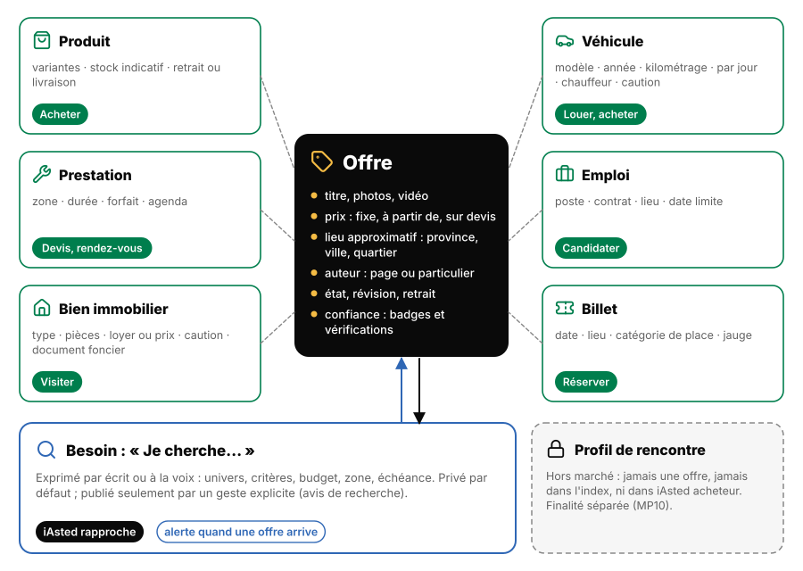

**Une offre typée commune** : titre, photos, vidéo ; prix qualifié (fixe, « à partir de », sur devis — jamais un faux prix payable) ; lieu approximatif (province, ville, quartier) ; auteur (page ou particulier) ; état, révision, retrait ; confiance (badges et vérifications). Chaque type ajoute ses attributs et son action :

| Type | Attributs propres | Action |
|---|---|---|
| Produit (dont menu de restauration) | variantes, stock indicatif, retrait ou livraison | Acheter, commander |
| Prestation | zone, durée, forfait, agenda | Demander un devis, prendre rendez-vous |
| Bien immobilier *(proposé)* | type, pièces, surface, loyer ou prix, caution, avance, document foncier | Demander une visite |
| Véhicule *(proposé)* | modèle, année, kilométrage, tarif par jour, chauffeur, caution | Louer, acheter |
| Emploi | poste, contrat, lieu, date limite | Candidater |
| Billet *(proposé)* | date, lieu, catégorie de place, jauge | Réserver |

**Pourquoi un seul modèle.** Une recherche, un index et des facettes par type : c'est la base de la marketplace MP03–MP04 et du contrat catalogue V2 (taxonomie versionnée, attributs typés, facettes allowlistées). Les mêmes règles de confiance, de retrait et de modération valent partout. iAsted n'a qu'un langage à comprendre.

**Le besoin, symétrique de l'offre.** « Je cherche une maison 3 chambres à Akanda » : univers, critères, budget, zone, échéance. Privé par défaut ; publié en « avis de recherche » seulement par un geste explicite et sans coordonnées. Il crée une alerte : une offre compatible publiée plus tard prévient la personne. PRO.GA modélise déjà le besoin B2B d'une structure (module `needs` : brouillon → publié → rapprochement → discussion → devis → accepté → clos ; rang « organique » sans score payé ni signal privé) ; il manque **le besoin du particulier**, côté ANTSIA.

**Le profil de rencontre n'est jamais une offre** : il n'entre ni dans l'index, ni dans iAsted acheteur, ni dans PRO.GA (finalité séparée, MP10).

### Un parcours type : louer une maison

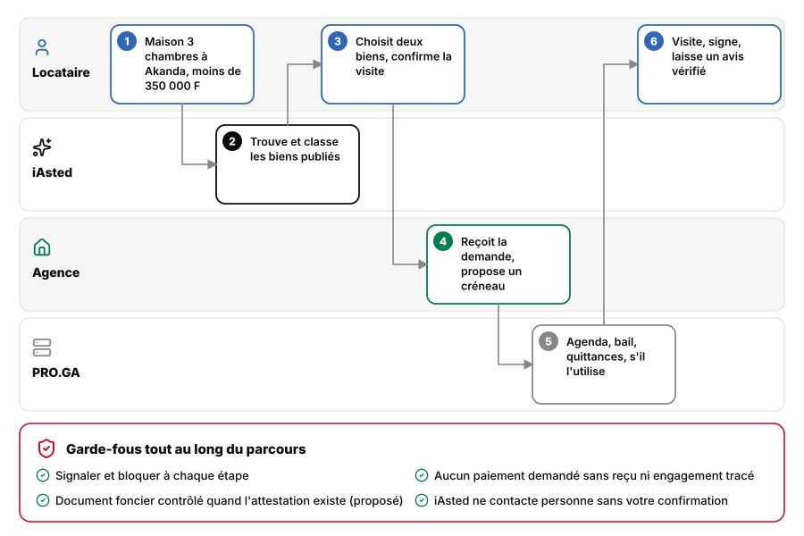

| Étape | Ce que voit la personne | Ce qui se passe derrière |
|---|---|---|
| 1 · Demande | elle écrit ou dit son besoin à iAsted | iAsted extrait univers, critères, budget, zone |
| 2 · Résultats | cinq biens, avec badges et raisons du classement | index public des offres admissibles ; sponsorisé à part |
| 3 · Choix | « Demander une visite » sur deux biens | confirmation explicite : aucune action sans elle |
| 4 · Contact | la demande arrive à l'agence dans Messages | contact commercial filtré (P10), sans relation préalable |
| 5 · Organisation | créneau, dossier, bail | agenda et documents dans PRO.GA si l'agence l'utilise |
| 6 · Après | avis vérifié après la visite ou le bail | avis lié à un engagement réel |

Garde-fous : signaler et bloquer à chaque étape ; aucun paiement demandé sans reçu ni engagement tracé (la parade aux « frais de visite » des démarcheurs) ; « Document contrôlé » quand l'attestation foncière existe ; iAsted ne contacte personne sans confirmation.

---

## 9. La vie publique : administrations, agents, médias, annonceurs

administration.ga est le réseau **fermé** des agents publics. Les mêmes administrations doivent parler à **toute la population** : ANTSIA leur réserve une place, à côté des médias et des annonceurs, sans jamais les confondre. Le cahier d'ANTSIA l'exige déjà : « Lire l'information officielle des administrations et des postes consulaires au même endroit que la vie de la communauté, sans jamais les confondre ».

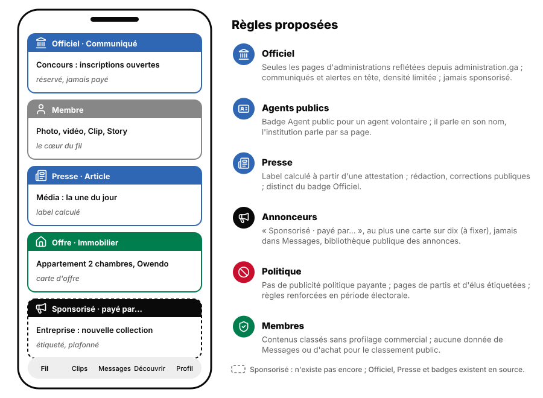

| Acteur | Où il parle | Ce qui le distingue | Ce qui lui est interdit |
|---|---|---|---|
| **Administration** | sa page Officielle, reflétée depuis administration.ga | badge Officiel ; communiqués, alertes, concours | le sponsorisé ; la campagne politique |
| **Agent public** | son profil personnel, s'il le veut | badge Agent public, retirable | parler au nom de l'institution |
| **Média** | sa page et son site éditorial | label Presse (proposé) ; corrections publiques | le badge Officiel ; le sponsorisé non étiqueté |
| **Annonceur** | cartes Sponsorisé dans le fil, mises en avant dans les univers | « payé par… » visible ; bibliothèque publique des annonces (proposé) | Messages ; le ciblage sensible ; la publicité politique |
| **Parti ou élu** | sa page étiquetée Politique (proposé) | règles renforcées en période électorale | la publicité politique payante (proposé) |

### 9.1 Les pages Officielles et la chaîne de publication

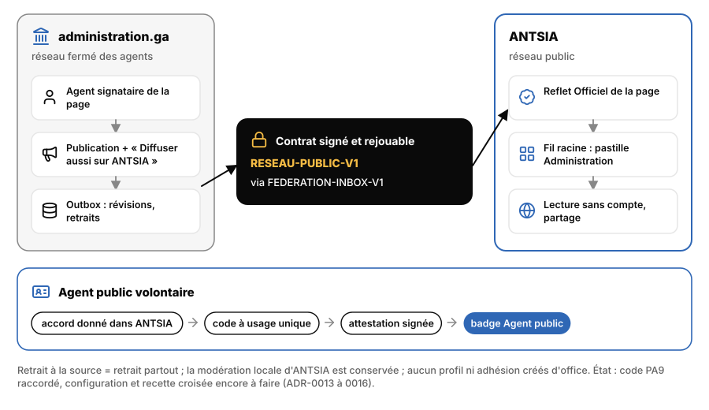

La chaîne existe en source (lots PA9A à PA9D, ADR-0013 à 0016) :
- le socle possède un producteur et une outbox ; une publication n'est diffusée que si son signataire coche « Diffuser aussi sur ANTSIA », jamais par défaut (arbitrage A7 du cahier) ;
- le contrat `RESEAU-PUBLIC-V1`, transporté par `FEDERATION-INBOX-V1`, est signé, versionné, idempotent et rejouable ; une révision ancienne ne ressuscite pas un retrait ;
- ANTSIA crée ou actualise la page institutionnelle Officielle dans le réseau `administration` (miroir, enfant de la racine) ; ses publications rejoignent le fil racine avec la pastille « Administration » et sont lisibles sans compte ;
- aucun profil, aucune identité, aucune adhésion ni aucun signataire n'est créé d'office ; la modération locale d'ANTSIA est conservée ;
- un agent public n'existe dans ANTSIA que s'il donne son accord (grant renouvelable, code à usage unique, attestation signée) ; le badge Agent public disparaît avec l'attestation.

**État** : code raccordé ; configuration réelle, preuve d'échange signé et recette croisée restent à faire (ADR-0013 à 0016, « vérifications différées »).

**Ce que l'étude ajoute** *(proposé)* :
- une catégorie **Alerte** réservée aux pages Officielles (coupures d'eau ou d'électricité, intempéries, santé publique, résultats d'examens), en tête du fil, en nombre limité, avec notification ;
- les liens **« Faire la démarche »** vers demarche.ga et **« Voir l'offre »** vers travail.ga, sans copier leurs données ;
- les **concours et recrutements publics** rejoignent l'univers Emploi, étiquetés Officiel ;
- la **neutralité** : une page Officielle informe ; elle ne fait ni campagne ni publicité. Le badge se retire quand l'attestation tombe ; les comptes publics abandonnés sont archivés (leçon des « comptes zombies » chinois et vietnamiens). La doctrine de communication publique du programme s'applique : aucun chiffre d'usage non mesuré, aucun service non ouvert présenté au présent.

### 9.2 Les médias et le label Presse *(proposé, D06)*

Les médias ont déjà leur page sociale et leur site éditorial dans ANTSIA (MP12–MP13 : une, rubriques, articles, auteurs, rédaction, versions publiées, corrections). Un média plafonne au badge Vérifié ; le badge Officiel reste réservé aux institutions (ADR-0034, décision 7). Proposition : un **label Presse calculé** à partir d'une attestation d'enregistrement du titre auprès de l'autorité compétente (à confirmer : HAC ou ministère), transmise par contrat signé, retirée avec l'attestation. Les médias de service public peuvent être signalés comme tels, selon des critères publiés et avec droit d'appel (leçon de Meta en 2020 et de l'échec de X en 2023).

### 9.3 Les annonceurs et le sponsorisé *(proposé, D06, D10)*

Le cahier prévoit une monétisation **B2B, étiquetée, jamais dans la messagerie, à densité plafonnée** (EXF-AN-52, lot A6). Règles proposées : « Sponsorisé · payé par … » sur chaque carte ; annonceur vérifié ; densité plafonnée (repère de travail : au plus une carte sur dix, à fixer après mesure) ; **bibliothèque publique de toutes les annonces** (qui, quoi, quand, pour quelle zone), au niveau du registre exigé en Europe par l'article 39 du DSA ; aucun ciblage sur des données sensibles, les Messages, les achats, les candidatures ou les rencontres ; mises en avant étiquetées « Mis en avant », sans remplacer le classement organique. La HAC régule la publicité (ordonnance 0013) : ces règles se présentent à elle.

### 9.4 La règle politique *(proposé, D07)*

ANTSIA est porté par un programme d'État ; sa crédibilité dépend de sa neutralité. Pas de **publicité politique payante** (TikTok l'interdit depuis 2019 ; Meta et Google l'ont arrêtée dans l'Union européenne en 2025) ; pages de partis et d'élus permises, étiquetées « Politique », soumises aux règles communes et renforcées en période électorale ; les pages Officielles ne font pas campagne ; un agent public s'exprime en son nom ; rapport de transparence périodique (prévu au cahier, EXF-AN-51). Aucune règle gabonaise spécifique de la publicité politique en ligne n'a été trouvée : à faire valider par le juridique et la HAC.

---

## 10. La chaîne de confiance

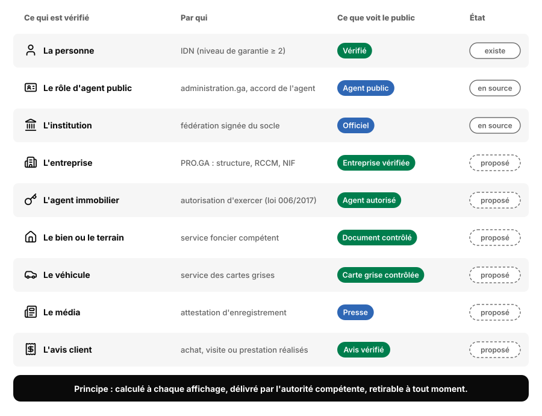

| Ce qui est vérifié | Par qui | Ce que voit le public | État |
|---|---|---|---|
| La personne | IDN, niveau de garantie ≥ 2 | Vérifié | existe |
| Le rôle d'agent public | administration.ga, avec l'accord de l'agent | Agent public | en source |
| L'institution | fédération signée du socle | Officiel | en source |
| L'entreprise | PRO.GA : structure, RCCM, NIF | Entreprise vérifiée | proposé |
| L'agent immobilier | autorisation d'exercer (loi 006/2017) | Agent autorisé | proposé |
| Le bien ou le terrain | service foncier compétent | Document contrôlé | proposé |
| Le véhicule | service des cartes grises | Carte grise contrôlée | proposé |
| Le média | attestation d'enregistrement | Presse | proposé |
| L'avis client | achat, visite ou prestation réalisés | Avis vérifié | proposé |

**Principe** : calculé à chaque affichage côté serveur, délivré par l'autorité compétente, retirable à tout moment, **gratuit** — comme les quatre badges actuels (ADR-0002 : « aucun champ déclaratif ne les porte »). On vend la visibilité et les outils, jamais le badge (contre-exemples : badge d'identité lié à un forfait payant chez Jiji, vérification vendue par abonnement chez Meta). Un badge reste un signal, pas une garantie : il est présenté comme tel.

**Le différenciateur.** Sur un réseau étranger, n'importe qui peut prétendre vendre un terrain. Sur ANTSIA, une annonce peut afficher « Document contrôlé » parce que le service foncier l'a attesté par contrat signé. **C'est la vie publique qui rend le business sûr.** Ces attestations demandent des conventions (D09) ; elles passent par la fédération entrante (contrats signés, jamais de lecture de base).

---

## 11. iAsted : l'assistant qui oriente, trouve et prépare

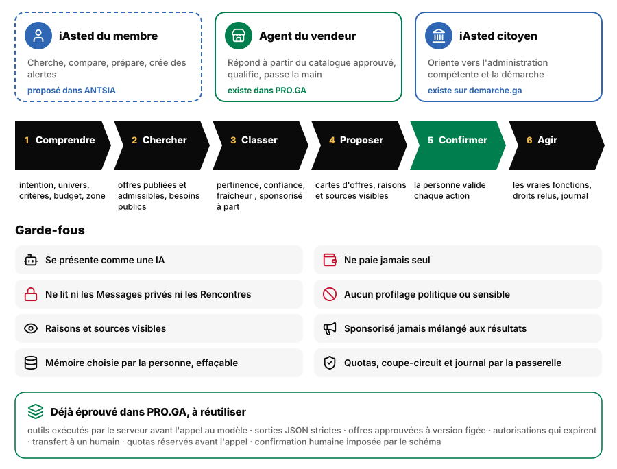

### 11.1 Ce qui existe

iAsted n'est pas un produit unique : c'est **le nom de l'assistant IA transversal du programme**, porté par plusieurs implémentations (note du vault `30-TRANSVERSE/iasted.md`). La promesse est partout la même : il prépare, explique et propose ; l'humain confirme tout engagement ; il n'invente rien ; il ne lit que ce que l'utilisateur a le droit de lire.

| Où | Ce qui existe (lu dans le code, non exécuté) |
|---|---|
| **PRO.GA — agent commercial** (`convex/modules/commercialAgent`) | un agent par structure, sur son site public ; réponses à partir des seules sources approuvées ; offres d'une liste approuvée à version figée, prix issus de ces offres ; outil `create_lead` fermé par défaut, ouvert par une autorisation qui expire, idempotent et soumis à quota ; transfert à un humain ; activation impossible sans corpus approuvé |
| **PRO.GA — assistant personnel et de structure** (`convex/modules/iasted`, `itravail`) | outils fermés par défaut, aucune mutation métier (« l'assistant prépare, l'humain envoie ») ; `confirmEngagingActions: v.literal(true)` imposé par le schéma ; mémoire limitée à ce que la personne écrit ou accepte ; purges automatiques ; journal sans contenu |
| **PRO.GA — besoins** (`convex/modules/needs`) | besoin d'achat B2B d'une structure ; recherche plein texte des correspondances ; raisons affichées ; « aucun score, sponsoring ou signal privé » |
| **Socle — iAsted citoyen** (demarche.ga) | orientation vers l'administration compétente sans inventer de nom (`find_administration`), démarche lancée après confirmation (`initiate_demarche`) |
| **Programme — plan iAsted 2.0** (`DOCUMENTATION/IASTED/PLAN_IASTED_2026-09-27.md`) | une passerelle IA unique : droit d'usage, crédits, classification de la donnée (quatre classes ; la classe « Secrète » n'autorise qu'un modèle souverain), langue, choix du modèle, journal |
| **DIASPORALE** | un « concierge » prévu en V2 (recherche limitée au réseau, actions confirmées), jamais porté dans le moteur |
| **ANTSIA** | **aucune ligne d'IA** ; iAsted a été **exclu** lors de la duplication du socle (`docs/02_OWNER_MAP_DUPLICATION.md`), choix que le propriétaire peut rouvrir |

### 11.2 Ce que l'on propose (D05)

Faire entrer iAsted dans ANTSIA sous **trois rôles** :
- **iAsted du membre** *(nouveau)* : il comprend un besoin écrit ou dit, cherche dans les offres publiées et admissibles, compare, explique son classement, crée des alertes, prépare un contact, une visite, un panier ou un devis.
- **Agent du vendeur** *(existe dans PRO.GA)* : il répond dans Messages, à partir du catalogue approuvé de la structure, qualifie la demande et passe la main à un humain ; il faut le relier au contact commercial d'ANTSIA.
- **iAsted citoyen** *(existe sur demarche.ga)* : il oriente vers l'administration compétente et la démarche, et cite les publications Officielles.

**La chaîne de décision** : 1 · comprendre (intention, univers, critères, budget, zone) → 2 · chercher (offres publiées et admissibles, besoins publics, filtres de réseau, de visibilité et de retrait du moteur) → 3 · classer (pertinence, confiance, fraîcheur ; le sponsorisé reste à part et étiqueté) → 4 · proposer (cartes, raisons et sources visibles) → 5 · **confirmer** (la personne valide chaque action) → 6 · agir (par les vraies fonctions du moteur, droits relus côté serveur ; journal).

**Garde-fous** : il se présente comme une IA (ordonnance 0011, art. 53 ; AI Act, art. 50) ; il ne paie jamais seul — tout engagement passe par la confirmation, plus tard par un mandat signé et plafonné ; il ne lit ni les Messages privés, ni les Rencontres, ni les candidatures d'autrui ; aucun profilage politique ou sensible, aucune inférence à partir des achats, abonnements ou relations ; raisons et sources visibles, sponsorisé jamais mélangé ; mémoire choisie, exportable et effaçable ; quotas, coupe-circuit et journal par la passerelle iAsted 2.0 ; le contenu des annonces n'est jamais traité comme une consigne (injection) ; ses réponses se limitent au catalogue vérifié, car elles engagent l'exploitant.

### 11.3 Étapes

| Étape | Contenu | Pré-requis |
|---|---|---|
| a · Chercher | langage courant → recherche ; résultats expliqués ; besoins et alertes ; lecture seule | index MP03, passerelle, D05 |
| b · Répondre pour le vendeur | l'agent PRO.GA répond dans Messages depuis le catalogue approuvé, passe la main | contact commercial P10, corpus approuvé |
| c · Agir avec confirmation | écrire, demander une visite, préparer un panier ou un devis | a et b, journal, quotas |
| d · Mandats d'achat | achat préparé et signé par la personne, avec plafonds | paiements ouverts (porte externe) |

### 11.4 Ce que les agents d'achat ont appris (2024-2026)

- Confirmation explicite avant tout achat (Google, protocole d'OpenAI et Stripe) ; mandats d'intention et de panier, signés et plafonnés (AP2 de Google) pour aller plus loin.
- Passage à un humain et reprise par le vendeur à tout moment (agent de Meta pour les entreprises, lancé en juin 2026).
- Ce que dit l'agent engage l'exploitant : Air Canada a été tenue par une politique inventée par son robot (2024).
- Un agent a acheté sans accord (Operator, 2025) ; un navigateur-agent a été détourné par une consigne cachée dans une page (Comet, 2025) ; un agent commerçant s'est laissé arracher des remises (Project Vend d'Anthropic, 2025).
- ChatGPT a revu son achat intégré en mars 2026 : préparer, puis passer la main au parcours du vendeur.

### 11.5 Écarts relevés par l'inventaire

- Rouvrir l'exclusion (D05) et brancher la passerelle iAsted 2.0, sans modèle codé en dur.
- Recherche en langage courant sur l'index des offres publiées (MP03), plus un index sémantique.
- Besoin du particulier, privé par défaut, avec alertes.
- Agent du vendeur relié au contact commercial dans Messages (P10).
- Actions confirmées et journal ; évaluation : injection de consignes, fuite entre vendeurs, biais.

S'y ajoutent des dettes PRO.GA : la durée de conservation des conversations de l'agent commercial n'est appliquée nulle part ; un identifiant de modèle ancien est codé en dur ; les fournisseurs divergent d'un produit à l'autre (Claude chez PRO.GA ; Gemini, Claude et OpenAI au socle). Recommandation : tout faire passer par la passerelle iAsted 2.0, avec des modèles actuels choisis par configuration.

**Coût.** iAsted est payant dans PRO.GA après 90 jours d'essai (barème provisoire du document 05 : 1 crédit = 500 FCFA). ANTSIA promet que « le citoyen ne paie jamais ». **Proposition : l'iAsted du membre est gratuit dans ANTSIA**, financé par les revenus professionnels ; l'agent du vendeur reste dans l'offre PRO.GA.

---

## 12. Réorganiser le site

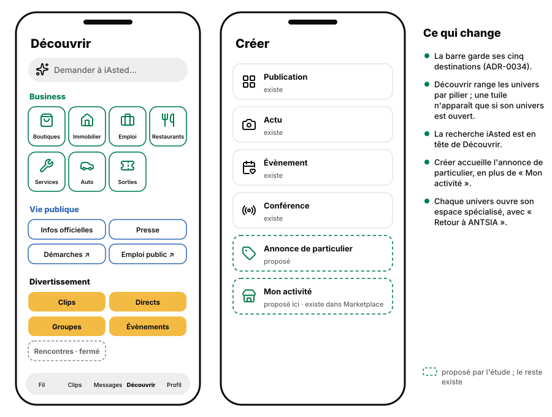

**Ce qui existe** (code au 21 octobre) : cinq destinations au téléphone — Fil, Clips, Messages, Découvrir, Profil — et un menu Créer (Publication, Actu, Évènement, Conférence, Album). Le reste s'atteint par Découvrir (`/explorer`) et par des routes dédiées : Marketplace, boutiques, prestataires, emplois, réseau pro, presse, rencontres (fermé), pages Officielles.

**Ce que l'on propose** — ranger, pas ajouter d'icônes (ADR-0034 : « Conserver la barre sociale à cinq destinations sur téléphone ») :
- **Découvrir** devient la porte des trois piliers : en tête la recherche « Demander à iAsted… » ; puis Business (les tuiles des univers **ouverts** seulement), Vie publique (Infos officielles, Presse, Démarches ↗, Emploi public ↗), Divertissement (Clips, Directs, Groupes, Évènements, Rencontres quand elles ouvriront).
- **Créer** accueille l'**annonce de particulier** et un accès direct à « Mon activité » (aujourd'hui dans Marketplace : « Créer ou gérer mon activité »).
- Chaque univers ouvre son **espace spécialisé** avec « Retour à ANTSIA » (contrat `specialized-navigation` v1 de MP00, raccordé en MP01).

| Destination | Route | État |
|---|---|---|
| Fil · Clips · Messages · Profil | `/fil` · `/clips` · `/messages` · `/moi` | existe |
| Découvrir | `/explorer` (membre) · `/decouvrir` (public) | existe ; à ranger par pilier |
| Marketplace : Produits, Boutiques, Services | `/marketplace` | existe (MP04) |
| Boutique et prestataire d'une activité | `/boutique/[handle]` · `/prestataire/[handle]` | existe (MP05–MP06) |
| Emplois d'une activité · réseau pro | `/boutique/[handle]/emplois` · `/professionnels` | existe (P15, MP09) |
| Presse et sites médias | `/presse` · `/media/[handle]` · `/medias/[handle]` | existe (MP12–MP13) |
| Rencontres | `/rencontres` | existe, fermé (MP10) |
| Pages Officielles | `/pages/[handle]` | existe |
| Immobilier · Auto · Restauration · Emploi · Sorties | `/immobilier` · `/auto` · `/restauration` · `/emploi` · `/sorties` | proposé, créé à l'ouverture |
| Annonces de particuliers | `/annonces` · `/annonces/[id]` | proposé |
| Vie publique (officiel, alertes) | `/officiel` | proposé |

Les routes proposées ne sont créées qu'à l'ouverture de leur univers (« aucun alias vide annonçant une fonctionnalité future », ADR-0034) et passent par `apps/antsia_ga/src/lib/routes.ts` (aucune URL en dur).

---

## 13. Architecture technique

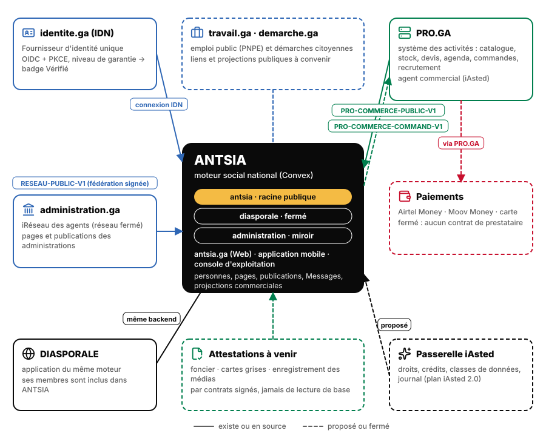

**Les autorités ne changent pas.** ANTSIA garde le social et la présentation ; PRO.GA garde la vérité commerciale (structure, catalogue, variantes, prix, stock, devis, agenda, engagements, rapprochement) ; les prestataires gardent l'état réel des fonds ; les administrations délivrent les attestations ; iAsted passe par une passerelle unique. Aucune base n'est lue par un autre produit, aucun client Convex croisé, aucun import de schéma : tout passe par des contrats signés, versionnés, idempotents et rejouables.

**Contrats existants** (`docs/contrats`) : `RESEAU-PUBLIC-V1`, `FEDERATION-INBOX-V1`, `PRO-COMMERCE-PUBLIC-V1`, `PRO-COMMERCE-COMMAND-V1`, `PRO-COMMERCE-LINK-V1`, `PRO-COMMERCE-CATALOG-READ-V1`, `PRO-COMMERCE-JOBS-V1`, `PRO-COMMERCE-SERVICE-CONTROL-V1`, `PRO-COMMERCE-CHECKOUT-CONTROL-V1`, `CONVERSATION-CONTEXTUELLE-V1`.

**Briques proposées** (noms définitifs à arrêter au lot SU00, comme MP00 l'a fait pour la marketplace) :

| Brique | Où | Rôle | Règle tenue |
|---|---|---|---|
| Types d'offre bien immobilier et véhicule | PRO.GA (catalogue V2) + projections ANTSIA | facettes immobilier et auto | PRO.GA maître ; contrat additif |
| Location de ressources (créneau + caution) | PRO.GA (agenda étendu) | voitures, matériel, salles | un besoin de deux secteurs = un module |
| Annonces de particuliers | ANTSIA, module dédié | annonces sans encaissement, quotas | networkId, débit, modération, effacement |
| Besoins du particulier et alertes | ANTSIA | « Je cherche… », privé par défaut | consentement, export, effacement |
| Alertes officielles | ANTSIA (fédération) | catégorie Alerte des pages Officielles | contrat signé ; densité bornée |
| Placements sponsorisés + bibliothèque | ANTSIA | sponsorisé étiqueté et public | jamais dans Messages ; densité plafonnée |
| Attestations (foncier, cartes grises, presse, entreprise) | ANTSIA (fédération) | labels calculés | retrait de l'attestation = disparition du label |
| Passerelle iAsted | transverse (plan iAsted 2.0) | droits, crédits, classes de données, journal | aucun modèle codé en dur ; coupe-circuit |
| Conversations iAsted du membre | ANTSIA | historique et mémoire choisie | purge, export, effacement |
| Index sémantique des offres | ANTSIA (index vectoriel) | recherche en langage naturel | offres publiées et admissibles seulement |

**Invariants à tenir pour chaque brique** (CLAUDE.md d'ANTSIA) : `networkId` sur toute table et `requireMembership` en tête de toute fonction ; refus indistinct ; visibilité `network` par défaut ; badges et labels calculés ; garde des fichiers fail-closed ; écriture bornée (adhésion → éligibilité → débit → droit) ; i18n FR/EN ; inventaires d'export et d'effacement ; cliquets étendus (`network-scoped-functions`, `rate-limited-writes`, `notification-payload-content`…).

### 13.1 Conformité à l'ordonnance 0011/PR/2026 (lot SU01)

| Exigence | Ce qu'ANTSIA a déjà | Ce qu'il faut ajouter |
|---|---|---|
| Identification des utilisateurs (art. 4) | IDN (identite.ga) pour l'identité vérifiée ; comptes légers par code à usage unique | identification de **tout** titulaire de compte (noms, prénoms, domicile, téléphone ; RCCM pour les commerçants), collectée au minimum, conservée à part, jamais publiée ; IDN comme preuve préférée ; pas de NIP sans autorisation de l'APDPVP |
| Majorité numérique à 16 ans, vérification d'âge (art. 16-24, 53) | aucune preuve d'âge ; rencontres fermées faute de preuve de majorité | aucun compte avant 16 ans (art. 17) ; vérification d'âge à l'inscription sous 12 mois (art. 53) ; 16-17 ans : accord parental et autorisation de l'APDPVP à arbitrer (loi 025/2023, art. 74, 81, 188, 190) ; 18 ans pour les transactions |
| Signalements : 24 h et 72 h pour un mineur, 24 h pour un hypertrucage (art. 24, 33) | modération à l'échelle, files, sanctions, recours, console (PA7) | catégories et chronomètres réglementaires, alertes de délai, rapport à l'autorité |
| Administrateurs de pages et de groupes responsables (art. 11) | rôles d'administrateur et de signataire de page, modération de groupe | outils de retrait rapides pour les administrateurs, information claire de leur responsabilité |
| Registre de la HAC (art. 37), éditeur identifié (art. 25) | mentions légales publiques | inscription au registre ; directeur de publication et hébergeur affichés |
| Marquage des contenus d'IA (art. 53) | aucune IA aujourd'hui | étiquette visible sur toute réponse et tout contenu produits par iAsted ; détection des contenus générés importés |
| Conservation des données d'identification (art. 29-31) | effacement effectif de toutes les tables sociales | durée légale de conservation à définir, en tension avec l'effacement : arbitrage juridique |
| « Assimilés » et termes des transactions (ordonnance 0012) | conditions vendeur V2 affichées (MP05) | conditions publiées pour chaque espace qui vend ; règles d'utilisation et politique de données accessibles |

---

## 14. Le modèle économique

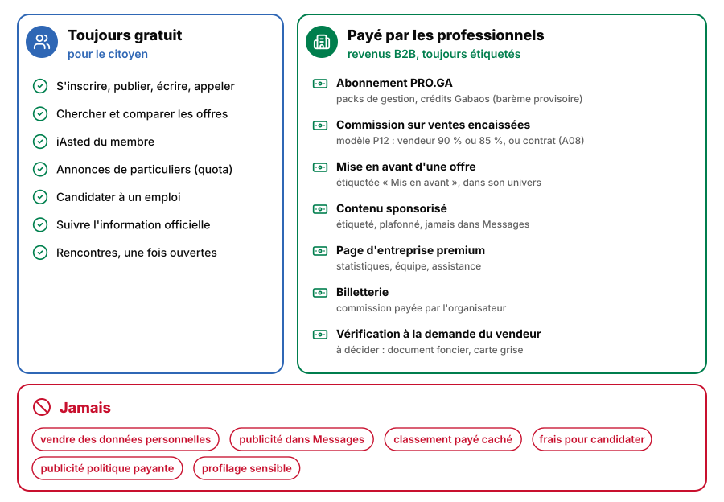

**Toujours gratuit pour le citoyen** : s'inscrire, publier, écrire, appeler ; chercher et comparer ; l'iAsted du membre ; les annonces de particuliers (dans les quotas) ; candidater ; suivre l'information officielle ; les rencontres, une fois ouvertes ; la vérification de base.

**Payé par les professionnels (B2B, toujours étiqueté)** :

| Revenu | Détail | État |
|---|---|---|
| Abonnement PRO.GA | packs de gestion, crédits Gabaos (barème provisoire : 1 crédit = 500 FCFA) | prévu dans PRO.GA |
| Commission sur ventes encaissées | modèle P12 conservé : part vendeur 90 % ou 85 %, ou contrat (A08) | fermé tant qu'aucun prestataire n'est contracté |
| Mise en avant d'une offre | étiquetée « Mis en avant », dans son univers | proposé |
| Contenu sponsorisé | étiqueté, plafonné, jamais dans Messages, bibliothèque publique | prévu au cahier (A6), à construire |
| Page d'entreprise premium | statistiques, équipe, assistance | prévu au cahier (EXF-AN-52) |
| Billetterie | commission payée par l'organisateur | proposé, après paiement |
| Vérification à la demande du vendeur | document foncier, carte grise | à décider (D10) |

**Jamais** : vendre des données personnelles ; publicité dans Messages ; classement payé caché ; frais pour candidater ; publicité politique payante ; profilage sensible ; badge payant. Aucun taux n'est fixé ici ; les frais réels doivent être affichés avant tout paiement. Annoncer les règles à l'avance et ne jamais les changer en bloc (leçon de Zalo, 2026).

---

## 15. La feuille de route

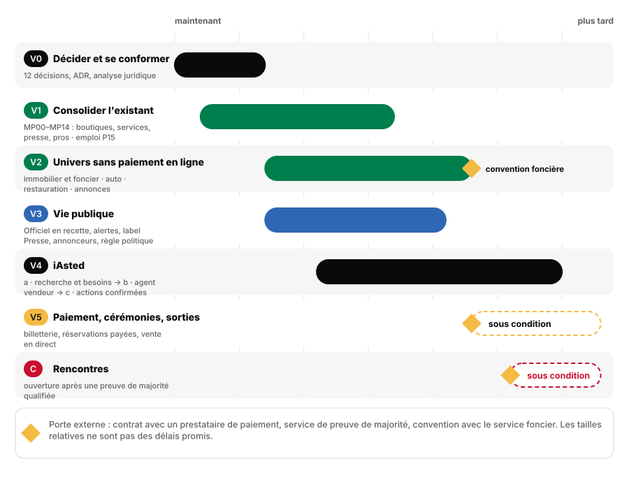

**Ordonner par dépendances, pas par envie** : d'abord ce qui existe, puis ce qui ne demande pas de paiement en ligne, puis ce qui attend une condition externe.

| Vague | Contenu | Porte de sortie |
|---|---|---|
| **V0 · Décider et se conformer** | décisions D01–D12, ADR « sept univers et vie publique », analyse juridique (ordonnance 0011, loi 025/2023) | ADR accepté |
| **V1 · Consolider l'existant** | MP00–MP14 en cours : boutiques, services, presse, pros ; emploi P15 ; Découvrir par piliers | MP14 ouvre Boutiques et Services en recette réelle |
| **V2 · Univers sans paiement en ligne** | immobilier et foncier ; auto et mobilité ; restauration (commande payée à la remise) ; annonces de particuliers | pilote Grand Libreville mesuré |
| **V3 · Vie publique** | Officiel en recette (PA9), alertes, label Presse, annonceurs, règle politique | HAC consultée ; premières administrations reflétées |
| **V4 · iAsted** | a · recherche et besoins → b · agent du vendeur → c · actions confirmées | évaluation au vert : exactitude, fuite, biais, injection |
| **V5 · Paiement, cérémonies, sorties** | billetterie, réservations payées, vente en direct | contrat de paiement (porte externe) |
| **Sous condition · Rencontres** | ouverture MP10–MP11 | preuve de majorité qualifiée (porte externe) |

**Lots proposés** (préfixe SU, « sept univers », libre dans le dépôt ; tailles relatives, pas des délais) :

| Lot | Contenu | Dépend de | Taille |
|---|---|---|---|
| SU00 | Décisions D01–D12 et ADR « sept univers et vie publique » | cette étude | S |
| SU01 | Conformité : registre HAC, identification des titulaires de compte, délais 24 h et 72 h, âge, marquage de l'IA (analyse livrée le 21/10) | D08, analyse juridique | L |
| SU02 | Découvrir par piliers ; tuiles des seuls univers ouverts | SU00, MP01 | M |
| SU03 | Types d'offre bien immobilier et véhicule (catalogue V2) | SU00, MP03 | L |
| SU04 | Immobilier et foncier : espace Biens, filtres, visites, gabarit agence | SU03, MP04 | L |
| SU05 | Location de ressources (créneau + caution) ; Auto et mobilité | SU03, MP06 | L |
| SU06 | Alimentation et restauration : gabarit, menu, commande payée à la remise | SU00, MP05 | M |
| SU07 | Annonces de particuliers : quotas, catégories, « Passer pro » | SU00, SU01, MP04 | M |
| SU08 | Emploi et talents réunis : P15, MP09, concours publics, lien travail.ga | SU00, PA9 | M |
| SU09 | Vie publique : alertes officielles, label Presse, règle politique | PA9 en recette, D06, D07 | M |
| SU10 | Annonceurs : sponsorisé étiqueté, densité, bibliothèque publique | SU09, D10 | M |
| SU11 | iAsted a : passerelle, recherche en langage courant, besoins, alertes | D05, MP03, SU01 | L |
| SU12 | iAsted b : agent du vendeur dans Messages | SU11, P10 | M |
| SU13 | iAsted c : actions confirmées et journal | SU11, SU12 | M |
| SU14 | Cérémonies et sorties : prestataires, matériel et salles, puis billetterie et vente en direct | SU05 ; MP08 pour payer | L |
| SU15 | Attestations d'État : foncier, cartes grises, agents immobiliers, presse, entreprise | D09, conventions | M |
| SU16 | Rencontres : ouverture conditionnelle (MP10–MP11) | preuve de majorité | L |

**Parallélisme possible** : après SU00 et SU01, les catalogues (SU03), les annonces (SU07), l'emploi (SU08) et iAsted (SU11) peuvent avancer en parallèle si leurs fichiers ne se recouvrent pas ; schéma, routes, i18n, registres et contrats gardent un seul responsable d'intégration à la fois, comme pour MP.

**Frontières entre sessions** : implémenter dans les vrais sources de l'application ; préserver DIASPORALE et la session marketplace ; aucun changement de branche dans l'arbre partagé ; `git add -- <chemins>` seulement ; aucun fonds réel, aucun univers sous condition externe ouvert sans ses preuves.

---

## 16. Indicateurs de réussite

| Domaine | Indicateur | Pourquoi |
|---|---|---|
| Usage | membres actifs par semaine et par mois | la roue tourne-t-elle ? |
| Univers | offres actives et vendeurs actifs, par univers et par province | l'univers vit-il ? |
| Confiance | part des offres d'acteurs vérifiés ; signalements d'arnaque pour 1 000 offres ; délai de traitement | l'univers est-il sûr ? |
| Mise en relation | part des demandes qui reçoivent une réponse sous 24 h | les vendeurs répondent-ils ? |
| Engagements | visites, rendez-vous, candidatures, commandes menés à terme | y a-t-il une valeur réelle ? |
| iAsted | recherches suivies d'un contact ; réponses signalées comme inutiles | l'assistant aide-t-il ? |
| Vie publique | pages Officielles actives ; délai entre la publication source et son reflet | l'État est-il présent ? |
| Conformité | part des signalements traités en 24 h et en 72 h ; contenus d'IA marqués | l'ordonnance 0011 est-elle tenue ? |
| Performance | temps de rendu du fil sur réseau 3G (p95) | le réseau reste-t-il utilisable ? |

Aucune cible chiffrée n'est fixée : elles se fixent après trois mois de mesure réelle, conformément à la règle de véracité du programme. Les mesures sont consenties et minimisées : aucune conversation, candidature ou préférence de rencontre dans l'analytique (exigence SC16 de l'étude du 18 octobre).

---

## 17. Risques et parades

| Risque | Effet | Parade |
|---|---|---|
| Arnaques : faux biens, faux emplois, frais demandés avant visite | perte de confiance d'un univers | identité vérifiée pour les catégories sensibles, attestations, signalement rapide, aucun paiement hors parcours tracé |
| Univers vides au lancement | les premiers visiteurs repartent | tuiles des seuls univers ouverts, vendeurs pilotes, zone pilote |
| Charge de modération | délais trop longs | files par univers, équipes thématiques, console (PA7) |
| Perception de propagande | rejet du réseau | étiquettes strictes, pas de publicité politique, rapport de transparence |
| Cadre juridique : données, communication, foncier, emploi | blocage ou sanction | dossier APDPVP, consultation de la HAC, conventions, conseil juridique avant chaque ouverture |
| Paiements non contractés | ventes bloquées | univers sans paiement d'abord ; aucun fonds réel sans preuves |
| Erreurs d'iAsted | mauvaise orientation, fuite de données | passerelle, sources visibles, confirmation, évaluation, coupe-circuit |
| Coût d'exploitation : Convex, IA, médias | budget dépassé | quotas, fil matérialisé, crédits, coût par membre actif mesuré |
| Rencontres : mineurs, extorsion, réputation | atteinte grave | fermé tant que la preuve de majorité n'est pas qualifiée |
| Non-conformité à l'ordonnance 0011 | amendes, référé numérique, suspension de 72 h | registre HAC, délais 24 h et 72 h outillés, vérification d'âge, marquage de l'IA (lot SU01) |
| Image de « réseau de remplacement » d'une censure | défiance, rejet | utilité d'abord, transparence, recours, export, aucune migration forcée |

---

## 18. Les décisions à prendre

|  | Décision | Recommandation | Si non | Statut |
|---|---|---|---|---|
| **D01** | **Adopter les trois piliers et les sept univers** | Oui : boutiques, immobilier et foncier, emploi, alimentation et restauration, services, auto et mobilité, cérémonies et sorties ; revoir la liste après six mois de mesures | on reste aux quatre familles du plan marketplace | validée |
| **D02** | **Étendre « une page + des espaces + PRO.GA » aux sept univers** | Oui ; une entité responsable derrière chaque page ; gabarits immobilier, location, restauration, cérémonies, employeur | chaque univers invente son propre modèle d'identité | validée |
| **D03** | **Créer l'annonce de particulier** | Oui, sans encaissement, avec quotas, catégories encadrées et « Passer pro » | les particuliers restent sur des plateformes étrangères | validée |
| **D04** | **Ouvrir d'abord les univers sans paiement en ligne** | Immobilier et foncier, Auto et mobilité, Restauration (commande payée à la remise), en vague 2 | les grands flux d'annonces restent dehors | validée |
| **D05** | **Faire entrer iAsted dans ANTSIA** | Oui : recherche d'abord, actions confirmées ensuite ; gratuit pour le membre ; marqué comme IA | recherche par filtres seulement | validée |
| **D06** | **Réserver les espaces de la vie publique** | Officiel, Agent public, Presse (label calculé sur attestation), Sponsorisé ; chacun étiqueté et borné | l'information et la promotion se mélangent | validée |
| **D07** | **Fixer la règle politique** | Pas de publicité politique payante ; pages politiques étiquetées ; règles de période électorale | le réseau d'État perd sa crédibilité | validée |
| **D08** | **Se conformer dès la conception** | Ordonnance 0011/PR/2026 et loi 025/2023 : registre de la HAC, identification de tout titulaire de compte (art. 4) collectée au minimum et jamais publiée, délais de 24 h et 72 h, 16 ans au moins, 18 ans pour les transactions, marquage de l'IA | sanctions, référé numérique, suspension | validée |
| **D09** | **Engager les vérifications d'État** | Conventions : foncier, cartes grises, autorisation des agents immobiliers, enregistrement des médias | la confiance repose sur l'identité seule | proposée |
| **D10** | **Arrêter le modèle économique** | Liste des revenus professionnels et liste « Jamais » ; barèmes plus tard | pas de revenus, ou des revenus qui détruisent la confiance | proposée |
| **D11** | **Choisir le positionnement et le pilote** | Gagner par l'utilité et la confiance, jamais par la contrainte ; Grand Libreville ; rapport de transparence | être perçu comme le réseau de remplacement d'une censure | proposée |
| **D12** | **Rencontres : garder fermé** | Rangées dans le Divertissement, fermées jusqu'à une preuve de majorité qualifiée | risque juridique et de réputation | proposée |

Les décisions D01 à D08 ont été validées par le propriétaire le 21 octobre 2026 et consignées dans l'[ADR-0035](../../adr/0035-sept-univers-et-vie-publique.md) ; l'analyse de conformité est dans [SU01](SU01_CONFORMITE_ORDONNANCE_0011.md).

### Où en est-on au 21 octobre

| Critère pour dire « on part » | État | Preuve ou responsable |
|---|---|---|
| Les décisions D01 à D08 sont validées et l'ADR « sept univers et vie publique » est accepté. | **fait** | ADR-0035, 21/10/2026 |
| MP14 a ouvert au moins Boutiques et Services en recette réelle. | **à faire** | session marketplace, lot MP14 |
| Une zone pilote et au moins trois vendeurs pilotes par univers ouvert sont identifiés. | **à faire** | propriétaire ; dépend de D11, encore proposée |
| Le dossier APDPVP couvre annonces, besoins et iAsted ; la HAC a été consultée pour la vie publique. | **à faire** | propriétaire (SU01, § 5) |
| La modération dispose d'une file par univers et d'un délai cible mesurable. | **à faire** | SU01d, puis chaque lot d'univers |
| L'analyse de conformité à l'ordonnance 0011 est faite : registre de la HAC, identification, délais, âge. | **livrée** | SU01, 21/10/2026 ; à valider par un juriste |

**Au propriétaire** (détail dans [SU01](SU01_CONFORMITE_ORDONNANCE_0011.md), § 5) :

- Compléter l'identité publique de l'éditeur : téléphone, directeur de publication, hébergeurs (art. 25).
- Demander à la HAC l'inscription au registre des plateformes (art. 37) et ouvrir le dialogue (art. 35 et 36).
- Nommer un représentant légal joignable : le référé numérique se juge « d'heure à heure » (art. 41).
- Déposer le dossier APDPVP : inscription, identification, signalements, iAsted, annonces, besoins.
- Faire trancher par un juriste les arbitrages A1 à A12 de SU01, en commençant par A1 à A3.
- Obtenir le texte de la loi de ratification du 05/10/2026.

**Prochains lots** (ordre et dépendances dans SU01, § 4, et dans [EXECUTION.md](EXECUTION.md)) :

- SU01a : mentions légales complètes, dès que les informations du propriétaire sont là.
- SU01d : signalements réglementés, accusé de réception sous 24 h et décision sous 72 h.
- SU01h : runbook du référé numérique, éprouvé sur la démo.
- SU01b et SU01c : identification et âge, après les arbitrages A1 à A4.
- SU02 : Découvrir par piliers, après MP01.

---

## 19. Sources

1. **Sources locales** : code d'antsia_ga et du moteur (routes, i18n, modules), ADR-0001 à 0034, cahier des charges ANTSIA, études du 18, du 20 et du 21 octobre 2026 et leur fichier EXECUTION.md ; PRO.GA (modules, documents 03, 05, 18 à 30, recherches sur le Gabon) ; doctrine de communication publique du socle ; plan iAsted 2.0 (DOCUMENTATION/IASTED).
2. [France 24, 18/02/2026, suspension des réseaux sociaux](https://www.france24.com/fr/afrique/20260218-gabon-suspension-reseaux-sociaux-jusqu-a-nouvel-ordre)
3. [OONI Explorer, mesures de février 2026](https://explorer.ooni.org/findings/340845567300)
4. [Internet Society Pulse](https://pulse.internetsociety.org/en/shutdowns/social-media-blocked-in-gabon-february-2026/)
5. [Gabon Media Time, 23/08/2026, suspension sans horizon](https://gabonmediatime.com/reseaux-sociaux-dun-retour-progressif-de-germain-biahodjow-a-une-suspension-sans-horizon/)
6. [Journal officiel n° 110 : ordonnances 0011, 0012, 0013/PR/2026](https://droit-et-politique-en-afrique.info/wp-content/uploads/2026/04/Ordonnance-du-26-fevrier-2026-reglementation-de-lusage-des-reseaux-sociaux-Journal-Officiel-n%C2%B0110-du-8-au-15-avril-2026.pdf)
7. [Village de la Justice, analyse des ordonnances, 16/04/2026](https://www.village-justice.com/articles/gabon-dote-droit-des-reseaux-sociaux-analyse-des-ordonnances-fevrier-2026,57009.html)
8. [Loi n° 025/2023 (données personnelles, APDPVP)](https://www.afapdp.org/wp-content/uploads/2023/12/Gabon-Loi-025-2023-du-12-juillet-2023-portant-modification-de-la-loi-001-2011-du-25-septembre-relative-a-la-protection-des-donnees-a-caractere-personnel.pdf)
9. [DataReportal, Digital 2026 : Gabon](https://datareportal.com/reports/digital-2026-gabon)
10. [BEAC, rapport 2024 sur les services de paiement dans la CEMAC](https://www.beac.int/wp-content/uploads/2026/04/RAPPORT-SUR-LES-SERVICES-DE-PAIEMENT-DANS-LA-CEMAC-2024-.pdf)
11. [Banque mondiale, Gabon Economic Update 2025](https://www.worldbank.org/en/news/press-release/2025/06/26/gabon-economic-update-2025-developing-and-preserving-gabon-wealth-to-improve-living-standards)
12. [Gabonreview, abonnements Internet T1 2025 (ARCEP)](https://www.gabonreview.com/gabon-legere-progression-des-abonnements-internet-au-1er-trimestre-2025/)
13. [Gabon Media Time, arnaques mobiles 2024](https://gabonmediatime.com/gabon-pres-dun-adulte-sur-deux-cible-par-une-arnaque-mobile-en-2024/)
14. [Gabon Media Time, ENEC 2024](https://gabonmediatime.com/gabon-seulement-108-733-chomeurs-en-2024/)
15. [Gabon Media Time, informel](https://gabonmediatime.com/gabon-linformel-colonne-vertebrale-du-tissu-productif/)
16. [Le360, 21/05/2026, logement et démarcheurs](https://afrique.le360.ma/societe/gabon-limpossible-quete-dun-toit-decent-a-cause-des-demarcheurs_6JAZ3OL7AVHM7JFT3RVGKE7GAU/)
17. [Gabon Media Time, 07/08/2025, démarcheurs et agences non déclarées](https://gabonmediatime.com/gabon-demarcheurs-et-agences-immobilieres-non-declarees-le-bail-locatif-en-danger/)
18. [Gabonreview, 15/02/2026, régularisation foncière à 600 000 FCFA](https://www.gabonreview.com/revolution-fonciere-600-000-francs-pour-devenir-proprietaire-au-gabon/)
19. [Le360, 05/10/2024, conflits fonciers](https://afrique.le360.ma/societe/libreville-sur-la-terre-fertile-du-foncier-poussent-des-conflits-a-nen-plus-finir_LCT6CND26FGNZMTDO55IMV6N7E/)
20. [Gabonreview, faux recrutements (GOC)](https://www.gabonreview.com/faux-recrutements-la-goc-met-en-garde-contre-une-vaste-operation-darnaque-en-ligne/)
21. [Infos Gabon, 30/09/2026, emploi et PNPE](https://fr.infosgabon.com/gabon-lemploi-passe-a-lepreuve-du-concret/)
22. [RFI via AllAfrica, 19/02/2026, commerçants et réseaux](https://fr.allafrica.com/stories/202602190251.html)
23. [Le360, 25/03/2026, retombées économiques de la coupure](https://afrique.le360.ma/economie/gabon-les-retombees-economiques-de-la-censure-numerique_EHGYKPTIOZEVFHCFR7YZVJZAHY/)
24. [Gabon Media Time, âge des véhicules importés](https://gabonmediatime.com/gabon-lage-limite-dimportation-des-vehicules-doccasion-passe-a-10-ans/)
25. [Gabon Media Time, Necro Gabon](https://gabonmediatime.com/gabon-lancement-du-site-necro-gabon-pour-revolutionner-lactualite-mortuaire/)
26. [CoinAfrique Gabon (observation directe)](https://ga.coinafrique.com/)
27. [Osiris, 28/09/2026, relance du NIP](https://osiris.sn/le-gabon-relance-l-attribution-du-nip-via-le-systeme-iboga-numerique.html)
28. [PPC Land, fin du paiement dans les boutiques Meta (2025)](https://ppc.land/meta-phases-out-facebook-and-instagram-shops-checkout-by-august-2025/)
29. [ProPublica, arnaques sur Marketplace (2021)](https://www.propublica.org/article/facebook-grew-marketplace-to-1-billion-users-now-scammers-are-using-it-to-target-people-around-the-world)
30. [Meta, étiquetage des médias contrôlés par un État (2020)](https://about.fb.com/news/2020/06/labeling-state-controlled-media/)
31. [Meta, transparence des publicités politiques](https://transparency.meta.com/policies/ad-standards/SIEP-advertising/SIEP/)
32. [Springlex, DSA article 39 (registre des publicités)](https://www.springlex.eu/en/packages/dsa/dsa-regulation/article-39/)
33. [Bayut, badge TruCheck](https://www.bayut.com/agentportal/heres-your-guide-to-the-trucheck-badge/)
34. [Axios, 30/06/2025, vérification faciale de Tinder](https://www.axios.com/2025/06/30/tinder-face-check-safety)
35. [Axios, 09/04/2024, recruteurs vérifiés sur LinkedIn](https://www.axios.com/2024/04/09/linkedin-recruiters-job-scams)
36. [Vietcetera, 01/2026, crise de Zalo](https://vietcetera.com/en/why-zalo-is-no-longer-vietnams-favorite-messaging-app)
37. [Business Today, 03/07/2024, fermeture de Koo](https://businesstoday.in/technology/news/story/little-yellow-bird-says-final-goodbye-indias-twitter-rival-koo-shuts-down-435555-2024-07-03)
38. [CNBC, 24/03/2026, ChatGPT revoit l'achat intégré](https://www.cnbc.com/2026/03/24/openai-revamps-shopping-experience-in-chatgpt-after-instant-checkout.html)
39. [Computer Weekly, protocole AP2 de Google](https://www.computerweekly.com/news/366631360/Google-Cloud-unveils-open-protocol-for-agentic-payments)
40. [CustomerThink, affaire Air Canada](https://customerthink.com/chatbots-under-fire-navigating-ai-pitfalls-with-insights-from-dpd-and-air-canada/)
41. [Brave, 20/08/2025, injection de consignes](https://brave.com/blog/comet-prompt-injection/)
42. [Anthropic, Project Vend (2025)](https://www.anthropic.com/news/project-vend-1)
43. **Limites** : quota de recherche web épuisé en fin de session ; statut de la suspension au 21/10/2026 non confirmé ; audiences YouTube et TikTok, règles de publicité politique en ligne, coût des cérémonies, billetterie et pièces détachées non documentés ; PROXIGAB (plateforme publique pour entrepreneurs, 02/10/2026) à vérifier.

---

## Annexe A — L'existant d'ANTSIA en un coup d'œil (21 octobre 2026)

**Routes membres** (`apps/antsia_ga/src/app/(membre)`) : fil, mon-fil, clips, actus (Stories), explorer, groupes, evenements, direct, conference, messages, notifications, moi, profil, page, parametres, moderation ; marketplace, panier, boutique/[handle] (catalogue, offres, contacter, devis, rendez-vous, prestation, preparer, emplois), prestataire/[handle], mes-boutiques, mes-achats, mes-commandes, mes-paiements, mes-demandes, mes-candidatures ; professionnels, mon-profil-pro, mes-collaborations ; presse, media/[handle], redaction, mes-medias ; rencontres.

**Routes publiques** (`(public)`) : decouvrir, boutiques/[handle], prestataires/[handle], pros/[handle], medias/[handle], pages/[handle], publications/[id], provinces/[slug], tags/[tag], a-propos, transparence, confidentialite, mentions-legales.

**Modules du moteur** (`convex/modules`) : albums, calls, commercialMessaging, contextualMessaging, diaspora, discovery, editorial, engagement, events, federation, files, graph, groups, live, marks, media, messaging, moderation, networks, notifications, pages, people, personalMeetings, platform, posts, professionals, public, shops, stories, suggestions, thematicGroups.

**États d'activation** : `shops/commerceActivation.ts` garde fermés paiements, services, candidatures et vitrine automatique (`ready: false`) ; aucun adaptateur de paiement enregistré dans PRO.GA ; rencontres personnelles fermées faute de preuve de majorité ; marketplace MP01–MP13 raccordée en source avec contrôles ciblés, MP14 en préparation (fichier `EXECUTION.md` du plan marketplace).

## Annexe B — Glossaire

- **Univers** : un des sept espaces business (boutiques, immobilier et foncier, emploi et talents, alimentation et restauration, services et artisans, auto et mobilité, cérémonies et sorties).
- **Pilier** : divertissement, business, vie publique.
- **Page d'activité** : l'identité sociale d'une activité ; une seule par activité.
- **Entité responsable** : la personne ou la structure PRO.GA qui répond de la page et détient son catalogue.
- **Espace métier** : une capacité activée sur la page (Boutique, Prestations, Biens, Location, Emplois, Billetterie, Média), avec sa navigation et son admission propres.
- **Gabarit** : un réglage de présentation par spécialité ; il ne donne aucun droit.
- **PRO.GA** : le système de gestion des activités ; maître du catalogue, des prix, du stock et des engagements.
- **Annonce de particulier** : une offre ponctuelle d'une personne, sans page ni encaissement.
- **Besoin** : ce que cherche une personne ; privé par défaut.
- **Attestation** : une preuve signée d'une autorité, qui calcule un label.
- **Porte externe** : une condition hors du code (contrat de paiement, preuve de majorité, convention).
