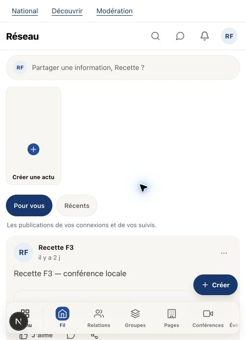

# ANTSIA — ouverture du fil sans reprise manuelle

Demande : corriger le refus résiduel du premier chargement, puis laisser le fil ouvert au format téléphone avec le fond blanc et les cartes beige.

## Cause et correction

Le navigateur réutilisait le délai de **4 secondes** prévu pour le travail de vérification serveur. Or ce délai client inclut aussi le réseau et la préparation de la route Next. Le journal local a enregistré un appel initial `/api/auth/convex/token` en **4,9 secondes**, dont 4,9 secondes de préparation Next et seulement 38 ms de travail applicatif. Une requête valide pouvait donc être abandonnée avant sa réponse ; le rechargement manuel profitait ensuite de la route déjà préparée.

Le budget d'attente client est maintenant distinct : **15 secondes**, toujours borné et annulable. Il s'applique à la confirmation du jeton et au transport HTTP du pont, y compris son préflight. La vérification serveur conserve son délai de **4 secondes** et toutes ses preuves : origine admise, session signée vivante, JWT corrélé et génération courante. Le correctif précédent sur la stabilité du SID signé est conservé.

Sources dans l'application ANTSIA uniquement :

- `src/lib/session-bridge.ts` : délai client séparé du délai serveur ;
- `src/lib/session-bridge-client.ts` : attente du transport initial ;
- `src/components/session-bridge.tsx` : attente de confirmation ;
- tests associés dans `src/lib/session-bridge-client.test.ts` et `src/components/session-bridge.test.tsx`.

Aucun nouvel essai automatique après un refus d'autorité, aucune boucle de rechargement, aucune modification du transport d'authentification partagé, des fichiers d'environnement ou du serveur de session. Une panne persistante reste fermée et affiche une erreur.

## Vérification automatisée locale

- Codegen officiel local et typage strict Convex : code 0.
- **Avant correction** : les deux régressions simulant une réponse initiale valide en 5 secondes échouent ; 9 autres tests passent.
- **Après correction** : **29 tests passent dans 5 fichiers**, couvrant le composant, le transport client, le parseur du pont, son serveur et la session SSR.
- Les tests confirment aussi le refus d'une génération remplacée, d'un SID remplacé/absent/ambigu, l'annulation de StrictMode, les refus serveur et la borne d'un transport bloqué avec réponse tardive.
- Typage ANTSIA : code 0. Lint des cinq fichiers : code 0. Contrôle des espaces : réussi.

Cette vérification ciblée ne remplace pas la vérification globale commune ; celle-ci reste coordonnée par le chat principal après le gel de ces sources.

## Vérification réelle dans Chrome

Session locale existante fictive `@recette.f3`, sur `http://localhost:3030/fil`. Aucune nouvelle connexion, saisie de code ou déconnexion.

1. Redémarrage du seul serveur Next ANTSIA, Node 22, webpack, mémoire limitée à 2 Go. Le backend et DIASPORALE restent actifs.
2. Première ouverture après ce démarrage : `/fil` est compilé en 7,4 s et rendu en 7,9 s ; le préflight et le POST d'admission aboutissent. Le fil connecté apparaît directement.
3. Nouveau rechargement complet : le fil connecté apparaît directement.
4. Fenêtre ANTSIA seule remise en format téléphone puis rechargée : le fil connecté apparaît directement.

**Aucun clic sur Réessayer pendant ces trois ouvertures.** Les délais de 5 secondes sont reproduits dans les tests ; la première ouverture réelle après redémarrage vérifie le parcours complet, sans prétendre que son appel de jeton a reproduit exactement les 4,9 secondes du journal antérieur.

L'affichage final a été constaté dans la fenêtre normale Chrome `969036299`, onglet `969036300`, taille extérieure 500 × 833 (minimum de largeur de Chrome), viewport **500 × 690**, et état `focused: true`. Il utilise la coque téléphone ; aucun appareil physique ni viewport global n'a été employé.

Couleurs calculées dans le DOM visible : fond `rgb(255, 255, 255)` ; surface parente de la publication `rgb(247, 246, 242)`. Aucun message d'échec de session ni bouton Réessayer dans le document final.

La fenêtre reste ouverte pour le propriétaire. Les autres fenêtres et recettes DIASPORALE sont préservées. Les traces temporaires de diagnostic ont été retirées ; aucune valeur de cookie ni de jeton n'a été enregistrée dans les preuves. Les changements restent locaux, sans commit ni publication.
